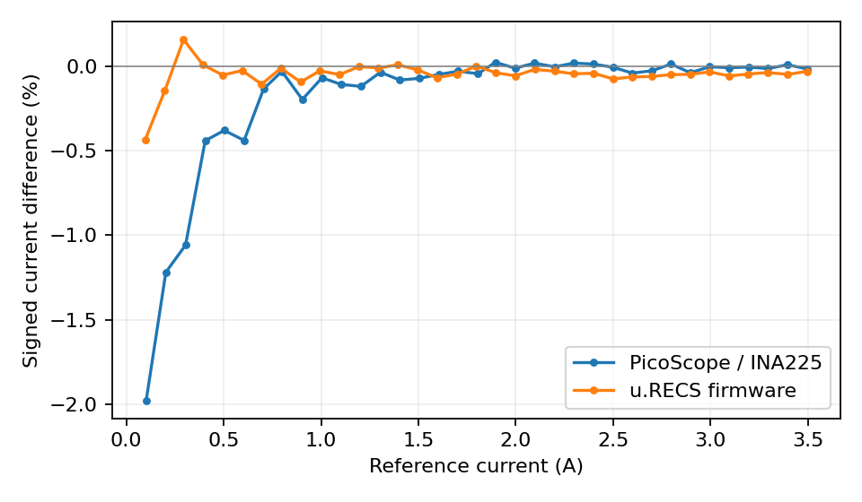

# Current verification and setup calibration

[Energy results](../README.md) · [Methods and limits](../METHODS.md) · [Table index](../tables/README.md)

Current verification uses an electronic load, a Fluke reference, endpoint gain/offset calibration and ten-second means over 36 settings. Relative-error summaries exclude the zero-target setting. Scope power uses the recorded nonlinear model P = I(a + bI), with a = 19.062607082705 V and b = −0.07444582 V/A, specified over 0–3.5 A; values beyond that interval extrapolate the model. These static checks do not provide a complete dynamic power uncertainty budget.

### Current-path verification

Measured verification settings and retained error behavior after endpoint calibration. The underlying workbook and per-setting records preserve the measured values.

[PNG](../figures/calibration/current_verification.png) · [PDF](../figures/calibration/current_verification.pdf)

Verification downloads: [all settings](../data/tim/validation/calibration/jetson_calibration_verification_rows.csv) · [summary](../data/tim/validation/calibration/jetson_calibration_verification_summary.json) · [workbook](../data/tim/validation/calibration/jetson_calibration.ods) · [validation record](../data/tim/validation/calibration/validation_result.json).

## Separate split-inference setup records

The following September calibration records cover three split-inference systems. They retain final post-gain factors, reference currents and voltages, repeat statistics and warnings. They do not retroactively recalibrate the TIM energy campaigns. Operational network addresses and collector/control logs were removed from these export copies.

| System | Full-system input scaling | M.2 idle-power calibration |
|---|---|---|
| Orin NX + DEEPX M1 | [Calibration record](../data/calibration/split-setups/orin_nx_deepx_m1_01/20260904_215309_full_system_input_scale/full_system_input_scale_calibration.json) | [Calibration record](../data/calibration/split-setups/orin_nx_deepx_m1_01/20260904_222957/m2_idle_power_calibration.json) |
| Orin NX + Hailo-10 | [Calibration record](../data/calibration/split-setups/orin_nx_hailo10_01/20260904_220910_full_system_input_scale/full_system_input_scale_calibration.json) | [Calibration record](../data/calibration/split-setups/orin_nx_hailo10_01/20260904_222453/m2_idle_power_calibration.json) |
| Orin NX + Hailo-8 | [Calibration record](../data/calibration/split-setups/orin_nx_hailo8_01/20260904_215950_full_system_input_scale/full_system_input_scale_calibration.json) | [Calibration record](../data/calibration/split-setups/orin_nx_hailo8_01/20260904_221941/m2_idle_power_calibration.json) |
