# Direct sampling-rate and duration sweeps

[Energy results](../README.md) · [Methods and limits](../METHODS.md) · [Table index](../tables/README.md)

These sweeps use independent executions, so acquisition settings, order, duration and run variability all contribute. The finalized main overview contains completed Jetson and Hailo series. Earlier discrete-GPU observations and Jetson adjusted/before-adjustment diagnostics remain in separate supplemental galleries. The observed grid does not isolate sampling error or establish a calibrated minimum rate.

| Open gallery | What it contains |
|---|---|
| [Jetson rate sweeps](direct/jetson-rates.md) | Eight completed workload series. |
| [Hailo rate sweeps](direct/hailo-rates.md) | Four completed workload series, retaining unavailable intervals. |
| [Jetson GEMM duration sweeps](direct/jetson-gemm-duration.md) | FP32, FP16 and INT8; distribution, full-range and paired-deviation views. |
| [Jetson YOLO duration sweeps](direct/jetson-yolo-duration.md) | FP32, FP16, INT8 and variable YOLO; three views each. |
| [Hailo duration sweeps](direct/hailo-duration.md) | GEMM, YOLO and variable YOLO; three views each. |
| [Supplemental Jetson diagnostics](direct/jetson-diagnostics.md) | Before-adjustment FP16 and adjusted variable-YOLO duration series. |
| [Earlier GPU observations](direct/earlier-gpu.md) | Two earlier individual rate series; no updated GPU campaign is claimed. |

## Finalized estimator and selection

The expanded figures are offline redraws of the finished direct-view data using TIM v0.3 estimators. Individual rate-panel displacement compares each rate-group mean with the unweighted mean of those means, and CV uses population standard deviation. Per-workload duration deviation bars show the median of individual matched sensor/PicoScope energy differences at each duration request. Only the duration-convergence curves and duration overview heatmaps use the fixed 600-s median-power reference. The recorded source numbers and older estimator columns remain available. Main figures use the finalized window policy; the supplemental rate-agreement heatmaps explicitly use a fixed 2-kS/s median reference.

## Duration dependence

The 600-s comparator is a fixed within-workload median, not a demonstrated steady state. Empirical quantiles and persistent passing grid points describe these observations only.

### Jetson duration dependence

Mean power relative to the workload’s fixed median at the 600-s request, using the final selection.

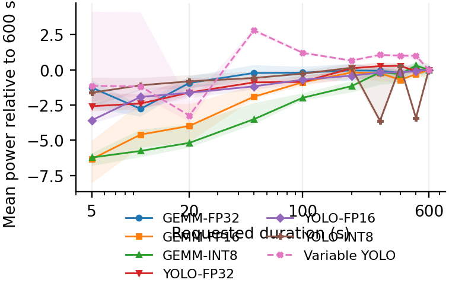

[PNG](../figures/tim/jetson_duration.png) · [PDF](../figures/tim/jetson_duration.pdf)

### Hailo duration dependence

The corresponding fixed-reference duration comparison for the completed Hailo series.

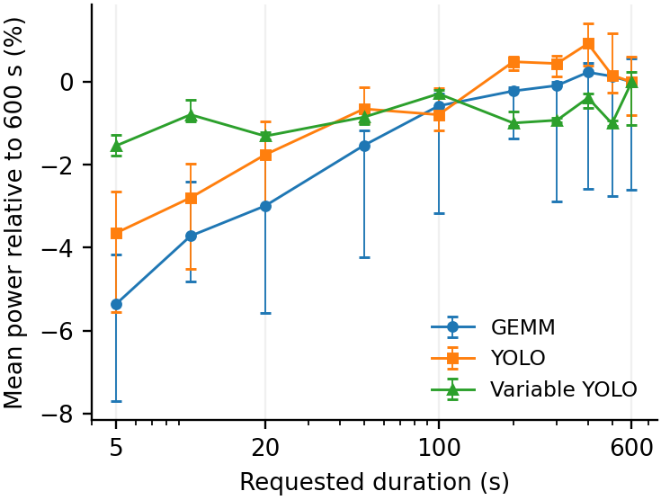

[PNG](../figures/tim/hailo_duration.png) · [PDF](../figures/tim/hailo_duration.pdf)

### Jetson duration dependence: publication view

PARMA view of mean-power displacement across requested durations relative to the fixed long-request reference.

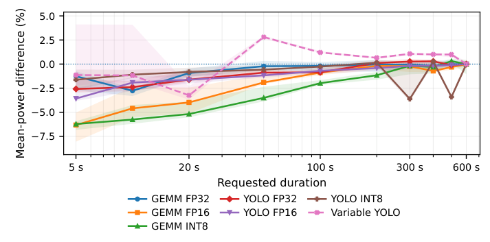

[PNG](../figures/parma/duration_dependence.png) · [PDF](../figures/parma/duration_dependence.pdf)

### Jetson duration overview

Completed Jetson duration series summarized together under the finalized selection.

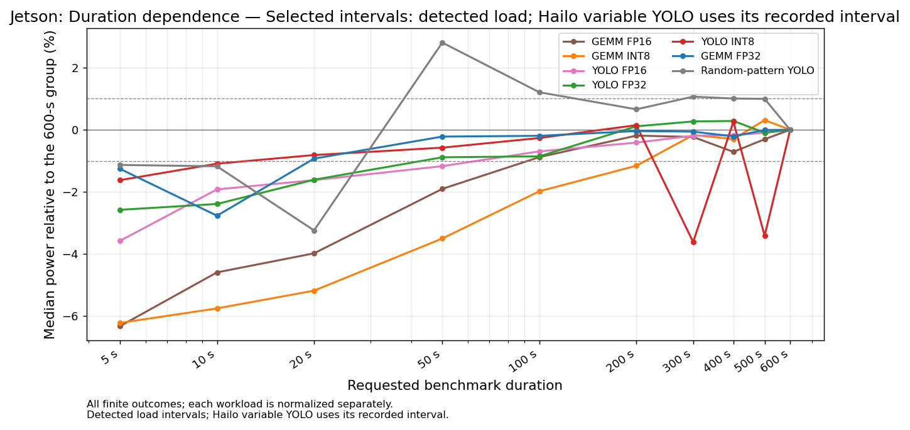

[PNG](../figures/direct-overview/jetson_duration_convergence.png) · [PDF](../figures/direct-overview/jetson_duration_convergence.pdf)

### Hailo duration overview

Completed Hailo duration series under the retained interval policies.

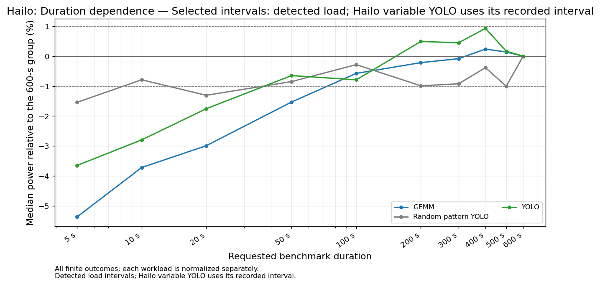

[PNG](../figures/direct-overview/hailo_duration_convergence.png) · [PDF](../figures/direct-overview/hailo_duration_convergence.pdf)

### Median power displacement by duration

Within-series displacement relative to the fixed 600-s median-power reference.

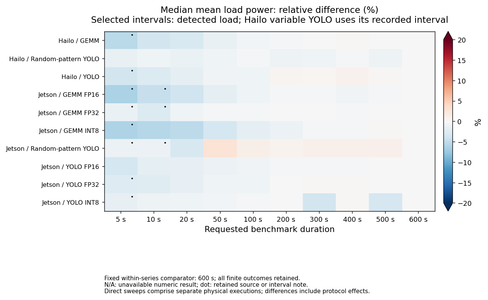

[PNG](../figures/direct-overview/duration_relative_difference.png) · [PDF](../figures/direct-overview/duration_relative_difference.pdf)

### Q95 absolute power difference by duration

Empirical tail of absolute individual power differences from the fixed duration reference.

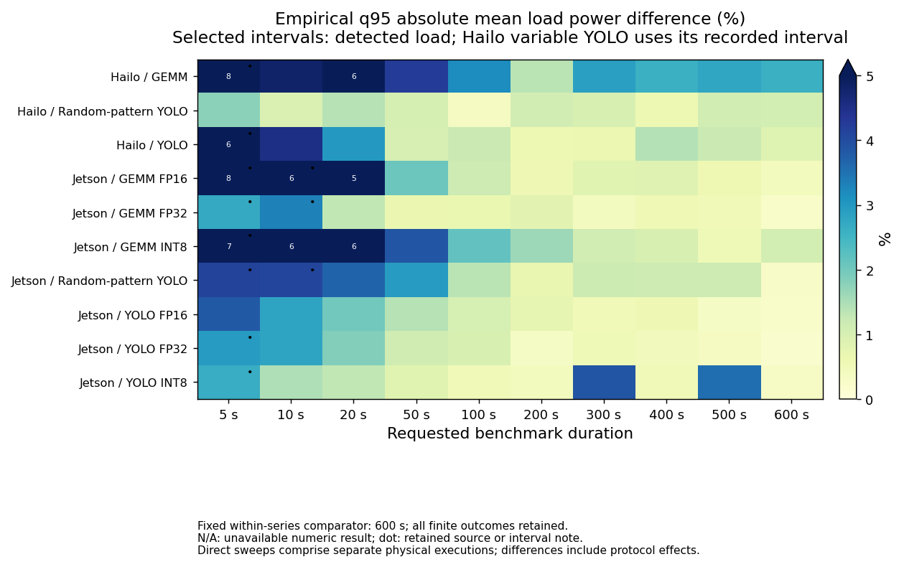

[PNG](../figures/direct-overview/duration_q95_absolute_difference.png) · [PDF](../figures/direct-overview/duration_q95_absolute_difference.pdf)

### Repeatability across duration requests

Within-group variation across independently acquired repeats; this is not a sensor uncertainty budget.

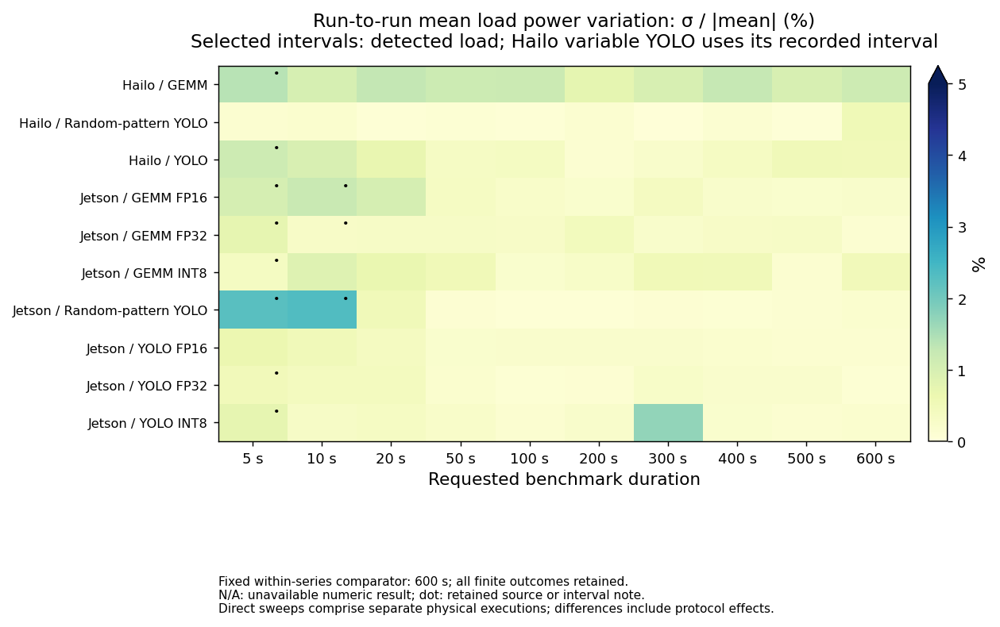

[PNG](../figures/direct-overview/duration_repeatability.png) · [PDF](../figures/direct-overview/duration_repeatability.pdf)

### Persistent agreement on the tested duration grid

First eligible duration meeting the displayed empirical criterion at that and every higher tested point. Endpoint-only and unmet cases remain distinguished.

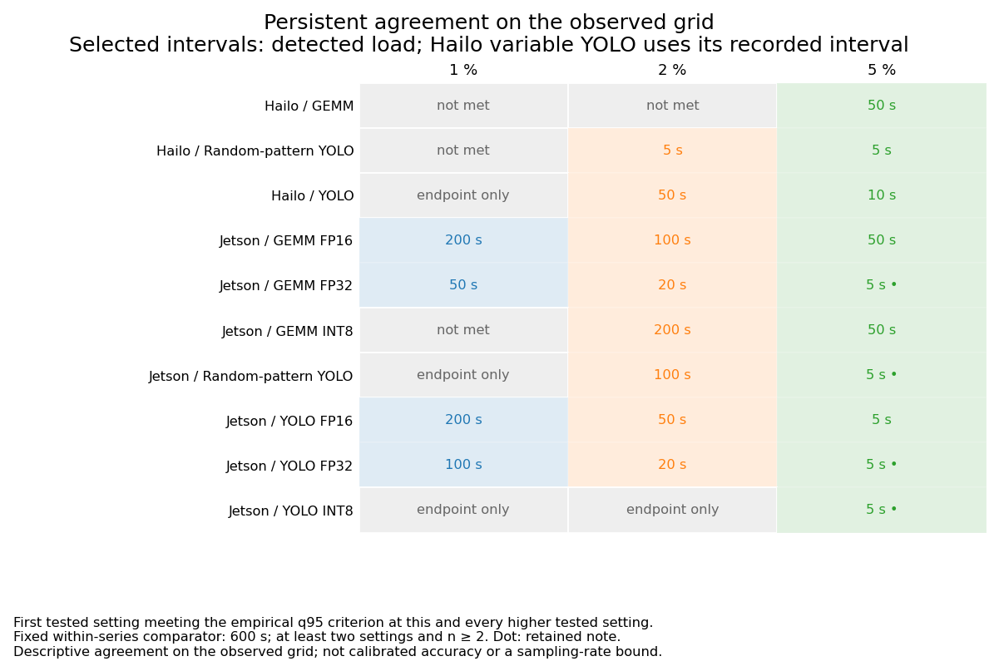

[PNG](../figures/direct-overview/duration_observed_agreement_limits.png) · [PDF](../figures/direct-overview/duration_observed_agreement_limits.pdf)

## Rate-grid summaries

These supplemental comparison grids use each series’ fixed 2-kS/s median as their explicit reference. The individual rate panels linked above instead use the finalized unweighted mean-of-means reference. Neither reference makes independently acquired runs a same-trace reconstruction experiment.

### Median energy displacement across the rate grid

Per-rate median displacement relative to the fixed within-series 2-kS/s median.

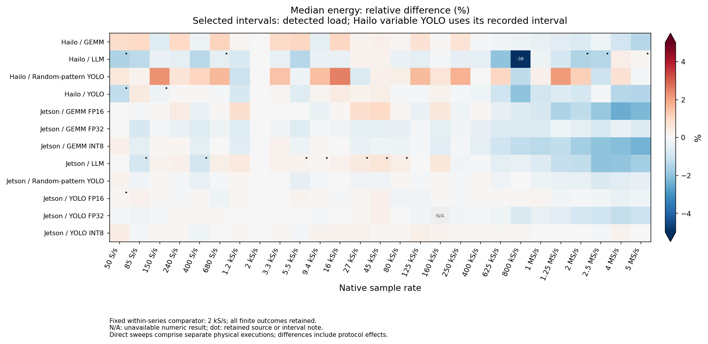

[PNG](../figures/direct-overview/samplerate_relative_difference.png) · [PDF](../figures/direct-overview/samplerate_relative_difference.pdf)

### Q95 absolute energy difference across the rate grid

Empirical absolute-difference tail relative to the fixed 2-kS/s median.

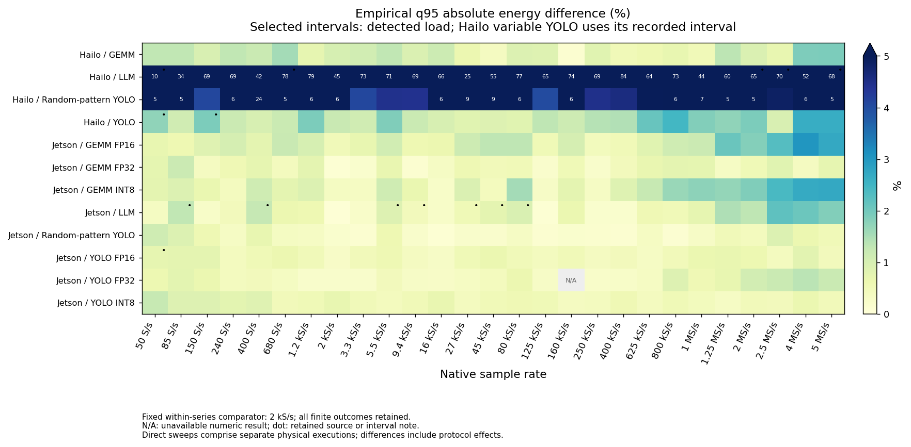

[PNG](../figures/direct-overview/samplerate_q95_absolute_difference.png) · [PDF](../figures/direct-overview/samplerate_q95_absolute_difference.pdf)

### Repeatability across sampling rates

Within-rate variability of independent acquisitions, using the displayed repeatability statistic.

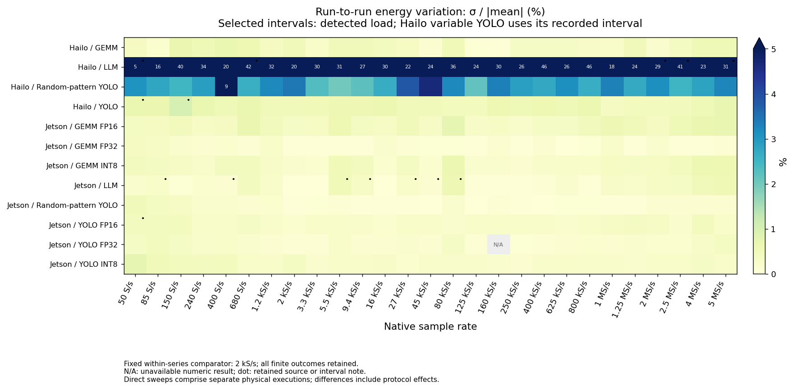

[PNG](../figures/direct-overview/samplerate_repeatability.png) · [PDF](../figures/direct-overview/samplerate_repeatability.pdf)

### Persistent agreement on the tested rate grid

Observed agreement at a rate and all higher eligible rates relative to the fixed 2-kS/s median. This is not a calibrated rate recommendation.

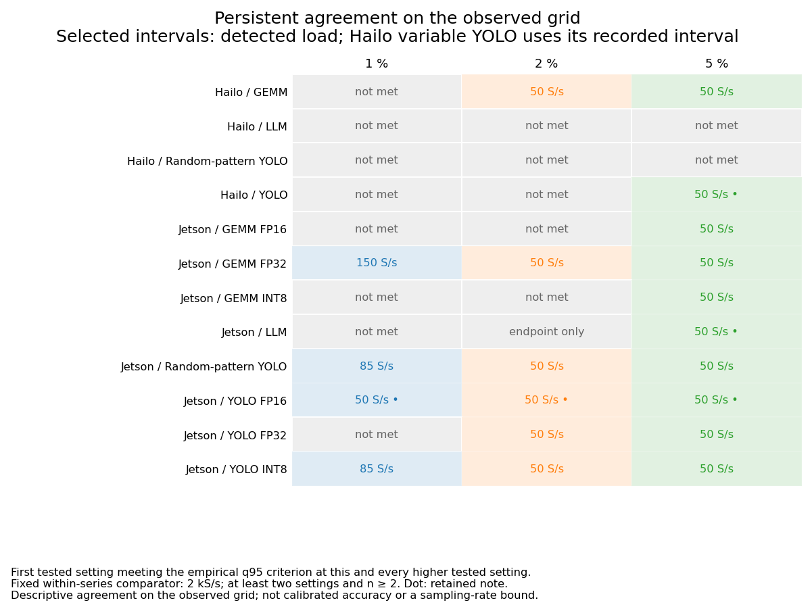

[PNG](../figures/direct-overview/samplerate_observed_agreement_limits.png) · [PDF](../figures/direct-overview/samplerate_observed_agreement_limits.pdf)

The [protocol-control gallery](protocol-controls.md) provides the balanced FP16 comparison and FP32 pause diagnostics.
