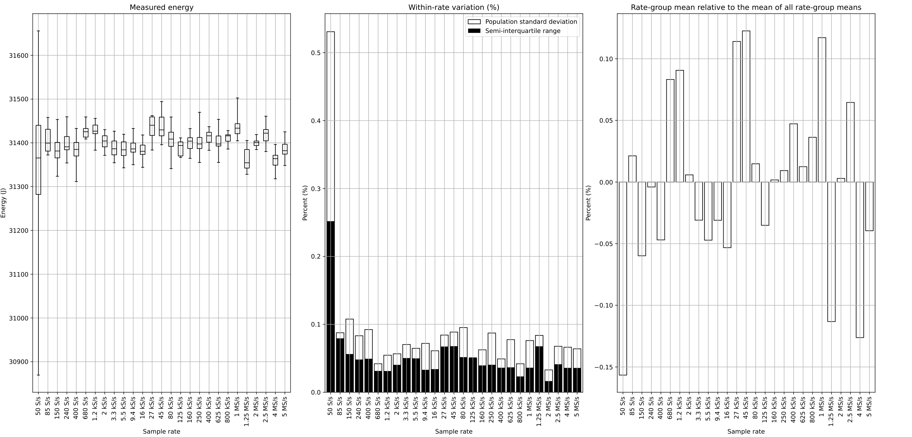
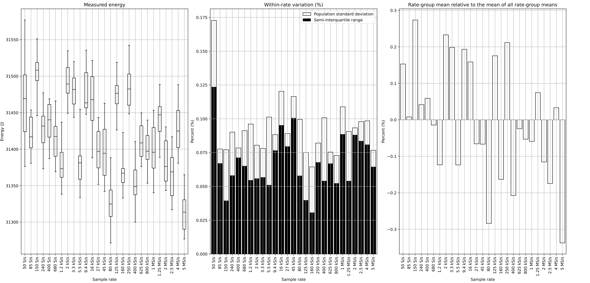

# Earlier discrete-GPU rate observations

[Back to gallery](../direct-sweeps.md) · [Energy results](../../README.md) · [Methods and limits](../../METHODS.md) · [Table index](../../tables/README.md)

These two individual series preserve earlier GPU observations as supplementary evidence. They are excluded from the completed Jetson/Hailo primary overview. No final updated GPU campaign, synchronized telemetry validation or completed new GPU acquisition is claimed. The offline redraw applies the finalized rate-panel estimator to the retained source outcomes.

### Earlier GPU GEMM FP16: rate sweep

Earlier independent acquisitions with energy distributions, mean-of-means displacement and population-CV repeatability. These observations do not complete the updated GPU evidence.

[PNG](../../figures/direct-sweeps/GPU/samplerate_sweep/gemm_fp16.png) · [PDF](../../figures/direct-sweeps/GPU/samplerate_sweep/gemm_fp16.pdf)

### Earlier GPU GEMM FP32: rate sweep

Earlier independent acquisitions with energy distributions, mean-of-means displacement and population-CV repeatability. These observations do not complete the updated GPU evidence.

[PNG](../../figures/direct-sweeps/GPU/samplerate_sweep/gemm_fp32.png) · [PDF](../../figures/direct-sweeps/GPU/samplerate_sweep/gemm_fp32.pdf)

