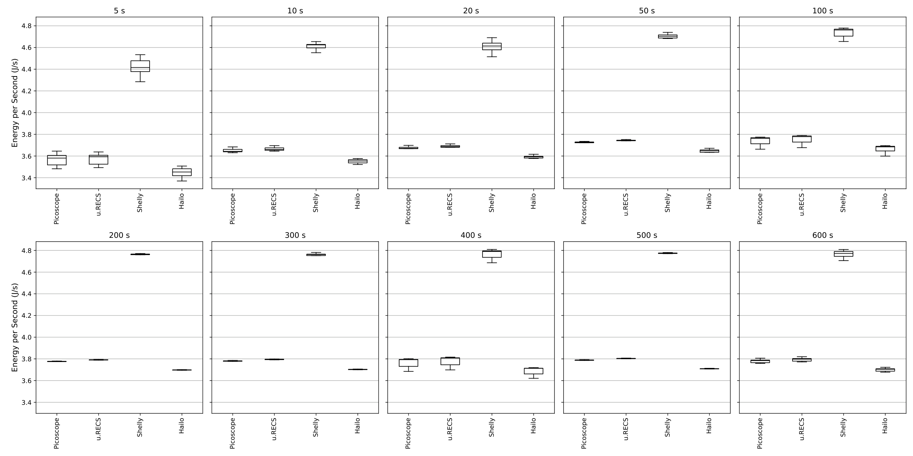
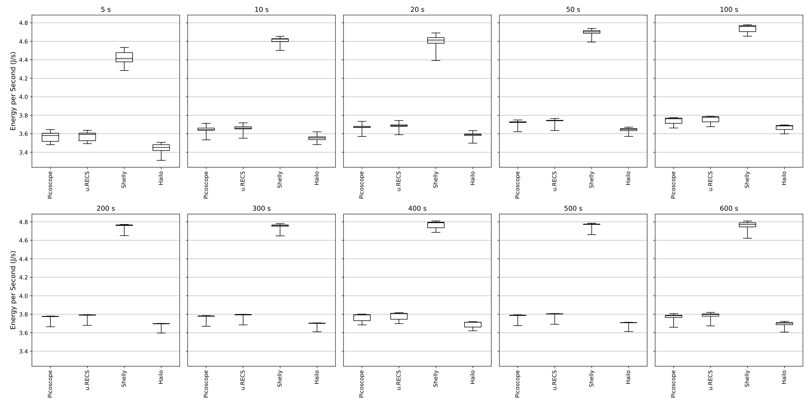
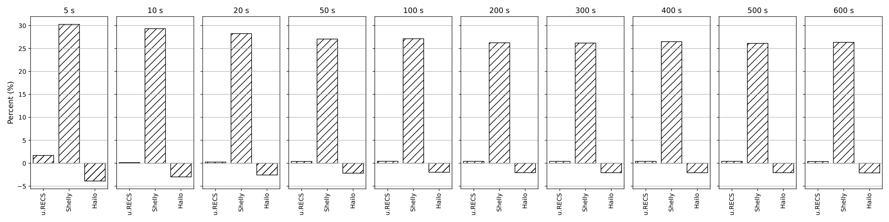
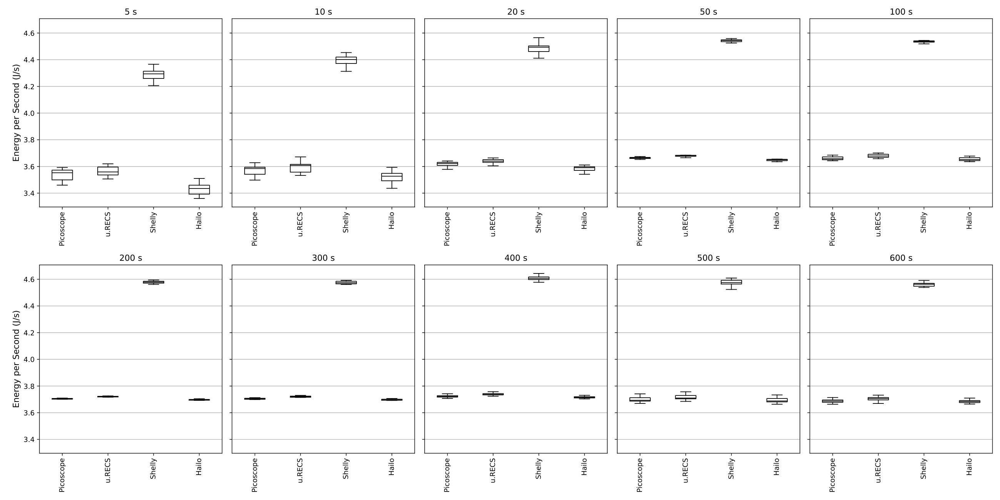
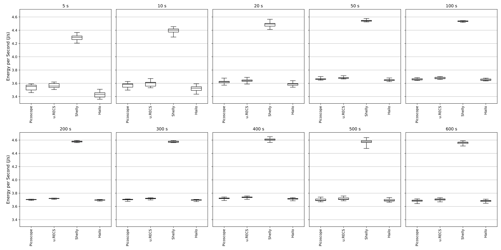
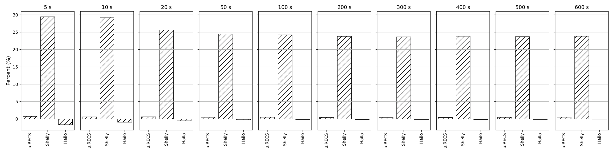
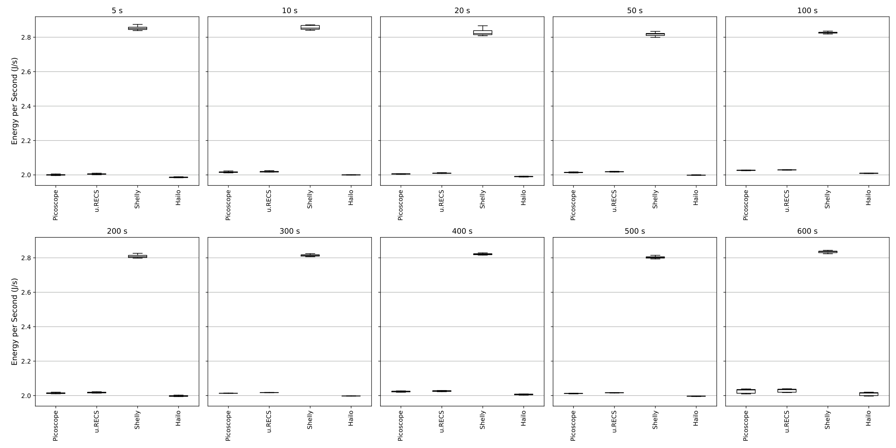
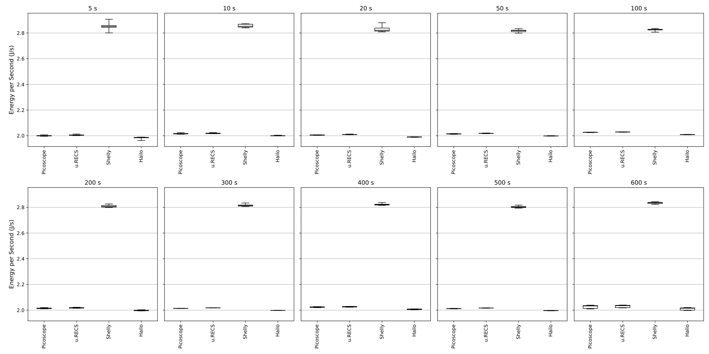
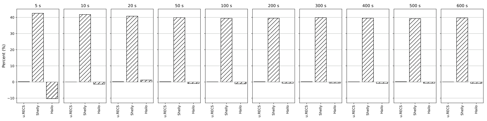

# Hailo duration sweeps

[Back to gallery](../direct-sweeps.md) · [Energy results](../../README.md) · [Methods and limits](../../METHODS.md) · [Table index](../../tables/README.md)

Each workload retains three complementary views: mean-power distributions, a full-range distribution view, and paired energy deviations. At each requested duration, the deviation bars show the median of individual matched differences, 100 × (sensor energy / PicoScope energy − 1). These per-workload device comparisons use paired executions; the separate duration-convergence overview uses a fixed 600-s median-power reference.

Variable YOLO uses the explicit reported legacy interval rather than the detected interval used by the other primary series.

## GEMM

### Hailo GEMM: distribution detail

Mean-power distributions for each measurement path across the requested durations; each path retains its own energy and duration.

[PNG](../../figures/direct-sweeps/Hailo/duration_sweep/gemm_duration_sweep_boxplot.png) · [PDF](../../figures/direct-sweeps/Hailo/duration_sweep/gemm_duration_sweep_boxplot.pdf)

### Hailo GEMM: full-range distribution

Full-range mean-power distributions retaining the displayed spread across measurement paths and duration requests.

[PNG](../../figures/direct-sweeps/Hailo/duration_sweep/gemm_duration_sweep_boxplot_full_range.png) · [PDF](../../figures/direct-sweeps/Hailo/duration_sweep/gemm_duration_sweep_boxplot_full_range.pdf)

### Hailo GEMM: paired energy deviations

At each requested duration, median individual matched sensor/PicoScope energy differences in percent. Ratios are formed per execution before taking the median.

[PNG](../../figures/direct-sweeps/Hailo/duration_sweep/gemm_duration_sweep_deviations.png) · [PDF](../../figures/direct-sweeps/Hailo/duration_sweep/gemm_duration_sweep_deviations.pdf)

## YOLO

### Hailo YOLO: distribution detail

Mean-power distributions for each measurement path across the requested durations; each path retains its own energy and duration.

[PNG](../../figures/direct-sweeps/Hailo/duration_sweep/yolo_duration_sweep_boxplot.png) · [PDF](../../figures/direct-sweeps/Hailo/duration_sweep/yolo_duration_sweep_boxplot.pdf)

### Hailo YOLO: full-range distribution

Full-range mean-power distributions retaining the displayed spread across measurement paths and duration requests.

[PNG](../../figures/direct-sweeps/Hailo/duration_sweep/yolo_duration_sweep_boxplot_full_range.png) · [PDF](../../figures/direct-sweeps/Hailo/duration_sweep/yolo_duration_sweep_boxplot_full_range.pdf)

### Hailo YOLO: paired energy deviations

At each requested duration, median individual matched sensor/PicoScope energy differences in percent. Ratios are formed per execution before taking the median.

[PNG](../../figures/direct-sweeps/Hailo/duration_sweep/yolo_duration_sweep_deviations.png) · [PDF](../../figures/direct-sweeps/Hailo/duration_sweep/yolo_duration_sweep_deviations.pdf)

## Variable YOLO

### Hailo Variable YOLO: distribution detail

Mean-power distributions for each measurement path across the requested durations; each path retains its own energy and duration.

[PNG](../../figures/direct-sweeps/Hailo/duration_sweep/random_pattern_yolo_duration_sweep_boxplot.png) · [PDF](../../figures/direct-sweeps/Hailo/duration_sweep/random_pattern_yolo_duration_sweep_boxplot.pdf)

### Hailo Variable YOLO: full-range distribution

Full-range mean-power distributions retaining the displayed spread across measurement paths and duration requests.

[PNG](../../figures/direct-sweeps/Hailo/duration_sweep/random_pattern_yolo_duration_sweep_boxplot_full_range.png) · [PDF](../../figures/direct-sweeps/Hailo/duration_sweep/random_pattern_yolo_duration_sweep_boxplot_full_range.pdf)

### Hailo Variable YOLO: paired energy deviations

At each requested duration, median individual matched sensor/PicoScope energy differences in percent. Ratios are formed per execution before taking the median.

[PNG](../../figures/direct-sweeps/Hailo/duration_sweep/random_pattern_yolo_duration_sweep_deviations.png) · [PDF](../../figures/direct-sweeps/Hailo/duration_sweep/random_pattern_yolo_duration_sweep_deviations.pdf)

