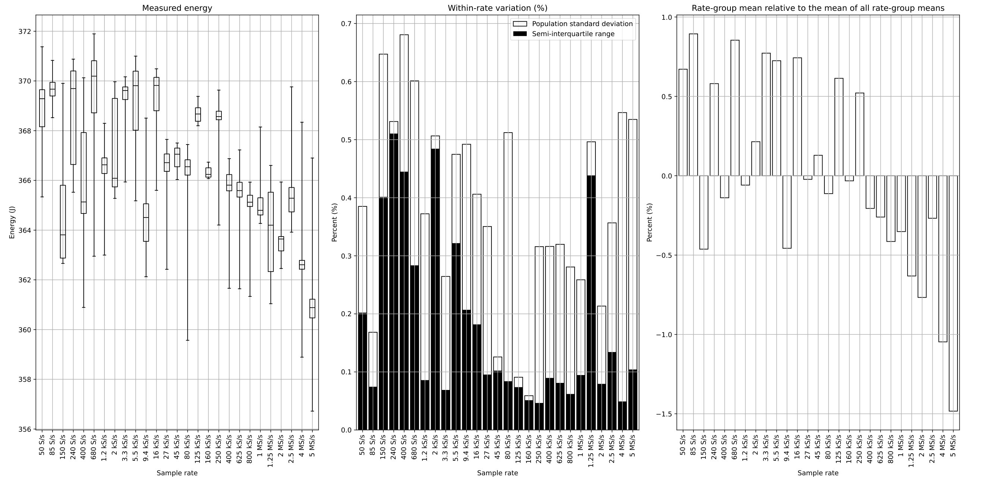
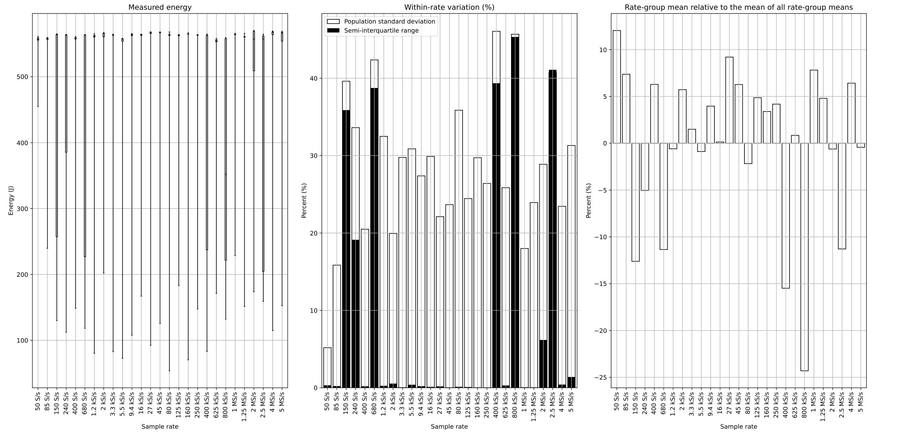
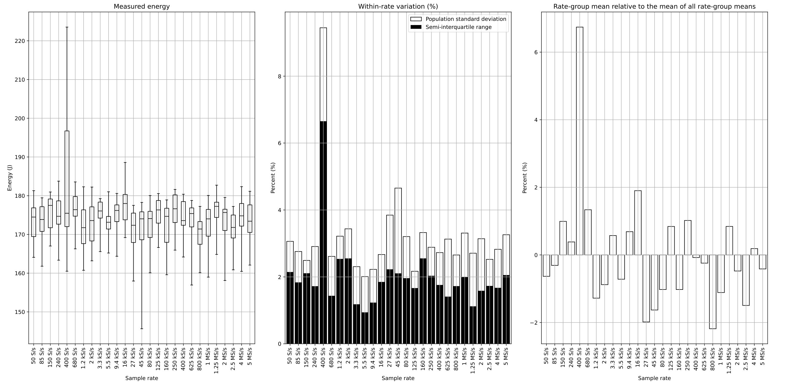
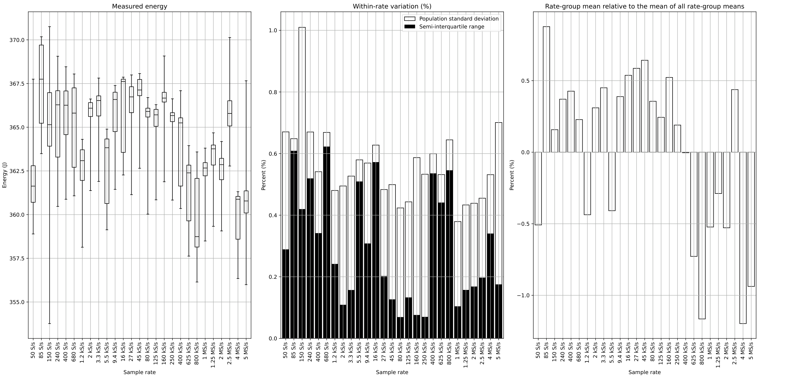

# Hailo: direct sampling-rate sweeps

[Back to gallery](../direct-sweeps.md) · [Energy results](../../README.md) · [Methods and limits](../../METHODS.md) · [Table index](../../tables/README.md)

Independent executions at each rate are shown with their observed energy distributions and repeatability. The finalized displacement reference is the unweighted mean of the rate-group means; CV uses population standard deviation divided by mean. Rate-dependent differences include execution and protocol variation.

Variable YOLO retains its explicit reported legacy interval. Unavailable LLM intervals remain unavailable; missing values are not filled with zero or a substitute interval.

### Hailo GEMM: rate sweep

Energy distributions, finalized mean displacement and within-rate repeatability for the retained independent executions.

[PNG](../../figures/direct-sweeps/Hailo/samplerate_sweep/gemm.png) · [PDF](../../figures/direct-sweeps/Hailo/samplerate_sweep/gemm.pdf)

### Hailo LLM: rate sweep

Energy distributions, finalized mean displacement and within-rate repeatability for the retained independent executions.

[PNG](../../figures/direct-sweeps/Hailo/samplerate_sweep/llm.png) · [PDF](../../figures/direct-sweeps/Hailo/samplerate_sweep/llm.pdf)

### Hailo Variable YOLO: rate sweep

Energy distributions, finalized mean displacement and within-rate repeatability for the retained independent executions.

[PNG](../../figures/direct-sweeps/Hailo/samplerate_sweep/random_pattern_yolo.png) · [PDF](../../figures/direct-sweeps/Hailo/samplerate_sweep/random_pattern_yolo.pdf)

### Hailo YOLO: rate sweep

Energy distributions, finalized mean displacement and within-rate repeatability for the retained independent executions.

[PNG](../../figures/direct-sweeps/Hailo/samplerate_sweep/yolo.png) · [PDF](../../figures/direct-sweeps/Hailo/samplerate_sweep/yolo.pdf)

