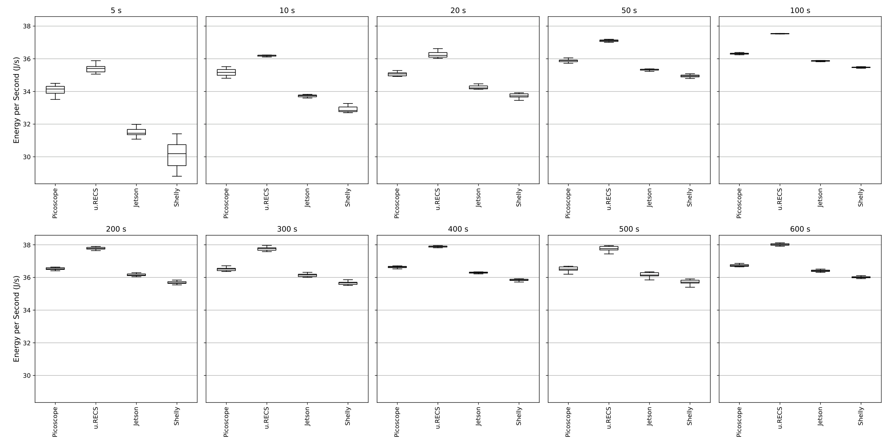
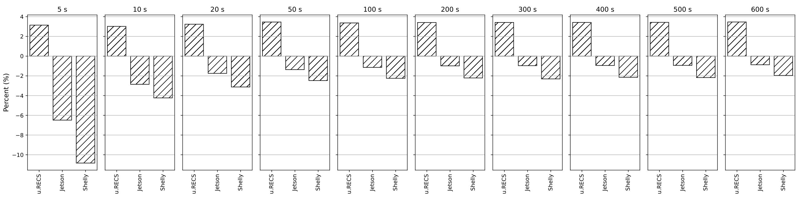
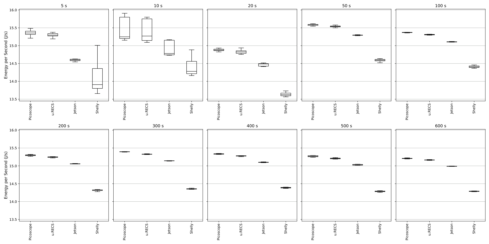
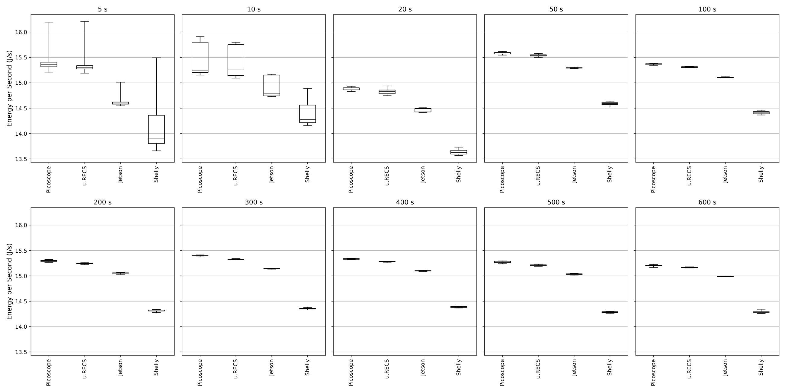
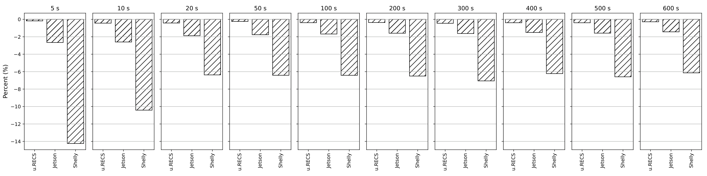

# Supplemental Jetson duration diagnostics

[Back to gallery](../direct-sweeps.md) · [Energy results](../../README.md) · [Methods and limits](../../METHODS.md) · [Table index](../../tables/README.md)

These before-adjustment FP16 and adjusted variable-YOLO series are supplemental diagnostics. They are separate from the completed primary overview and must not be pooled with the final selection. Distribution views show mean power. At each requested duration, the deviation bars show the median of individual matched sensor/PicoScope energy differences, 100 × (sensor energy / PicoScope energy − 1).

## GEMM FP16 before adjustment

### Jetson GEMM FP16 before adjustment: distribution detail

Mean-power distributions for each measurement path across the requested durations; each path retains its own energy and duration.

[PNG](../../figures/direct-sweeps/Jetson/duration_sweep/gemm_fp16_before_adjustment_duration_sweep_boxplot.png) · [PDF](../../figures/direct-sweeps/Jetson/duration_sweep/gemm_fp16_before_adjustment_duration_sweep_boxplot.pdf)

### Jetson GEMM FP16 before adjustment: full-range distribution

Full-range mean-power distributions retaining the displayed spread across measurement paths and duration requests.

[PNG](../../figures/direct-sweeps/Jetson/duration_sweep/gemm_fp16_before_adjustment_duration_sweep_boxplot_full_range.png) · [PDF](../../figures/direct-sweeps/Jetson/duration_sweep/gemm_fp16_before_adjustment_duration_sweep_boxplot_full_range.pdf)

### Jetson GEMM FP16 before adjustment: paired energy deviations

At each requested duration, median individual matched sensor/PicoScope energy differences in percent. Ratios are formed per execution before taking the median.

[PNG](../../figures/direct-sweeps/Jetson/duration_sweep/gemm_fp16_before_adjustment_duration_sweep_deviations.png) · [PDF](../../figures/direct-sweeps/Jetson/duration_sweep/gemm_fp16_before_adjustment_duration_sweep_deviations.pdf)

## Variable YOLO with adjusted interval

### Jetson Variable YOLO with adjusted interval: distribution detail

Mean-power distributions for each measurement path across the requested durations; each path retains its own energy and duration.

[PNG](../../figures/direct-sweeps/Jetson/duration_sweep/random_pattern_yolo_adjusted_duration_sweep_boxplot.png) · [PDF](../../figures/direct-sweeps/Jetson/duration_sweep/random_pattern_yolo_adjusted_duration_sweep_boxplot.pdf)

### Jetson Variable YOLO with adjusted interval: full-range distribution

Full-range mean-power distributions retaining the displayed spread across measurement paths and duration requests.

[PNG](../../figures/direct-sweeps/Jetson/duration_sweep/random_pattern_yolo_adjusted_duration_sweep_boxplot_full_range.png) · [PDF](../../figures/direct-sweeps/Jetson/duration_sweep/random_pattern_yolo_adjusted_duration_sweep_boxplot_full_range.pdf)

### Jetson Variable YOLO with adjusted interval: paired energy deviations

At each requested duration, median individual matched sensor/PicoScope energy differences in percent. Ratios are formed per execution before taking the median.

[PNG](../../figures/direct-sweeps/Jetson/duration_sweep/random_pattern_yolo_adjusted_duration_sweep_deviations.png) · [PDF](../../figures/direct-sweeps/Jetson/duration_sweep/random_pattern_yolo_adjusted_duration_sweep_deviations.pdf)

