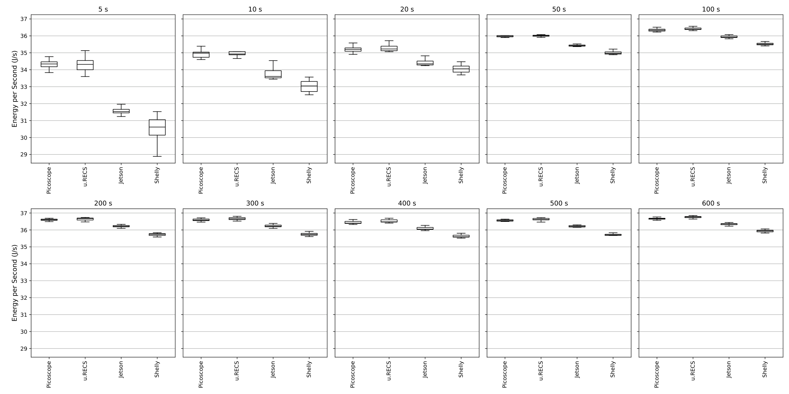
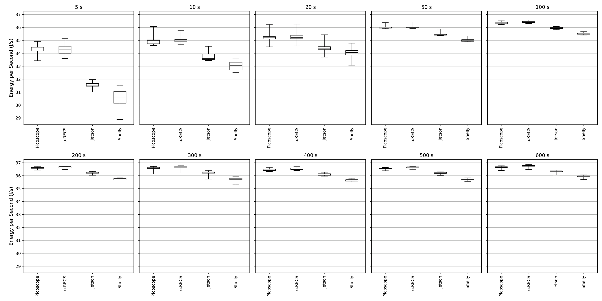
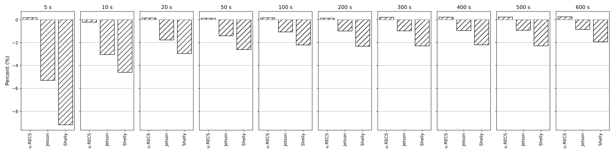
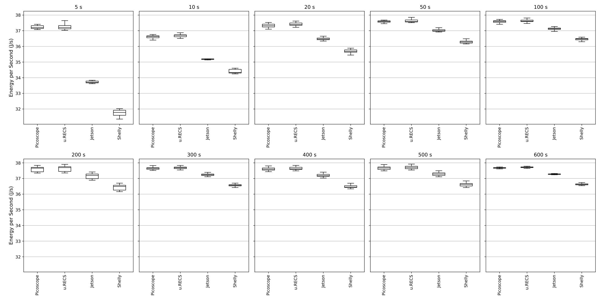
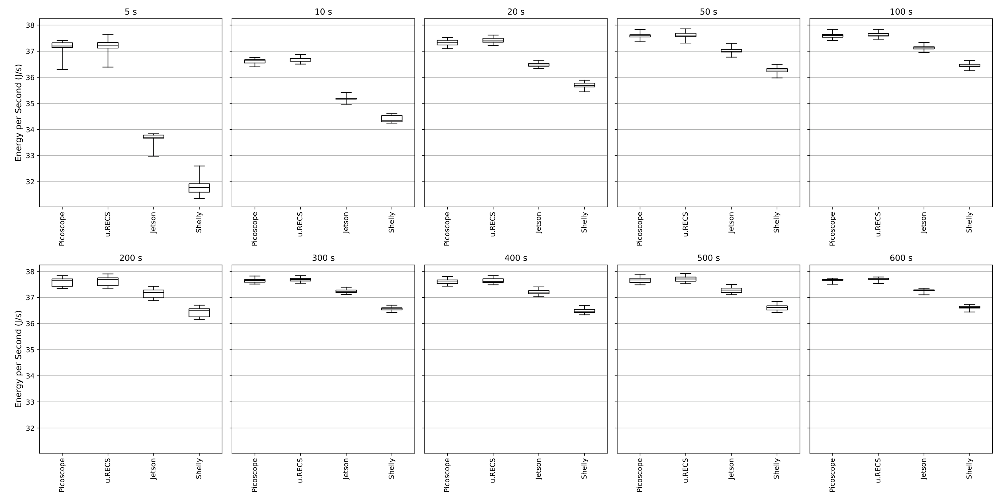
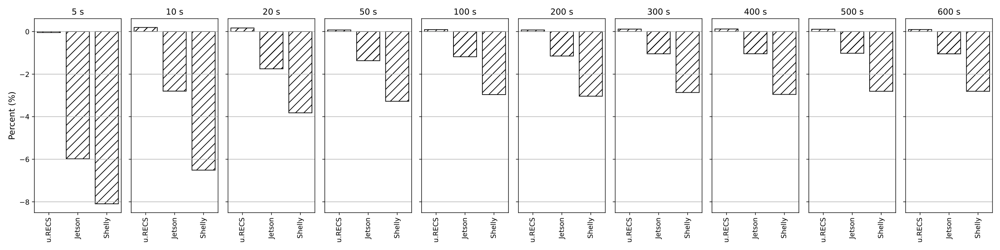
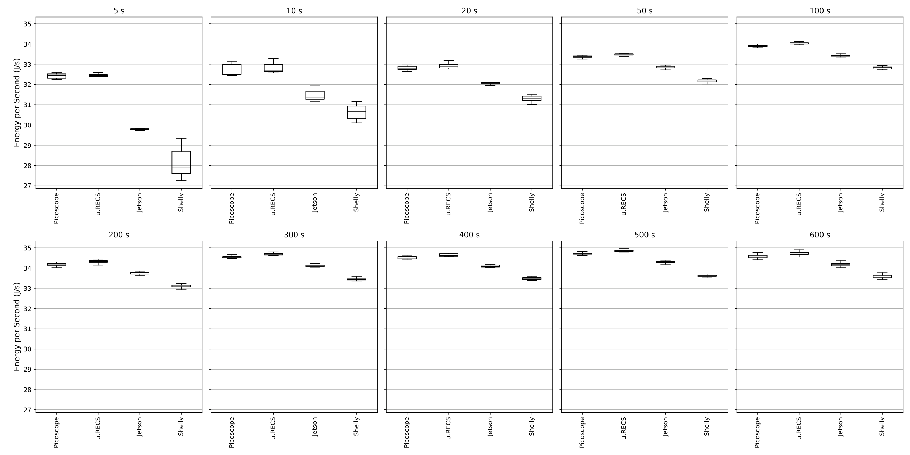
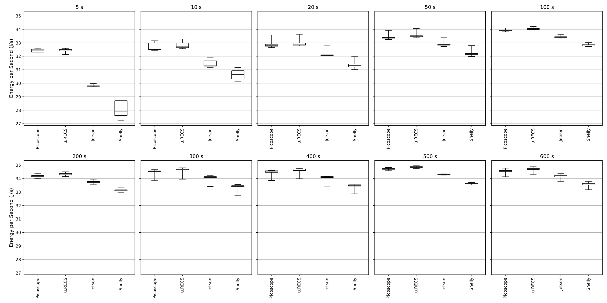
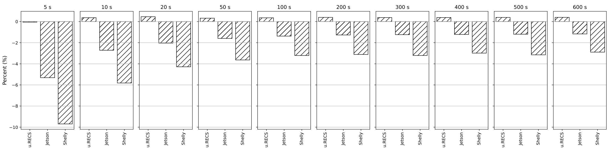

# Jetson GEMM duration sweeps

[Back to gallery](../direct-sweeps.md) · [Energy results](../../README.md) · [Methods and limits](../../METHODS.md) · [Table index](../../tables/README.md)

Each workload retains three complementary views: mean-power distributions, a full-range distribution view, and paired energy deviations. At each requested duration, the deviation bars show the median of individual matched differences, 100 × (sensor energy / PicoScope energy − 1). These per-workload device comparisons use paired executions; the separate duration-convergence overview uses a fixed 600-s median-power reference.

## GEMM FP16

### Jetson GEMM FP16: distribution detail

Mean-power distributions for each measurement path across the requested durations; each path retains its own energy and duration.

[PNG](../../figures/direct-sweeps/Jetson/duration_sweep/gemm_fp16_duration_sweep_boxplot.png) · [PDF](../../figures/direct-sweeps/Jetson/duration_sweep/gemm_fp16_duration_sweep_boxplot.pdf)

### Jetson GEMM FP16: full-range distribution

Full-range mean-power distributions retaining the displayed spread across measurement paths and duration requests.

[PNG](../../figures/direct-sweeps/Jetson/duration_sweep/gemm_fp16_duration_sweep_boxplot_full_range.png) · [PDF](../../figures/direct-sweeps/Jetson/duration_sweep/gemm_fp16_duration_sweep_boxplot_full_range.pdf)

### Jetson GEMM FP16: paired energy deviations

At each requested duration, median individual matched sensor/PicoScope energy differences in percent. Ratios are formed per execution before taking the median.

[PNG](../../figures/direct-sweeps/Jetson/duration_sweep/gemm_fp16_duration_sweep_deviations.png) · [PDF](../../figures/direct-sweeps/Jetson/duration_sweep/gemm_fp16_duration_sweep_deviations.pdf)

## GEMM FP32

### Jetson GEMM FP32: distribution detail

Mean-power distributions for each measurement path across the requested durations; each path retains its own energy and duration.

[PNG](../../figures/direct-sweeps/Jetson/duration_sweep/gemm_fp32_duration_sweep_boxplot.png) · [PDF](../../figures/direct-sweeps/Jetson/duration_sweep/gemm_fp32_duration_sweep_boxplot.pdf)

### Jetson GEMM FP32: full-range distribution

Full-range mean-power distributions retaining the displayed spread across measurement paths and duration requests.

[PNG](../../figures/direct-sweeps/Jetson/duration_sweep/gemm_fp32_duration_sweep_boxplot_full_range.png) · [PDF](../../figures/direct-sweeps/Jetson/duration_sweep/gemm_fp32_duration_sweep_boxplot_full_range.pdf)

### Jetson GEMM FP32: paired energy deviations

At each requested duration, median individual matched sensor/PicoScope energy differences in percent. Ratios are formed per execution before taking the median.

[PNG](../../figures/direct-sweeps/Jetson/duration_sweep/gemm_fp32_duration_sweep_deviations.png) · [PDF](../../figures/direct-sweeps/Jetson/duration_sweep/gemm_fp32_duration_sweep_deviations.pdf)

## GEMM INT8

### Jetson GEMM INT8: distribution detail

Mean-power distributions for each measurement path across the requested durations; each path retains its own energy and duration.

[PNG](../../figures/direct-sweeps/Jetson/duration_sweep/gemm_int8_duration_sweep_boxplot.png) · [PDF](../../figures/direct-sweeps/Jetson/duration_sweep/gemm_int8_duration_sweep_boxplot.pdf)

### Jetson GEMM INT8: full-range distribution

Full-range mean-power distributions retaining the displayed spread across measurement paths and duration requests.

[PNG](../../figures/direct-sweeps/Jetson/duration_sweep/gemm_int8_duration_sweep_boxplot_full_range.png) · [PDF](../../figures/direct-sweeps/Jetson/duration_sweep/gemm_int8_duration_sweep_boxplot_full_range.pdf)

### Jetson GEMM INT8: paired energy deviations

At each requested duration, median individual matched sensor/PicoScope energy differences in percent. Ratios are formed per execution before taking the median.

[PNG](../../figures/direct-sweeps/Jetson/duration_sweep/gemm_int8_duration_sweep_deviations.png) · [PDF](../../figures/direct-sweeps/Jetson/duration_sweep/gemm_int8_duration_sweep_deviations.pdf)

