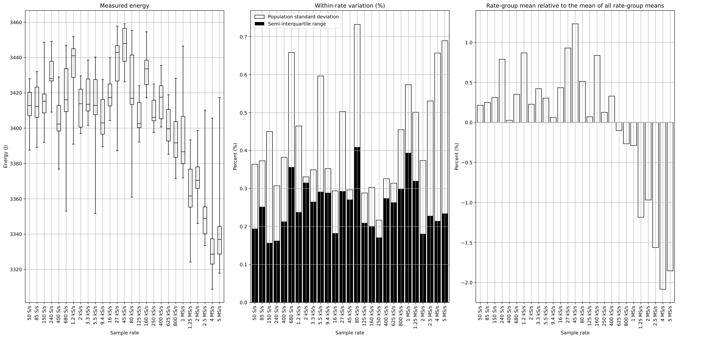
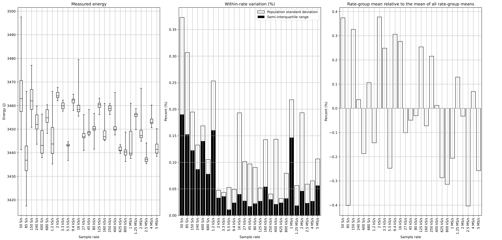
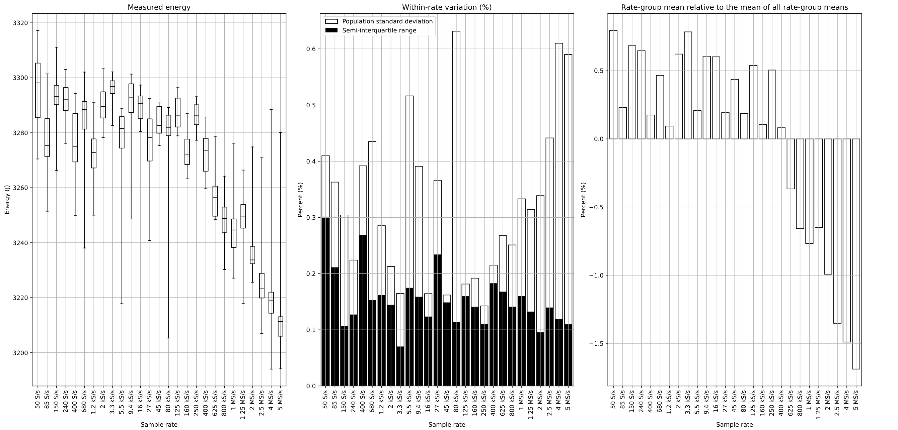
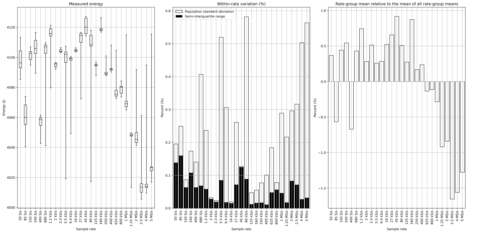
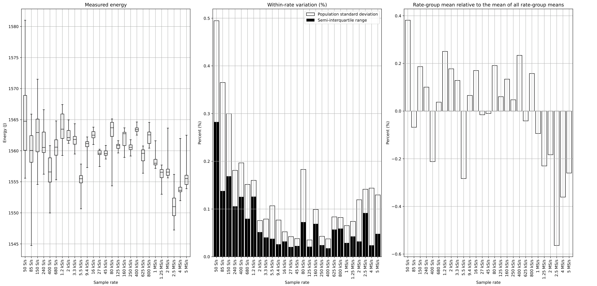
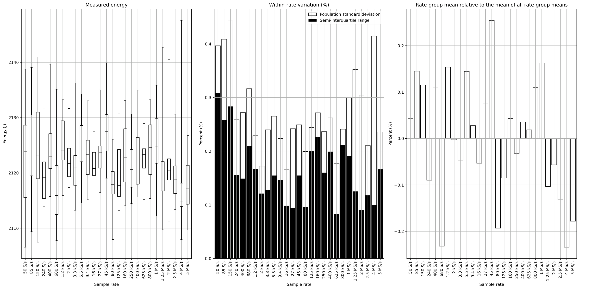
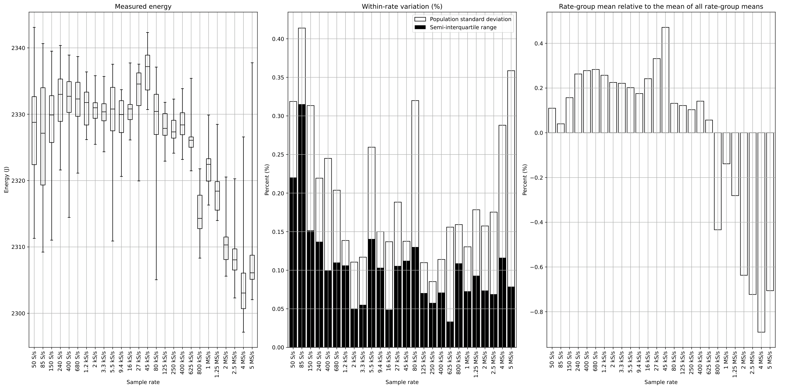
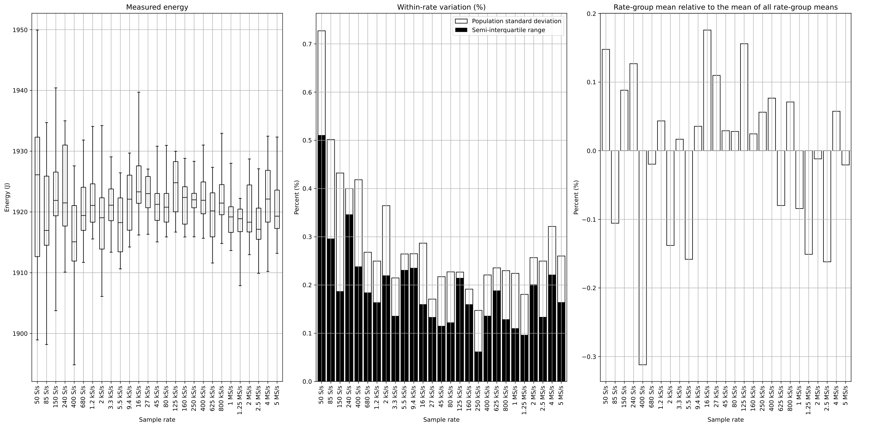

# Jetson: direct sampling-rate sweeps

[Back to gallery](../direct-sweeps.md) · [Energy results](../../README.md) · [Methods and limits](../../METHODS.md) · [Table index](../../tables/README.md)

Independent executions at each rate are shown with their observed energy distributions and repeatability. The finalized displacement reference is the unweighted mean of the rate-group means; CV uses population standard deviation divided by mean. Rate-dependent differences include execution and protocol variation.

### Jetson GEMM FP16: rate sweep

Energy distributions, finalized mean displacement and within-rate repeatability for the retained independent executions.

[PNG](../../figures/direct-sweeps/Jetson/samplerate_sweep/gemm_fp16.png) · [PDF](../../figures/direct-sweeps/Jetson/samplerate_sweep/gemm_fp16.pdf)

### Jetson GEMM FP32: rate sweep

Energy distributions, finalized mean displacement and within-rate repeatability for the retained independent executions.

[PNG](../../figures/direct-sweeps/Jetson/samplerate_sweep/gemm_fp32.png) · [PDF](../../figures/direct-sweeps/Jetson/samplerate_sweep/gemm_fp32.pdf)

### Jetson GEMM INT8: rate sweep

Energy distributions, finalized mean displacement and within-rate repeatability for the retained independent executions.

[PNG](../../figures/direct-sweeps/Jetson/samplerate_sweep/gemm_int8.png) · [PDF](../../figures/direct-sweeps/Jetson/samplerate_sweep/gemm_int8.pdf)

### Jetson LLM: rate sweep

Energy distributions, finalized mean displacement and within-rate repeatability for the retained independent executions.

[PNG](../../figures/direct-sweeps/Jetson/samplerate_sweep/llm.png) · [PDF](../../figures/direct-sweeps/Jetson/samplerate_sweep/llm.pdf)

### Jetson Variable YOLO: rate sweep

Energy distributions, finalized mean displacement and within-rate repeatability for the retained independent executions.

[PNG](../../figures/direct-sweeps/Jetson/samplerate_sweep/random_pattern_yolo.png) · [PDF](../../figures/direct-sweeps/Jetson/samplerate_sweep/random_pattern_yolo.pdf)

### Jetson YOLO FP16: rate sweep

Energy distributions, finalized mean displacement and within-rate repeatability for the retained independent executions.

[PNG](../../figures/direct-sweeps/Jetson/samplerate_sweep/yolo_fp16.png) · [PDF](../../figures/direct-sweeps/Jetson/samplerate_sweep/yolo_fp16.pdf)

### Jetson YOLO FP32: rate sweep

Energy distributions, finalized mean displacement and within-rate repeatability for the retained independent executions.

[PNG](../../figures/direct-sweeps/Jetson/samplerate_sweep/yolo_fp32.png) · [PDF](../../figures/direct-sweeps/Jetson/samplerate_sweep/yolo_fp32.pdf)

### Jetson YOLO INT8: rate sweep

Energy distributions, finalized mean displacement and within-rate repeatability for the retained independent executions.

[PNG](../../figures/direct-sweeps/Jetson/samplerate_sweep/yolo_int8.png) · [PDF](../../figures/direct-sweeps/Jetson/samplerate_sweep/yolo_int8.pdf)

