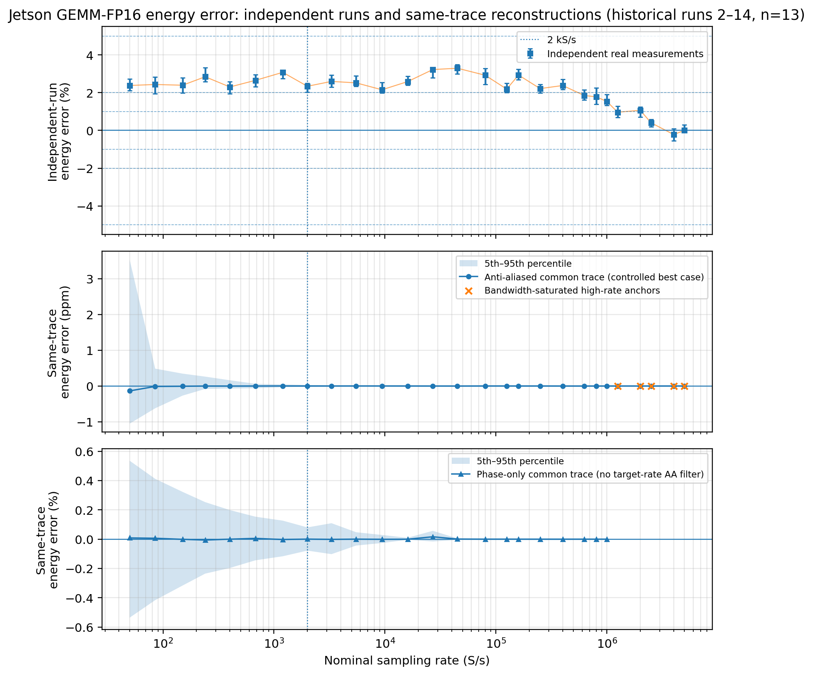
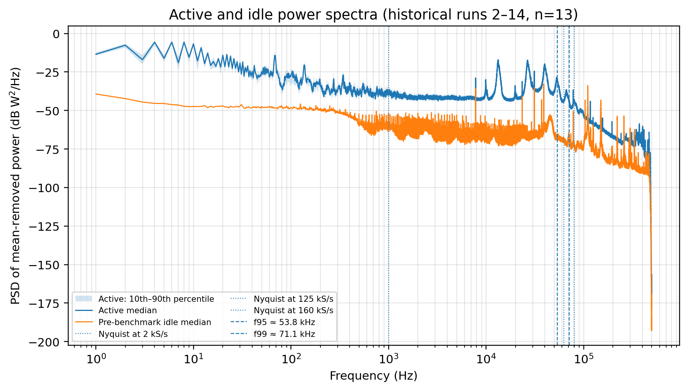
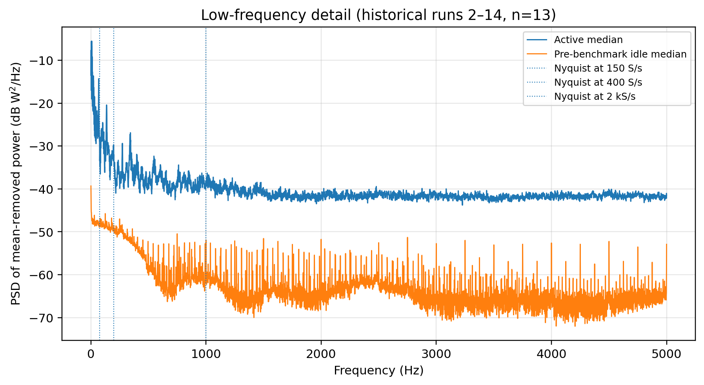
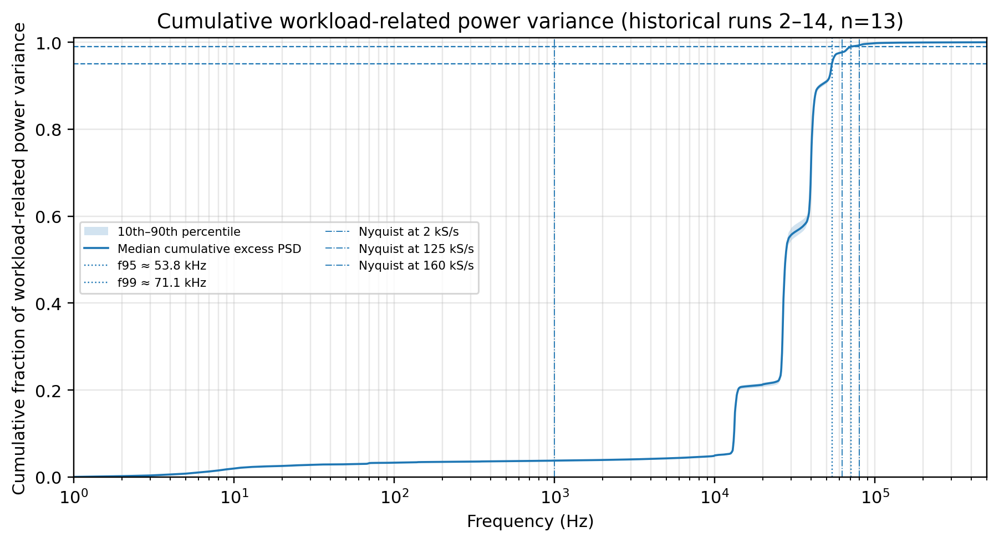
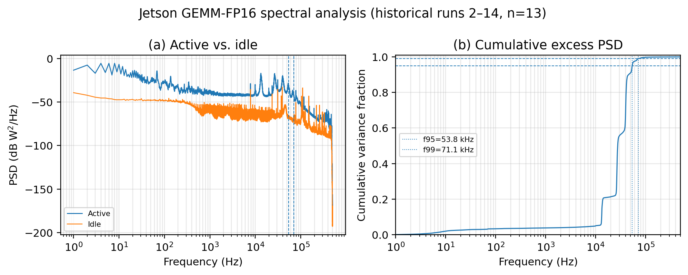
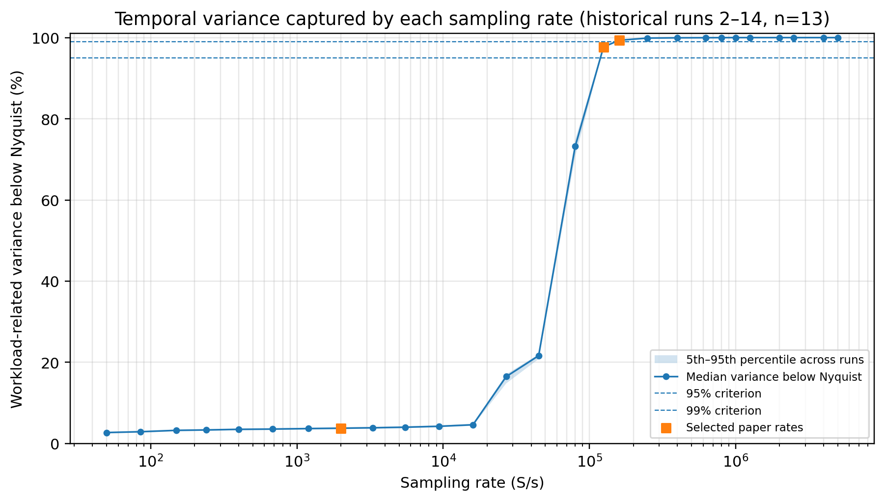

# Historical GEMM-FP16 spectra and rate curves

[Energy results](../README.md) · [Input definitions](../data/historical-fp16-20260809/README.md) · [Analysis commands](../../../scripts/energy-measurement/README.md)

This historical snapshot (9 August 2026) asks how energy integration and fluctuation coverage differ across tested rates. It uses 13 reference recordings, IDs 2–14, with ten-second active and four-second idle spectral windows. The current [all-15 energy](reconstruction.md) and [matched-four-second coverage](spectra-jetson.md) results retain their own cohorts and definitions.

The command below recomputes 49 common-trace error groups from 16,159 retained phase outcomes, 27 independent-acquisition groups and 27 spectral-coverage groups from 351 outcomes each. Six figures are then drawn from the fresh summaries and the explicitly retained aggregate PSD samples. The full energy command also includes this study.

```bash
../local-preparation/energy-venv/bin/python -B scripts/energy-measurement/reproduce.py --historical-fp16-only --output ../fp16-historical-output
```

Run from the repository root with an environment installed from the [energy requirements](../../../scripts/energy-measurement/requirements.txt), replacing the interpreter path if needed. The output must be fresh or empty and outside the repository.

| Generated values | CSV | Readable table |
|---|---|---|
| Same-trace energy error by mode and rate | [CSV](../tables/historical-fp16-20260809/common_trace/common_trace_summary.csv) | [Markdown](../tables/historical-fp16-20260809/common_trace/common_trace_summary.md) |
| Independent rate acquisitions | [CSV](../tables/historical-fp16-20260809/real_measurements/real_measurements_summary.csv) | [Markdown](../tables/historical-fp16-20260809/real_measurements/real_measurements_summary.md) |
| Variance coverage over 27 tested rates | [CSV](../tables/historical-fp16-20260809/psd/variance_capture_summary.csv) | [Markdown](../tables/historical-fp16-20260809/psd/variance_capture_summary.md) |
| Exact selected PSD/cumulative bins | [CSV](../tables/historical-fp16-20260809/psd/psd_plot_samples.csv) | [Definitions](../data/historical-fp16-20260809/README.md) |

[Counts and cumulative crossings](../tables/historical-fp16-20260809/summary.json) are also available as JSON. No measured dense curve is inferred from the three current summary points.

## Energy error and independent acquisitions

The panels retain separate independent acquisitions, anti-aliased same-trace reconstruction and phase-only reconstruction without a target-rate anti-alias filter. The top error bars and lower shaded bands are empirical 5th–95th percentiles; the common-trace distributions include dependent phase conditions within runs. They are not confidence intervals. The anti-aliased panel uses ppm; the others use percent. Nominal reconstruction rates above 1 MS/s are bandwidth-saturated anchors, not independent high-rate phase sweeps. Independent-run differences include execution and acquisition effects.



[PDF](../figures/historical-fp16-20260809/common_trace_energy_error.pdf) · [SVG](../figures/historical-fp16-20260809/common_trace_energy_error.svg) · [PNG](../figures/historical-fp16-20260809/common_trace_energy_error.png)

## Active and idle power spectra

The active distribution has a pointwise 10th–90th percentile band across the 13 recordings. PSD integrates to power variance, not energy. Marked 95%/99% frequencies are crossings of the median cumulative excess curve.



[PDF](../figures/historical-fp16-20260809/psd_active_vs_idle_full.pdf) · [SVG](../figures/historical-fp16-20260809/psd_active_vs_idle_full.svg) · [PNG](../figures/historical-fp16-20260809/psd_active_vs_idle_full.png)



[PDF](../figures/historical-fp16-20260809/psd_active_vs_idle_0_5khz.pdf) · [SVG](../figures/historical-fp16-20260809/psd_active_vs_idle_0_5khz.svg) · [PNG](../figures/historical-fp16-20260809/psd_active_vs_idle_0_5khz.png)

## Cumulative excess variance

Per-record positive excess spectra were integrated and normalized before the median and 10th–90th percentiles were taken. The compact source contains original aggregate values; raw traces are unnecessary for this redraw.



[PDF](../figures/historical-fp16-20260809/psd_cumulative.pdf) · [SVG](../figures/historical-fp16-20260809/psd_cumulative.svg) · [PNG](../figures/historical-fp16-20260809/psd_cumulative.png)



[PDF](../figures/historical-fp16-20260809/psd_and_cumulative.pdf) · [SVG](../figures/historical-fp16-20260809/psd_and_cumulative.svg) · [PNG](../figures/historical-fp16-20260809/psd_and_cumulative.png)

## Coverage across the tested rate grid

Median captured variance is 3.78% at 2 kS/s, 97.70% at 125 kS/s and 99.34% at 160 kS/s. Shading is the empirical 5th–95th percentile across the 13 recordings. Connected points show the tested grid; they establish neither an interpolated minimum nor a hardware-wide guarantee. This historical curve does not replace the current all-15 matched-window results.



[PDF](../figures/historical-fp16-20260809/variance_capture_by_sampling_rate.pdf) · [SVG](../figures/historical-fp16-20260809/variance_capture_by_sampling_rate.svg) · [PNG](../figures/historical-fp16-20260809/variance_capture_by_sampling_rate.png)
