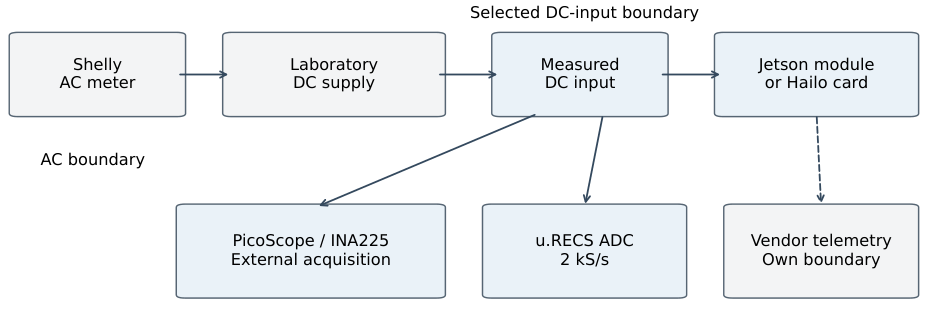
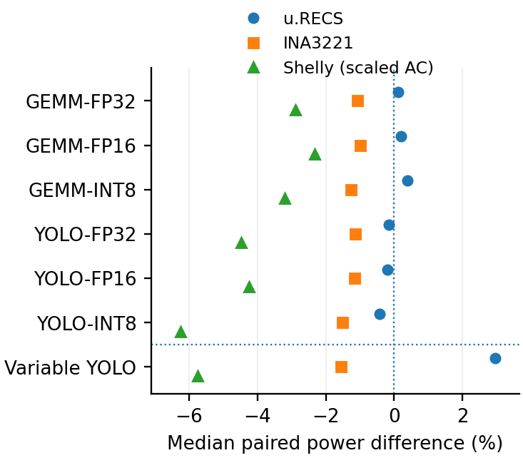
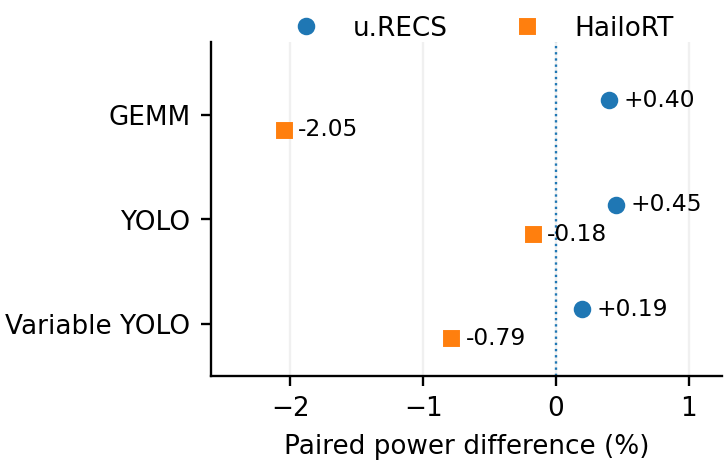
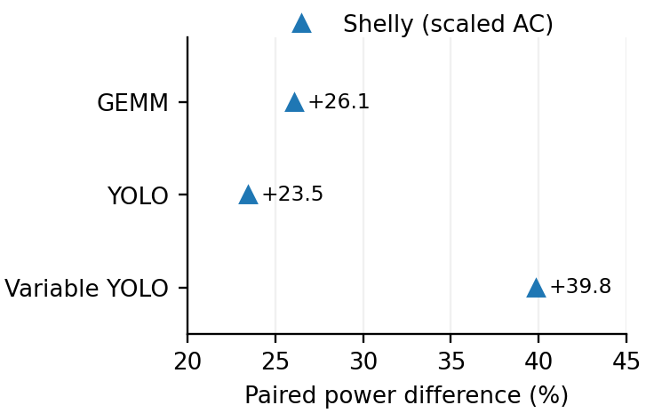
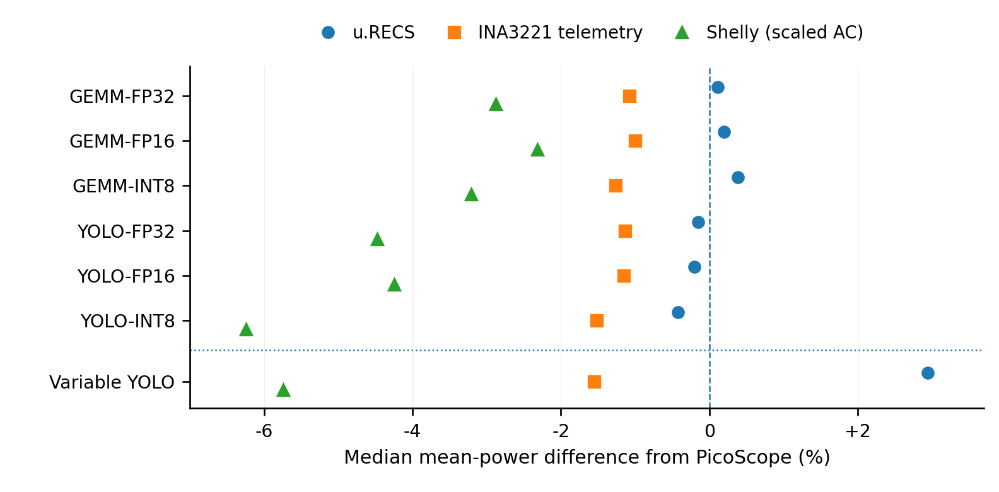
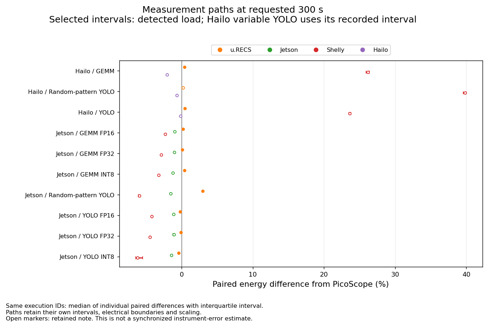
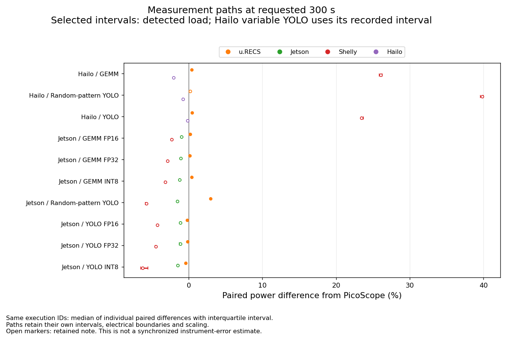
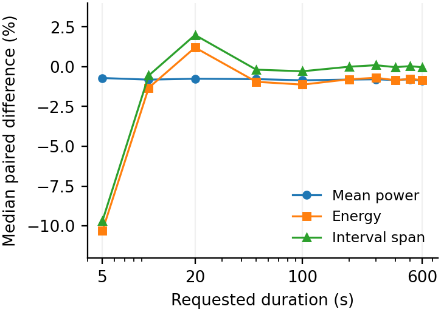
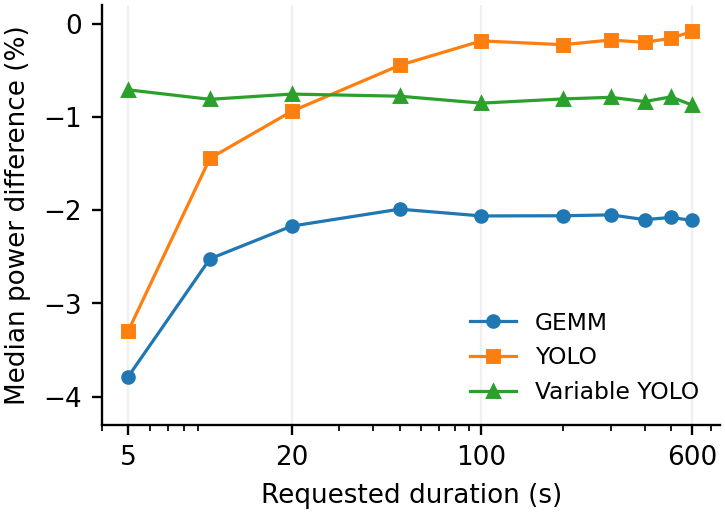

# Measurement paths, boundaries and paired outcomes

[Energy results](../README.md) · [Methods and limits](../METHODS.md) · [Table index](../tables/README.md)

Jetson’s selected module-associated DC input, Hailo’s whole-card M.2 input, Shelly’s connected AC supply arrangement and vendor telemetry have different boundaries. For each matched execution, the signed difference is 100 × (sensor / Pico − 1), summarized with medians and empirical fifth/95th percentiles. The 300-s cohort contains 150 physical executions and 450 comparator pairs; three comparators do not create three independent executions.

## Measurement boundaries and 300-s comparisons

Mean power uses each path’s own integrated energy and actual retained duration. AC/DC differences do not independently identify host energy or instrument error.

### Electrical measurement boundaries

Diagram of the domains retained by the measurement paths. Compare like boundaries before interpreting absolute differences.

[PNG](../figures/tim/measurement_boundaries.png) · [PDF](../figures/tim/measurement_boundaries.pdf)

### Jetson deployed measurement paths

Paired Jetson comparisons under the recorded scope, telemetry and AC arrangements.

[PNG](../figures/tim/jetson_deployed_meters.png) · [PDF](../figures/tim/jetson_deployed_meters.pdf)

### Hailo DC and telemetry comparison

Paired Hailo observations retaining the card-input and telemetry measurement domains.

[PNG](../figures/tim/hailo_dc_telemetry.png) · [PDF](../figures/tim/hailo_dc_telemetry.pdf)

### Hailo AC context

The AC supply comparison includes its own connected arrangement and recorded empirical scaling.

[PNG](../figures/tim/hailo_ac_context.png) · [PDF](../figures/tim/hailo_ac_context.pdf)

### Median paired differences: publication view

Per-execution comparisons summarized as paired medians for the publication cohort.

[PNG](../figures/parma/device_pair_medians.png) · [PDF](../figures/parma/device_pair_medians.pdf) · [SVG](../figures/parma/device_pair_medians.svg)

### Energy comparisons at the 300-s request

Completed Jetson and Hailo meter comparisons, with execution-level paired energy differences.

[PNG](../figures/direct-overview/devices_300s_energy.png) · [PDF](../figures/direct-overview/devices_300s_energy.pdf)

### Mean-power comparisons at the 300-s request

Completed paired mean-power comparisons using each path’s actual retained span.

[PNG](../figures/direct-overview/devices_300s_power.png) · [PDF](../figures/direct-overview/devices_300s_power.pdf)

## Interval span and duration effects

Energy, average power and retained span answer different questions. Their joint behavior helps expose window differences without assigning them automatically to a sensor error.

### Variable Hailo YOLO: energy, power and interval span

Median paired differences for variable YOLO retain the explicit legacy interval policy for this series.

[PNG](../figures/tim/hailo_variable_intervals.png) · [PDF](../figures/tim/hailo_variable_intervals.pdf)

### HailoRT power comparison across duration requests

Median paired power differences across the requested durations for the completed Hailo workloads.

[PNG](../figures/tim/hailort_duration.png) · [PDF](../figures/tim/hailort_duration.pdf)

See [direct duration sweeps](direct-sweeps.md) for within-path comparisons with the fixed 600-s median-power reference.
