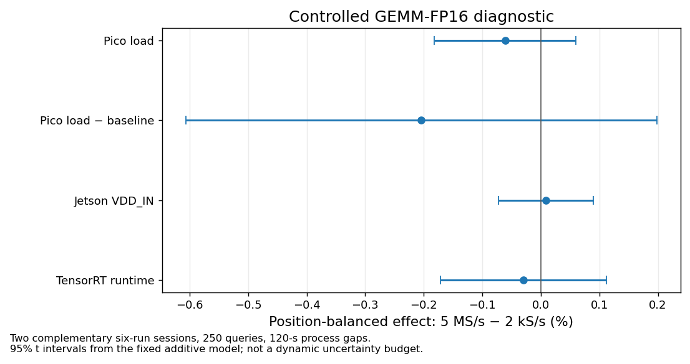
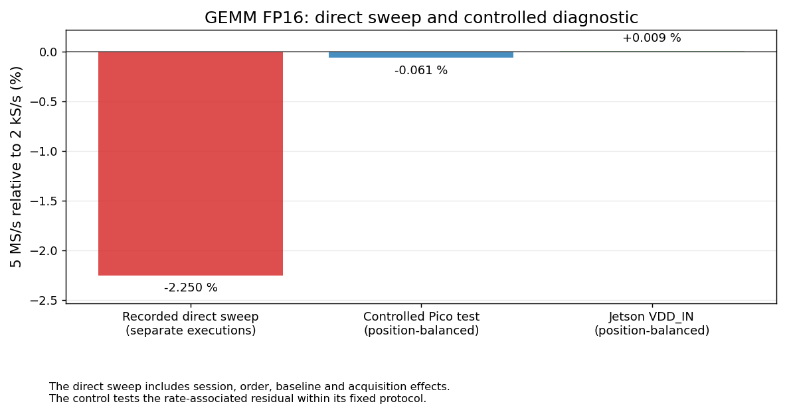
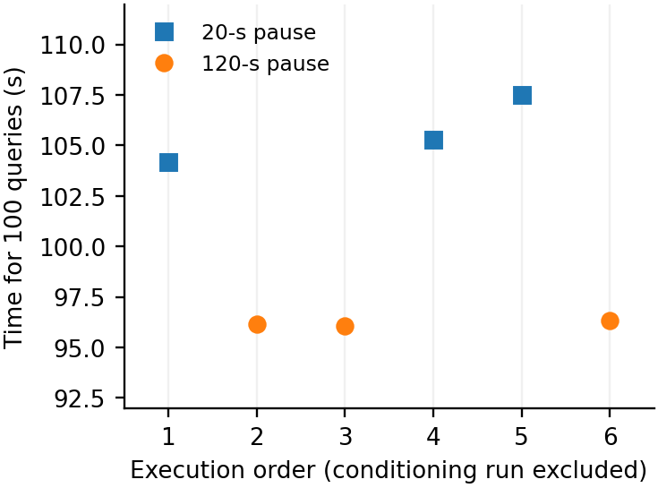
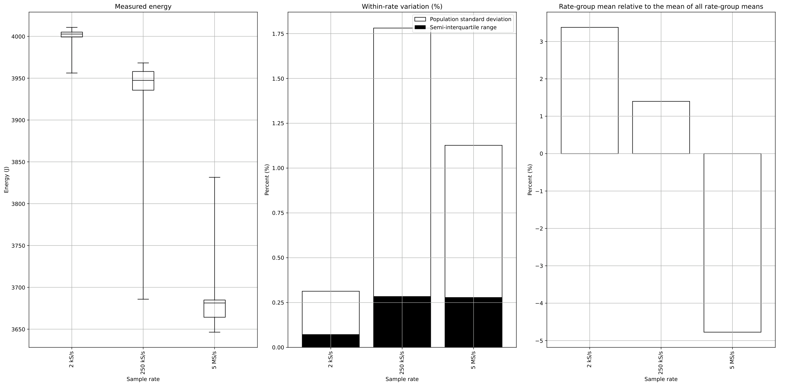
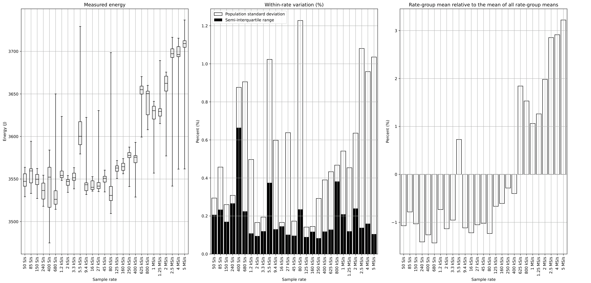

# Execution protocol and window controls

[Energy results](../README.md) · [Methods and limits](../METHODS.md) · [Table index](../tables/README.md)

Protocol controls test whether sequence, pauses and retained intervals can change independent-run comparisons. The balanced FP16 control has two six-run sessions, ABBAAB/BAABBA, 250 completed queries, useSpinWait and 120-s process gaps. Its additive model has rank 8 and four residual degrees of freedom; the two-sided t interval is not an equivalence test or a complete uncertainty budget.

## Balanced FP16 comparison

### Balanced FP16 rate-effect estimates

Rate estimate and two-sided t interval normalized by the observed 2-kS/s mean under the recorded additive design.

[PNG](../figures/direct-overview/controlled_gemm_fp16_rate_effects.png) · [PDF](../figures/direct-overview/controlled_gemm_fp16_rate_effects.pdf)

### Direct sweep and balanced FP16 control

Juxtaposition of the direct acquisitions and complementary controlled sessions, retaining their different designs.

[PNG](../figures/direct-overview/direct_vs_controlled_gemm_fp16.png) · [PDF](../figures/direct-overview/direct_vs_controlled_gemm_fp16.pdf)

## FP32 protocol diagnostics

The pause diagnostic excludes one conditioner and scores six 100-query runs, three per pause condition. Unchanged logged GPU/CPU frequency is retained as counterevidence to a clock-throttling explanation. Waiting energy is excluded, and the absolute energy scaling remains limited; this is not a randomized causal trial. The wider fixed-window analysis retains 225 executions across five workloads, three rates and 15 repeats.

### FP32 runtime under the pause diagnostic

Observed runtime under the recorded pause conditions, with the diagnostic cohort and exclusions retained.

[PNG](../figures/tim/pause_runtime.png) · [PDF](../figures/tim/pause_runtime.pdf)

### FP32 fixed-query protocol: 100 iterations

Independent-rate observations under the fixed-query protocol; the rate-panel reference uses the finalized mean-of-means estimator.

[PNG](../figures/protocol-controls/Jetson/samplerate_sweep/gemm_fp32_iterations100.png) · [PDF](../figures/protocol-controls/Jetson/samplerate_sweep/gemm_fp32_iterations100.pdf)

### FP32 timeout and GPU-profile protocol

Independent-rate observations under the recorded timeout/GPU-profile protocol. Frequency logs and protocol differences constrain causal interpretations.

[PNG](../figures/protocol-controls/Jetson/samplerate_sweep/gemm_fp32_timeout100_gpu_profile.png) · [PDF](../figures/protocol-controls/Jetson/samplerate_sweep/gemm_fp32_timeout100_gpu_profile.pdf)

Numeric window and timing evidence is available in the [protocol sections of the table index](../tables/README.md).

Read the retained [window and pause findings](../data/protocol-controls/window-pause/FINDINGS.md) for the 45-trace window comparison, analysis-induced process gaps, pause-test counterevidence and interpretation limits.
