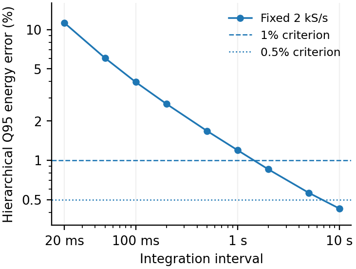
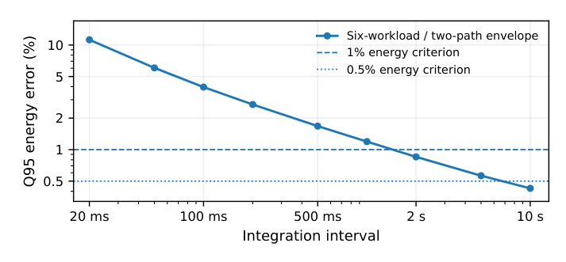
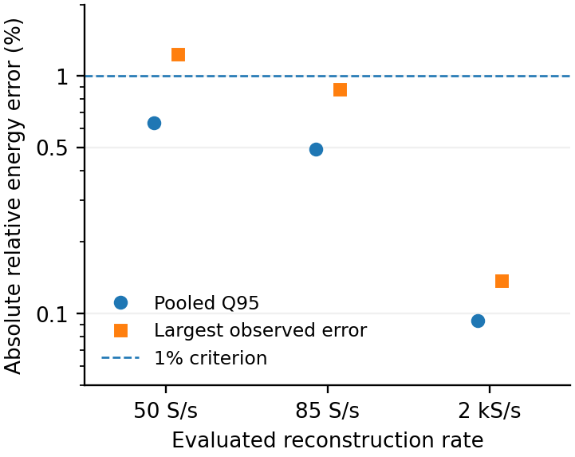
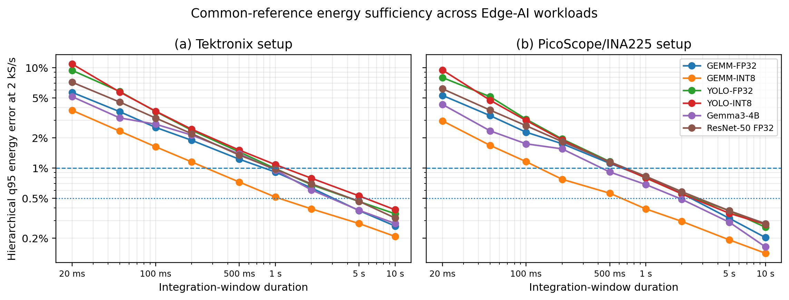
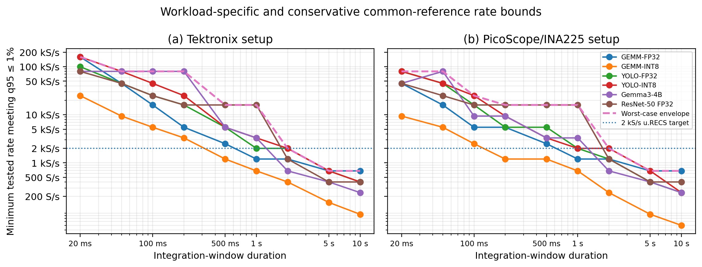
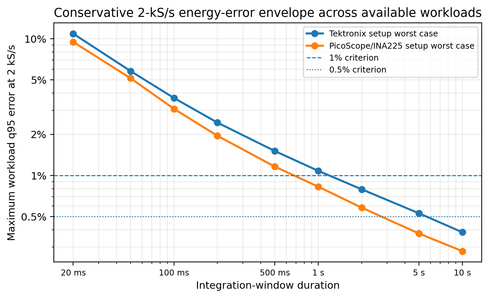
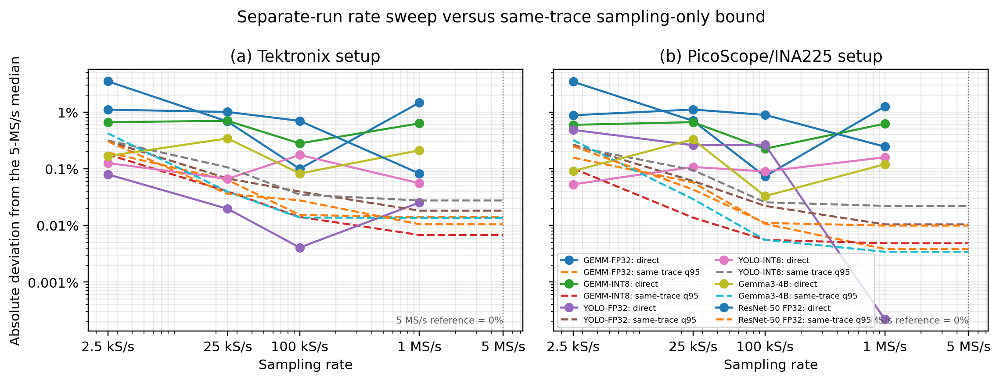

# Energy reconstruction and sampling limits

[Energy results](../README.md) · [Methods and limits](../METHODS.md) · [Table index](../tables/README.md)

The primary reconstruction uses native 5-MS/s derived power from six workloads: 59 physical executions and 118 traces. The summaries retain the hierarchy of Q95 across window/offset cases, Q95 across recordings, and the maximum across workload/path groups. A persistent passing rate must also pass at every higher eligible tested rate. These are empirical results on the tested grid, not a confidence guarantee.

## Native reference and long-window FP16

At fixed 2 kS/s, the native envelope passes 1% at 2, 5 and 10 s; the persistent 1% minimum at 2 s remains 16 kS/s. The FP16 cohort contains every recording ID from 0 to 14 and 960 cases per tested energy rate. A passing pooled Q95 does not mean that every case passes.

### Native energy error at 2 kS/s

Hierarchical energy-error envelope over the tested integration intervals; ineligible cells remain missing.

[PNG](../figures/tim/jetson_rate_duration.png) · [PDF](../figures/tim/jetson_rate_duration.pdf)

### Native scope reconstruction: publication view

PARMA view of the same six-workload, two-path native energy envelope, with the 1% and 0.5% criteria.

[PNG](../figures/parma/scope_native_energy.png) · [PDF](../figures/parma/scope_native_energy.pdf)

### FP16 energy reconstruction across all 15 recordings

Long-window FP16 energy reconstruction. At 50 S/s the pooled Q95 passes 1% while some individual cases fail; every tested 85-S/s case passes.

[PNG](../figures/tim/fp16_energy_objective.png) · [PDF](../figures/tim/fp16_energy_objective.pdf)

## Supplemental sensitivity via a 1-MS/s reference

The following multi-workload figures use the 1-MS/s common-reference branch. They provide sensitivity and context; the native 5-MS/s results above supply the primary energy conclusions. Independent direct acquisitions also include execution variability.

### Energy error by workload and interval: 1-MS/s sensitivity

Hierarchical Q95 error at 2 kS/s versus integration duration, shown separately for the two acquisition paths.

[PNG](../figures/multi-workload/cross_workload_energy_duration_paper.png) · [PDF](../figures/multi-workload/cross_workload_energy_duration_paper.pdf)

### Tested passing rates: 1-MS/s sensitivity

Rate-versus-duration sufficiency under the common-reference sensitivity branch. Tested passing rates must not be read as interpolated or hardware-wide minima.

[PNG](../figures/multi-workload/cross_workload_fmin_paper.png) · [PDF](../figures/multi-workload/cross_workload_fmin_paper.pdf)

### Across-workload envelope: 1-MS/s sensitivity

Maximum workload Q95 error at 2 kS/s for each path. This sensitivity envelope has a different reference from the native primary figures.

[PNG](../figures/multi-workload/cross_workload_worst_case_envelope_paper.png) · [PDF](../figures/multi-workload/cross_workload_worst_case_envelope_paper.pdf)

### Independent acquisitions and same-trace reconstruction

Separate-run rate observations are compared with the same-trace common-reference Q95 bound. Their difference does not isolate a causal sampling effect.

[PNG](../figures/multi-workload/cross_workload_direct_vs_common_reference_paper.png) · [PDF](../figures/multi-workload/cross_workload_direct_vs_common_reference_paper.pdf)

Continue with [fluctuation coverage and setup response](spectra-jetson.md) or [independent direct sweeps](direct-sweeps.md). Numeric exports are grouped in the [table index](../tables/README.md).

The [historical 13-run FP16 gallery](historical-fp16.md) adds the earlier dense 27-rate energy-error and coverage curves, retaining their separate cohort and spectral windows.
