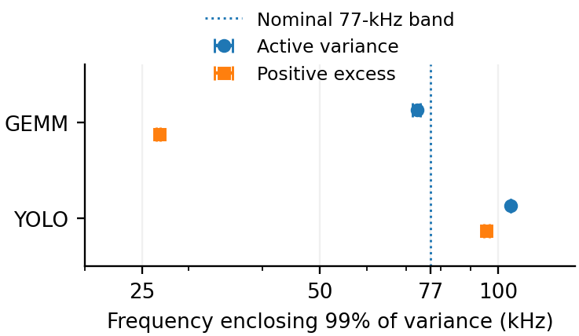
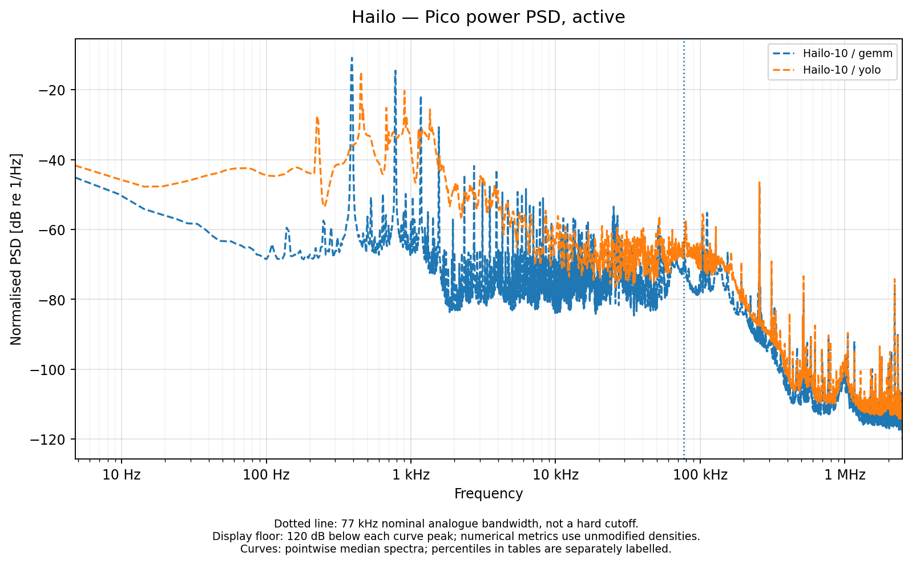
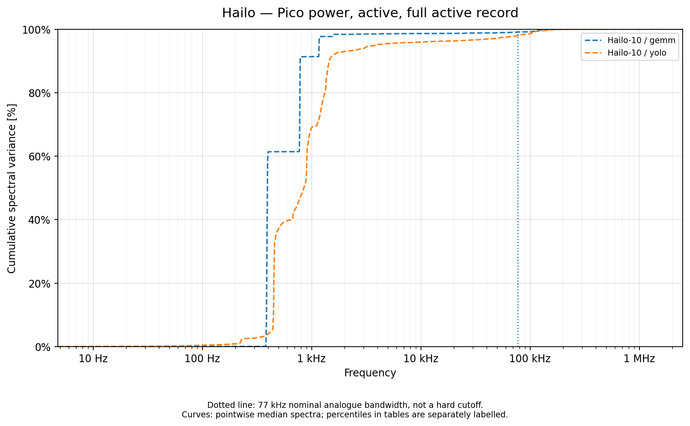
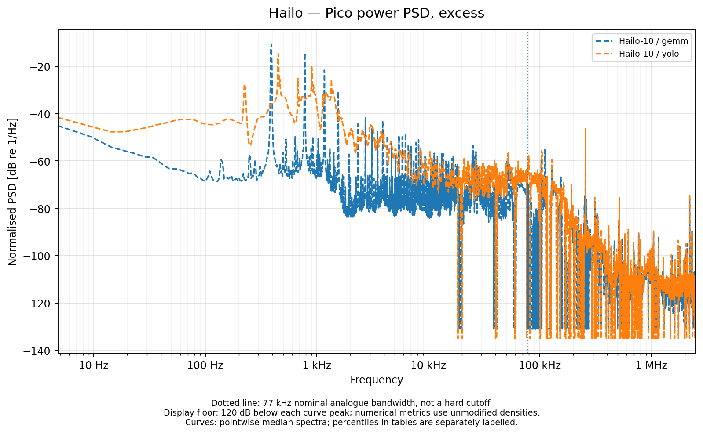
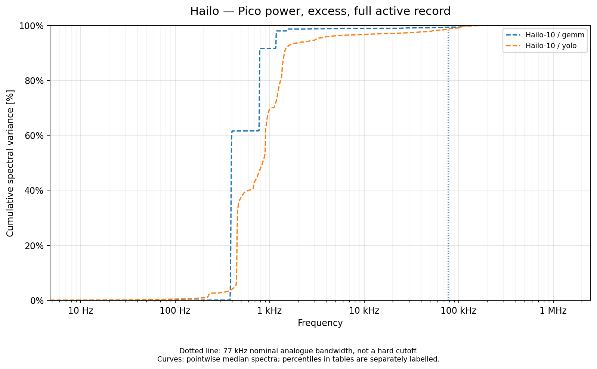
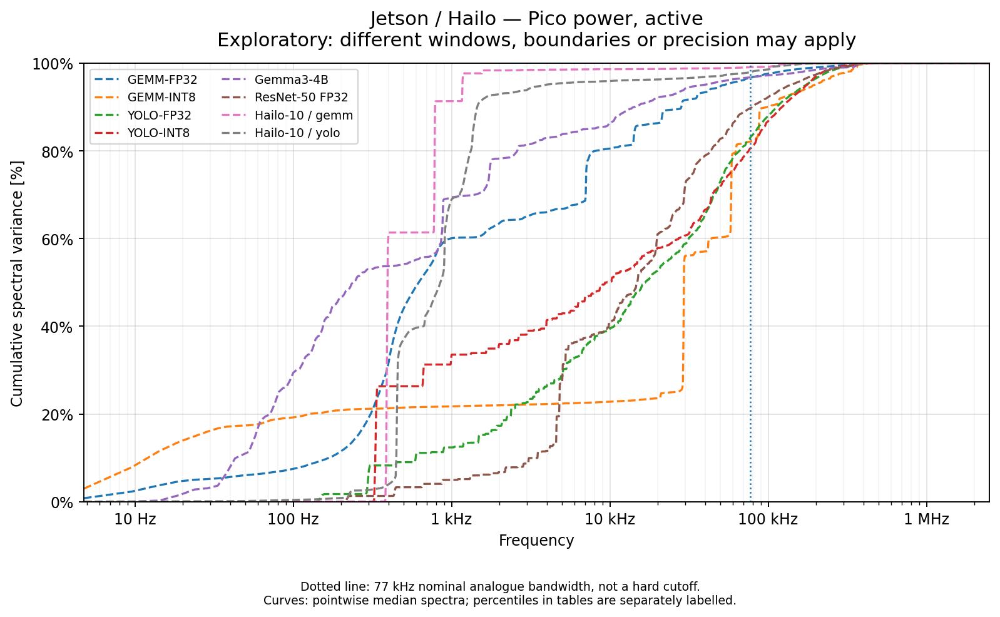
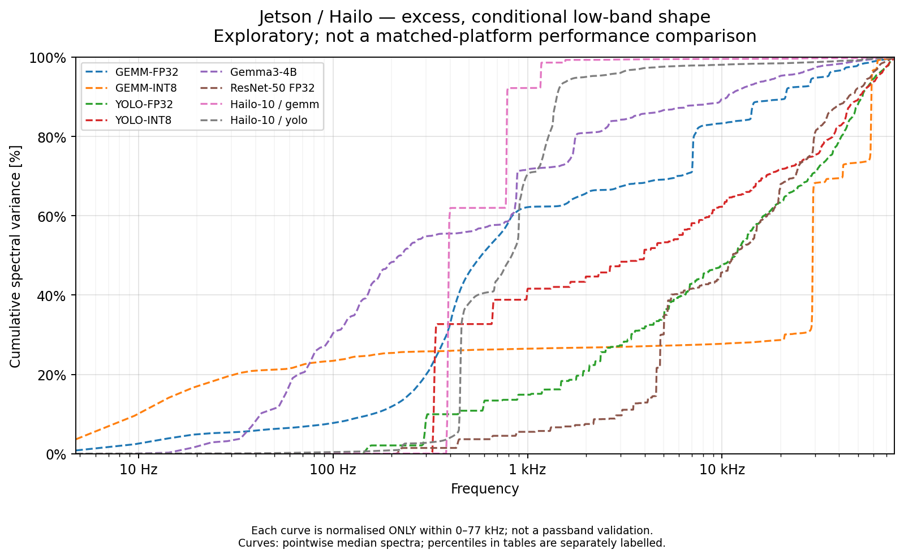
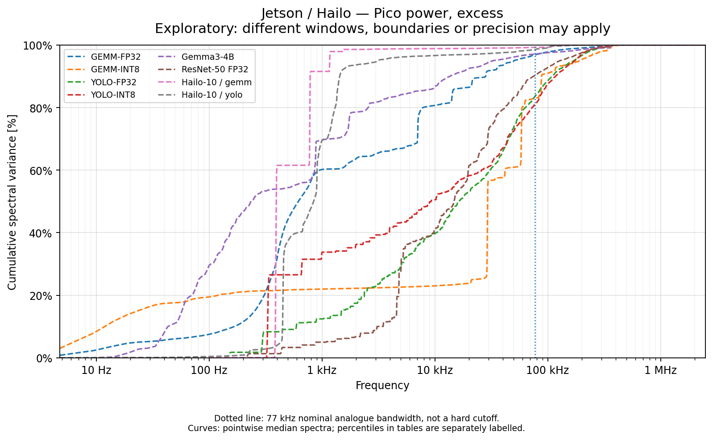

# Hailo spectra and cross-platform context

[Energy results](../README.md) · [Methods and limits](../METHODS.md) · [Table index](../tables/README.md)

Hailo spectra contain 15 GEMM and 15 YOLO recordings. Matched ten-second active prefixes and same-record idle intervals use native 5-MS/s power data; metrics are calculated per recording before cross-record quantiles. Missing idle intervals are not replaced by another platform’s idle or by zeros. Power PSD integrals are variance.

## Hailo active and excess spectra

### Hailo high-frequency variance tail

Retained Hailo fluctuation coverage and spectral-tail summary for the completed cohorts.

[PNG](../figures/tim/hailo_spectral_tail.png) · [PDF](../figures/tim/hailo_spectral_tail.pdf)

### Hailo active power PSD

Recorded active power fluctuation density for GEMM and YOLO.

[PNG](../figures/spectra/cross_platform_psd/hailo_power_active_psd.png) · [PDF](../figures/spectra/cross_platform_psd/hailo_power_active_psd.pdf)

### Hailo cumulative active variance

Cumulative active power variance, normalized by each recorded full-band total.

[PNG](../figures/spectra/cross_platform_psd/hailo_power_active_cumulative.png) · [PDF](../figures/spectra/cross_platform_psd/hailo_power_active_cumulative.pdf)

### Hailo positive-excess power PSD

Power fluctuation density after subtracting same-record idle and retaining positive excess.

[PNG](../figures/spectra/cross_platform_psd/hailo_power_excess_psd.png) · [PDF](../figures/spectra/cross_platform_psd/hailo_power_excess_psd.pdf)

### Hailo cumulative positive-excess variance

Cumulative positive-excess power variance for the cohort with valid same-record idle.

[PNG](../figures/spectra/cross_platform_psd/hailo_power_excess_cumulative.png) · [PDF](../figures/spectra/cross_platform_psd/hailo_power_excess_cumulative.pdf)

## Descriptive Jetson–Hailo comparisons

Matching duration alone does not match model, precision, batch size, stationarity, electrical boundary or acquisition response. These plots support spectral description, not energy-efficiency rankings or hardware-causal claims. The independently normalized 0–77-kHz views have a different denominator from the full-band views.

### Duration-matched active power spectra

Comparison of the matched ten-second windows, subject to the remaining workload, boundary and setup differences.

[PNG](../figures/spectra/cross_platform_psd/jetson_vs_hailo_pico_power_active_matched_duration.png) · [PDF](../figures/spectra/cross_platform_psd/jetson_vs_hailo_pico_power_active_matched_duration.pdf)

### Active variance within 0–77 kHz

Conditional cumulative fractions renormalized independently within the nominal bandwidth; the marker is not a hard cutoff.

[PNG](../figures/spectra/cross_platform_psd/jetson_vs_hailo_pico_power_active_conditional_0_77khz.png) · [PDF](../figures/spectra/cross_platform_psd/jetson_vs_hailo_pico_power_active_conditional_0_77khz.pdf)

### Exploratory full-record active cumulative variance

Full-band cumulative comparison of retained records with different durations. This is an exploratory context view.

[PNG](../figures/spectra/cross_platform_psd/jetson_vs_hailo_pico_power_active_cumulative_exploratory.png) · [PDF](../figures/spectra/cross_platform_psd/jetson_vs_hailo_pico_power_active_cumulative_exploratory.pdf)

### Duration-matched positive-excess power spectra

Comparison of the matched ten-second windows, subject to the remaining workload, boundary and setup differences.

[PNG](../figures/spectra/cross_platform_psd/jetson_vs_hailo_pico_power_excess_matched_duration.png) · [PDF](../figures/spectra/cross_platform_psd/jetson_vs_hailo_pico_power_excess_matched_duration.pdf)

### Positive-excess variance within 0–77 kHz

Conditional cumulative fractions renormalized independently within the nominal bandwidth; the marker is not a hard cutoff.

[PNG](../figures/spectra/cross_platform_psd/jetson_vs_hailo_pico_power_excess_conditional_0_77khz.png) · [PDF](../figures/spectra/cross_platform_psd/jetson_vs_hailo_pico_power_excess_conditional_0_77khz.pdf)

### Exploratory full-record positive-excess cumulative variance

Full-band cumulative comparison of retained records with different durations. This is an exploratory context view.

[PNG](../figures/spectra/cross_platform_psd/jetson_vs_hailo_pico_power_excess_cumulative_exploratory.png) · [PDF](../figures/spectra/cross_platform_psd/jetson_vs_hailo_pico_power_excess_cumulative_exploratory.pdf)

