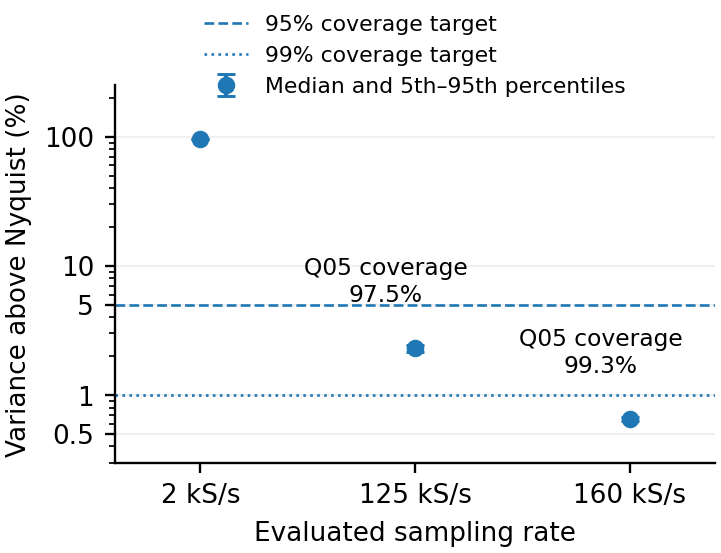
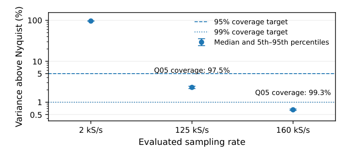
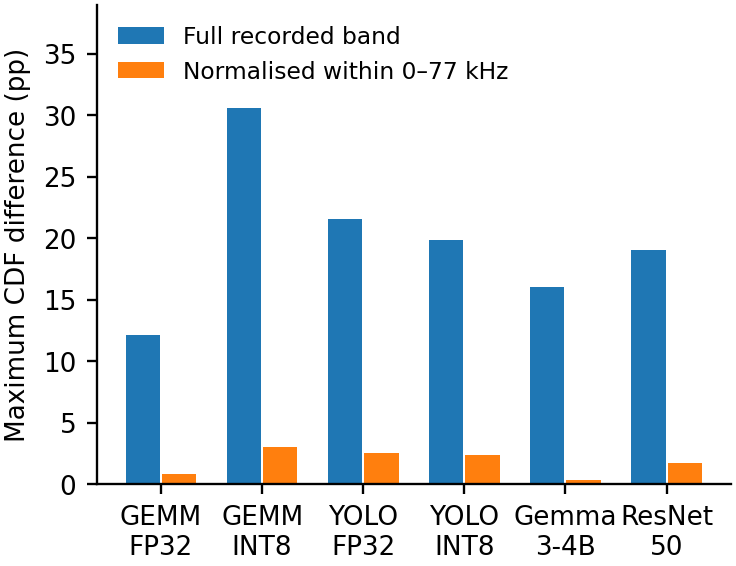

# Jetson fluctuation coverage and acquisition response

[Energy results](../README.md) · [Methods and limits](../METHODS.md) · [Table index](../tables/README.md)

Spectra describe electrical fluctuations: integrating a current or power PSD gives variance, not energy in joules. The native setup comparison uses 5-MS/s data and independent ten-second idle recordings. Its pointwise-median spectra and subsequent positive-excess calculation differ from the matched per-record FP16 estimator. See the [spectral conventions](../data/spectra/METHODS.md) before comparing cohorts or percentile definitions.

| Open gallery | What it contains |
|---|---|
| [Historical GEMM-FP16 active/idle PSD](historical-fp16.md) | Earlier 13-run spectra, cumulative distributions and dense rate curves; separate from the current all-15 branch. |
| [Current: setup comparison](spectra/jetson-current.md) | Normalized PSDs, cumulative fractions, observed ratios, and variance frequencies. |
| [Power: setup comparison](spectra/jetson-power.md) | The same views after the recorded nonlinear current-to-power conversion. |
| [Frequency detail](spectra/jetson-frequency-detail.md) | Five frequency bands from sub-kHz structure to 700 kHz. |
| [Workload spectral overview](spectra/jetson-workload-overview.md) | Across-workload current/power distributions, active/idle contrasts, and band shares. |

## Primary summaries

The FP16 fluctuation branch uses matched four-second active and idle segments at a 1-MS/s representation, with idle subtraction and positive-excess integration performed per recording. Tested 125 and 160 kS/s meet the 95% and 99% coverage criteria, respectively. This does not establish an untested minimum.

### FP16 fluctuation coverage at tested rates

All-15 FP16 matched-segment coverage, with per-record quantities summarized across recordings.

[PNG](../figures/tim/fp16_fluctuation_coverage.png) · [PDF](../figures/tim/fp16_fluctuation_coverage.pdf)

### FP16 variance above Nyquist: publication view

PARMA presentation of the variance remaining above the tested Nyquist frequencies, including empirical cross-record percentiles.

[PNG](../figures/parma/fp16_variance_coverage.png) · [PDF](../figures/parma/fp16_variance_coverage.pdf)

### Full-band and conditional setup differences

Maximum native cumulative-spectrum differences in percentage points. The full-band CDF and the CDF normalized only within 0–77 kHz use different denominators.

[PNG](../figures/tim/native_cdf.png) · [PDF](../figures/tim/native_cdf.pdf)

## Individual workload spectra

Each workload page shows absolute current and power PSDs plus cumulative fractions for both acquisition paths. The nominal 77-kHz marker is not a brick-wall cutoff or an anti-alias guarantee.

| Open gallery | What it contains |
|---|---|
| [GEMM FP32](spectra/gemmfp32.md) | Four previews: current PSD, current cumulative fraction, power PSD, power cumulative fraction. |
| [GEMM INT8](spectra/gemmint8.md) | Four previews: current PSD, current cumulative fraction, power PSD, power cumulative fraction. |
| [YOLO FP32](spectra/yolofp32.md) | Four previews: current PSD, current cumulative fraction, power PSD, power cumulative fraction. |
| [YOLO INT8](spectra/yoloint8.md) | Four previews: current PSD, current cumulative fraction, power PSD, power cumulative fraction. |
| [Gemma 3 4B](spectra/gemma3-4b.md) | Four previews: current PSD, current cumulative fraction, power PSD, power cumulative fraction. |
| [ResNet-50](spectra/resnet50.md) | Four previews: current PSD, current cumulative fraction, power PSD, power cumulative fraction. |

For Hailo and descriptive cross-platform comparisons, open the [Hailo spectral gallery](spectra-hailo.md).
