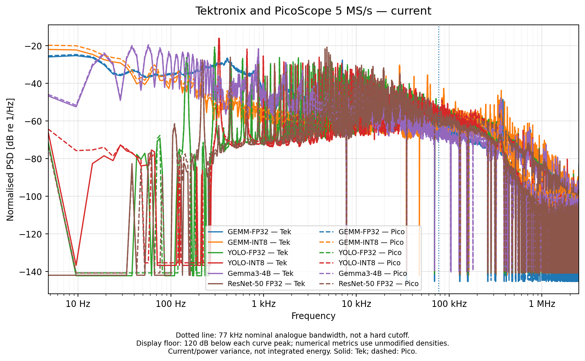
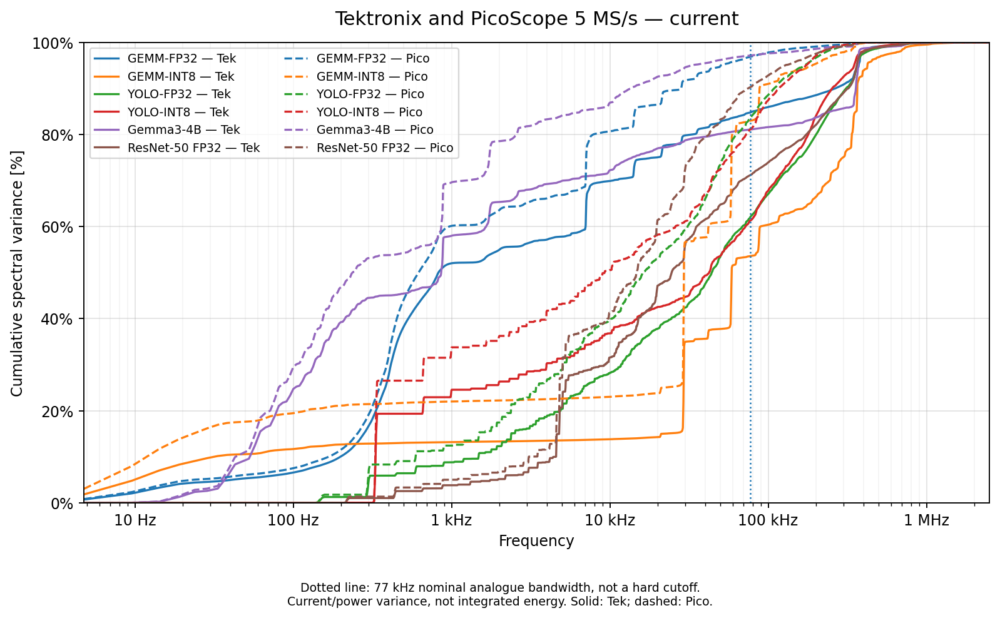
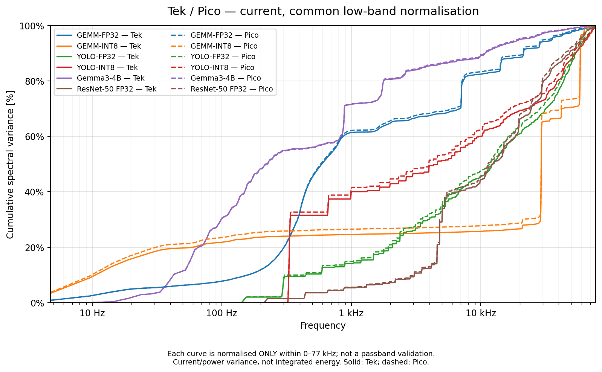
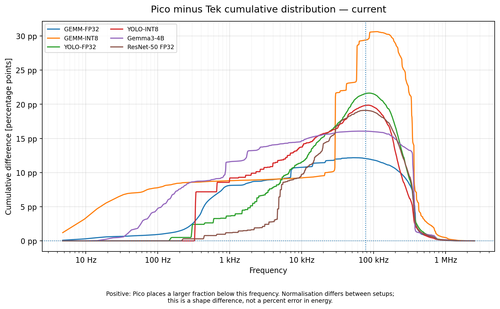
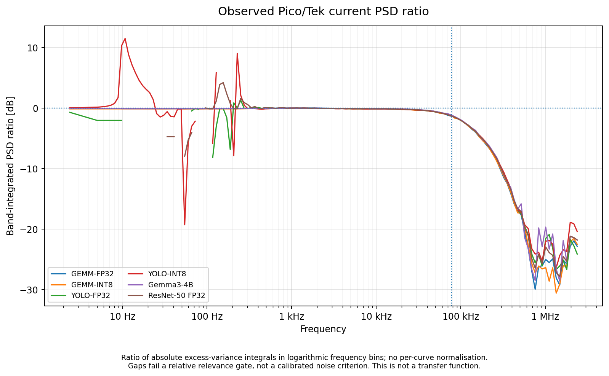
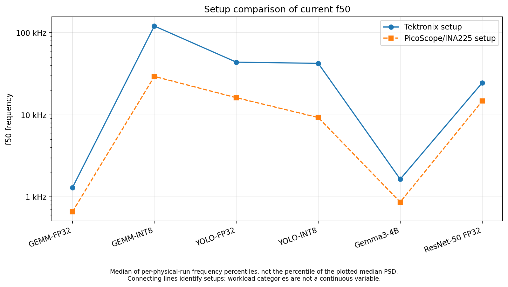
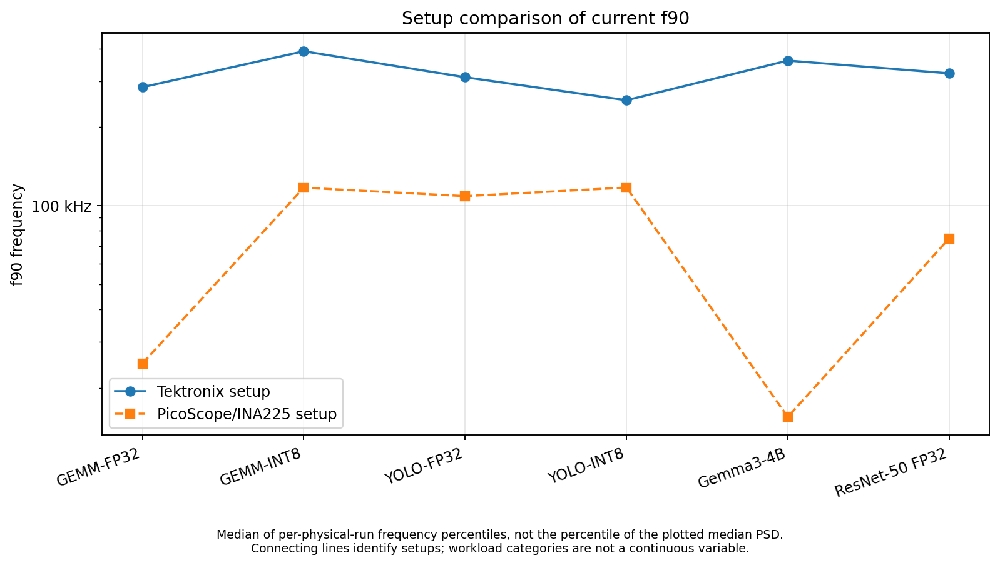
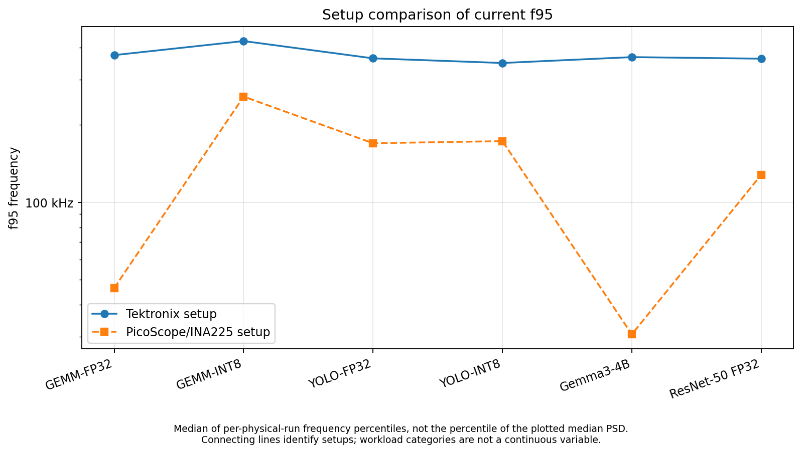
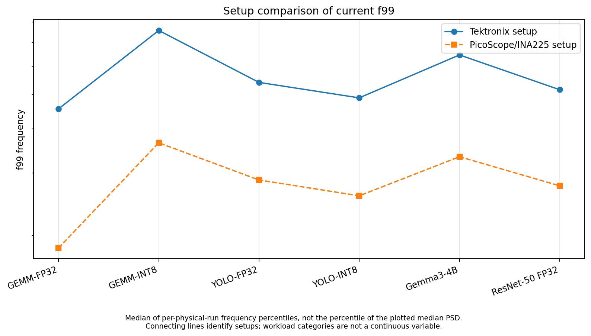

# Jetson current: acquisition-path comparison

[Back to gallery](../spectra-jetson.md) · [Energy results](../../README.md) · [Methods and limits](../../METHODS.md) · [Table index](../../tables/README.md)

These native 5-MS/s comparisons describe observed setup response. Full-band and conditional cumulative differences are percentage points, not energy errors. PSD ratios alone establish neither a transfer function nor absolute instrument accuracy. Empirical per-record ranges and percentiles of a plotted median curve are distinct quantities.

## Spectral shape and cumulative variance

### Normalized current PSDs

Overlay of variance-normalized spectral densities. Normalization supports shape comparisons and removes total-variance scale.

[PNG](../../figures/spectra/pico_vs_tek_psd/tek_vs_pico_current_normalised_psd_overlay.png) · [PDF](../../figures/spectra/pico_vs_tek_psd/tek_vs_pico_current_normalised_psd_overlay.pdf)

### Full-band current cumulative fractions

Cumulative fractions of each setup’s full recorded variance; attenuation at high frequencies also changes the low-frequency fraction.

[PNG](../../figures/spectra/pico_vs_tek_psd/tek_vs_pico_current_cumulative_overlay.png) · [PDF](../../figures/spectra/pico_vs_tek_psd/tek_vs_pico_current_cumulative_overlay.pdf)

### Current cumulative fractions within 0–77 kHz

Each spectrum is independently renormalized within the nominal 77-kHz band to separate low-band shape from full-band denominator effects.

[PNG](../../figures/spectra/pico_vs_tek_psd/tek_vs_pico_current_conditional_cumulative_0_77khz.png) · [PDF](../../figures/spectra/pico_vs_tek_psd/tek_vs_pico_current_conditional_cumulative_0_77khz.pdf)

### Difference between current cumulative fractions

Observed differences between acquisition-path cumulative fractions, expressed in percentage points.

[PNG](../../figures/spectra/pico_vs_tek_psd/tek_vs_pico_current_cumulative_difference.png) · [PDF](../../figures/spectra/pico_vs_tek_psd/tek_vs_pico_current_cumulative_difference.pdf)

### Observed current PSD ratio

Ratios of variance integrated over matching logarithmic bins. The numerical relevance gate is not a calibrated noise threshold.

[PNG](../../figures/spectra/pico_vs_tek_psd/tek_vs_pico_current_observed_psd_ratio.png) · [PDF](../../figures/spectra/pico_vs_tek_psd/tek_vs_pico_current_observed_psd_ratio.pdf)

## Frequencies containing a selected variance fraction

These views summarize where the recorded variance accumulates. They do not directly determine the sampling rate required for integrated-energy accuracy.

### Current frequency at 50% cumulative variance

Frequency containing 50% of full-band current variance under the retained curve and per-record conventions.

[PNG](../../figures/spectra/pico_vs_tek_psd/tek_vs_pico_current_f50.png) · [PDF](../../figures/spectra/pico_vs_tek_psd/tek_vs_pico_current_f50.pdf)

### Current frequency at 90% cumulative variance

Frequency containing 90% of full-band current variance under the retained curve and per-record conventions.

[PNG](../../figures/spectra/pico_vs_tek_psd/tek_vs_pico_current_f90.png) · [PDF](../../figures/spectra/pico_vs_tek_psd/tek_vs_pico_current_f90.pdf)

### Current frequency at 95% cumulative variance

Frequency containing 95% of full-band current variance under the retained curve and per-record conventions.

[PNG](../../figures/spectra/pico_vs_tek_psd/tek_vs_pico_current_f95.png) · [PDF](../../figures/spectra/pico_vs_tek_psd/tek_vs_pico_current_f95.pdf)

### Current frequency at 99% cumulative variance

Frequency containing 99% of full-band current variance under the retained curve and per-record conventions.

[PNG](../../figures/spectra/pico_vs_tek_psd/tek_vs_pico_current_f99.png) · [PDF](../../figures/spectra/pico_vs_tek_psd/tek_vs_pico_current_f99.pdf)

