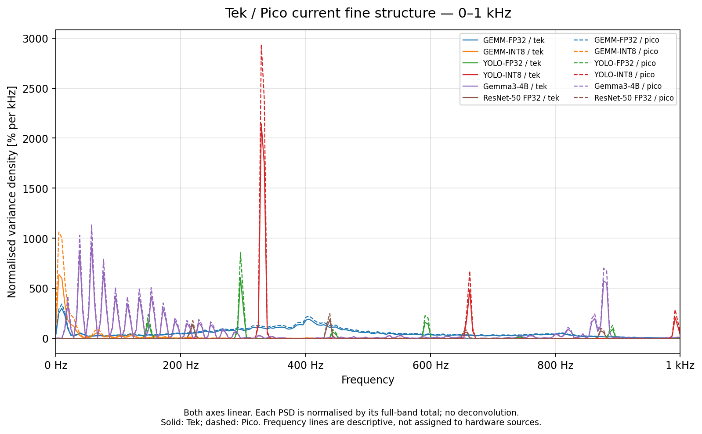
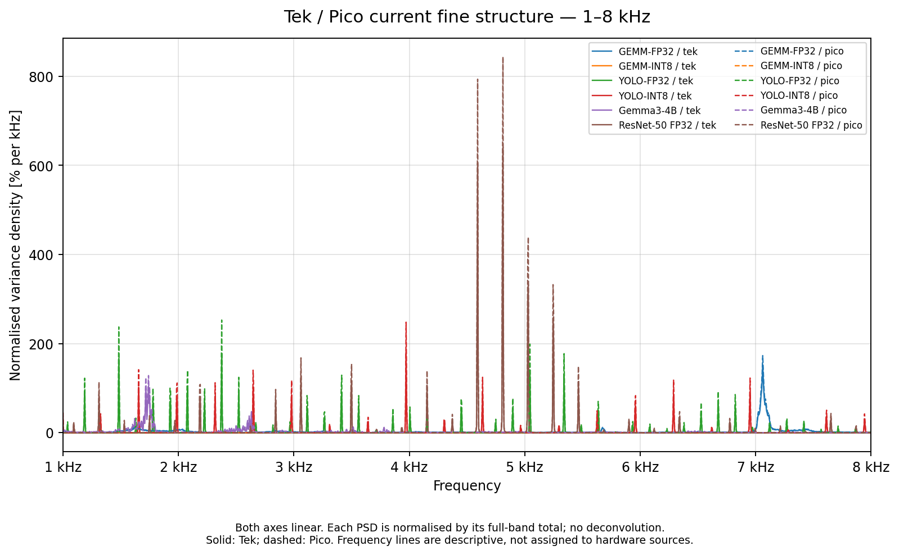
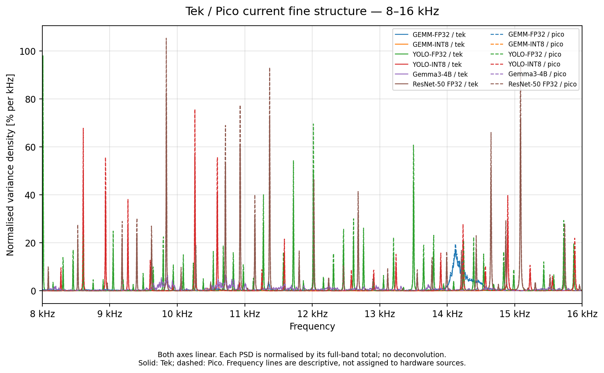
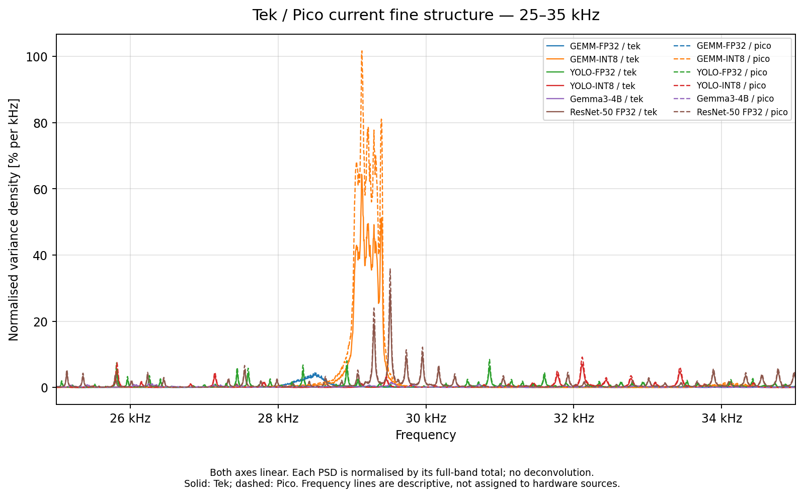
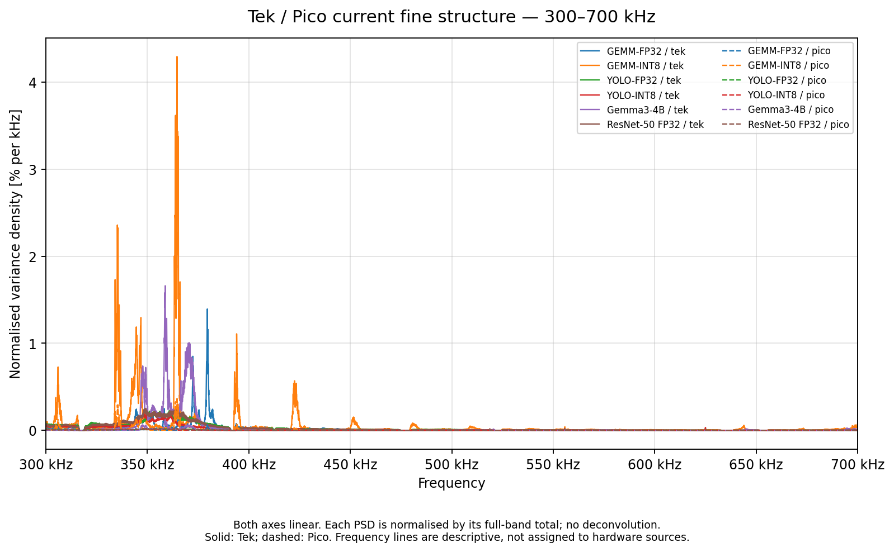

# Jetson spectral fine structure

[Back to gallery](../spectra-jetson.md) · [Energy results](../../README.md) · [Methods and limits](../../METHODS.md) · [Table index](../../tables/README.md)

Frequency-local views compare the observed native setup spectra. The normalized variance-density ordinate emphasizes shape within each displayed interval. Peaks and ratios are descriptive and do not establish hardware causes or an instrument transfer function.

### Spectral structure from 0 to 1 kHz

Native setup comparison restricted to 0 to 1 kHz; the underlying spectral cohort and normalization are unchanged.

[PNG](../../figures/spectra/pico_vs_tek_psd/fine_structure/tek_vs_pico_fine_0_1000hz.png) · [PDF](../../figures/spectra/pico_vs_tek_psd/fine_structure/tek_vs_pico_fine_0_1000hz.pdf)

### Spectral structure from 1 to 8 kHz

Native setup comparison restricted to 1 to 8 kHz; the underlying spectral cohort and normalization are unchanged.

[PNG](../../figures/spectra/pico_vs_tek_psd/fine_structure/tek_vs_pico_fine_1000_8000hz.png) · [PDF](../../figures/spectra/pico_vs_tek_psd/fine_structure/tek_vs_pico_fine_1000_8000hz.pdf)

### Spectral structure from 8 to 16 kHz

Native setup comparison restricted to 8 to 16 kHz; the underlying spectral cohort and normalization are unchanged.

[PNG](../../figures/spectra/pico_vs_tek_psd/fine_structure/tek_vs_pico_fine_8000_16000hz.png) · [PDF](../../figures/spectra/pico_vs_tek_psd/fine_structure/tek_vs_pico_fine_8000_16000hz.pdf)

### Spectral structure from 25 to 35 kHz

Native setup comparison restricted to 25 to 35 kHz; the underlying spectral cohort and normalization are unchanged.

[PNG](../../figures/spectra/pico_vs_tek_psd/fine_structure/tek_vs_pico_fine_25000_35000hz.png) · [PDF](../../figures/spectra/pico_vs_tek_psd/fine_structure/tek_vs_pico_fine_25000_35000hz.pdf)

### Spectral structure from 300 to 700 kHz

Native setup comparison restricted to 300 to 700 kHz; the underlying spectral cohort and normalization are unchanged.

[PNG](../../figures/spectra/pico_vs_tek_psd/fine_structure/tek_vs_pico_fine_300000_700000hz.png) · [PDF](../../figures/spectra/pico_vs_tek_psd/fine_structure/tek_vs_pico_fine_300000_700000hz.pdf)

