# Jetson workload spectral overview

[Back to gallery](../spectra-jetson.md) · [Energy results](../../README.md) · [Methods and limits](../../METHODS.md) · [Table index](../../tables/README.md)

These completed multi-workload views describe spectral shape, active/idle contrasts and variance allocation. They complement the native setup comparison and retain their own source estimators. Variance shares must not be read as energy shares. The separate 1-MS/s energy sensitivity figures are in the [reconstruction gallery](../reconstruction.md).

## PicoScope workload comparison

### Current PSD shape across workloads

Variance-normalized current spectra compare frequency structure across the six workloads.

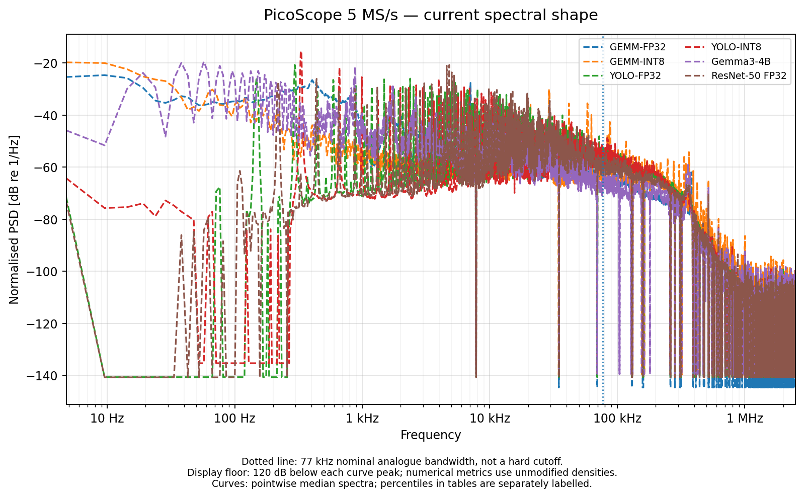

[PNG](../../figures/spectra/pico_vs_tek_psd/pico_cross_workload_current_normalised_psd.png) · [PDF](../../figures/spectra/pico_vs_tek_psd/pico_cross_workload_current_normalised_psd.pdf)

### Current cumulative variance across workloads

Full-band cumulative current fractions use each workload’s own variance denominator.

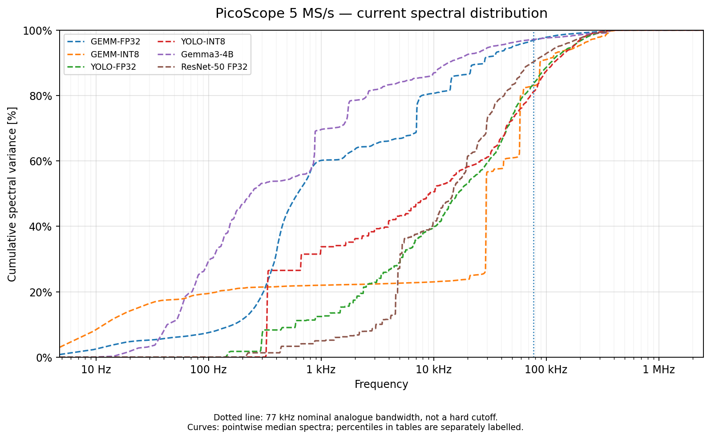

[PNG](../../figures/spectra/pico_vs_tek_psd/pico_cross_workload_current_cumulative.png) · [PDF](../../figures/spectra/pico_vs_tek_psd/pico_cross_workload_current_cumulative.pdf)

### Current variance by frequency band

Bandwise allocation of the recorded current variance.

[PNG](../../figures/spectra/pico_vs_tek_psd/pico_current_frequency_bands.png) · [PDF](../../figures/spectra/pico_vs_tek_psd/pico_current_frequency_bands.pdf)

### Power PSD shape across workloads

Variance-normalized power spectra after the recorded current-to-power conversion.

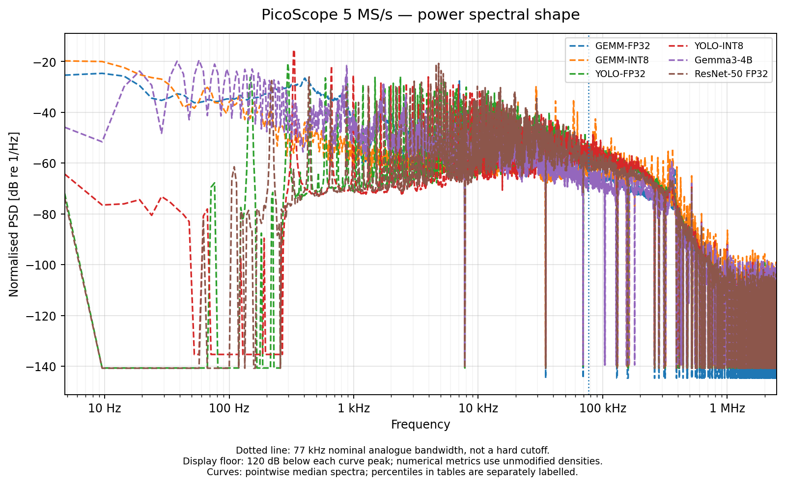

[PNG](../../figures/spectra/pico_vs_tek_psd/pico_cross_workload_power_normalised_psd.png) · [PDF](../../figures/spectra/pico_vs_tek_psd/pico_cross_workload_power_normalised_psd.pdf)

### Power cumulative variance across workloads

Full-band cumulative power fractions for the recorded workload cohorts.

[PNG](../../figures/spectra/pico_vs_tek_psd/pico_cross_workload_power_cumulative.png) · [PDF](../../figures/spectra/pico_vs_tek_psd/pico_cross_workload_power_cumulative.pdf)

### Power variance by frequency band

Bandwise allocation of recorded power variance; these fractions are not energy fractions.

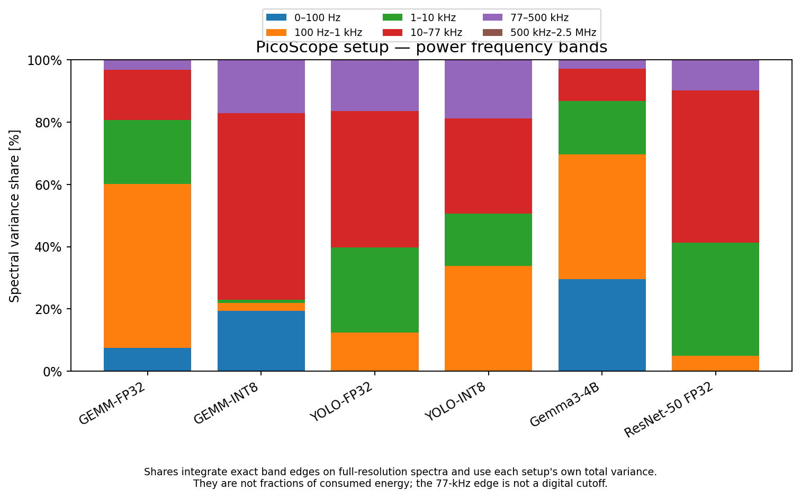

[PNG](../../figures/spectra/pico_vs_tek_psd/pico_power_frequency_bands.png) · [PDF](../../figures/spectra/pico_vs_tek_psd/pico_power_frequency_bands.pdf)

## Multi-workload active/idle context

The source views below retain the completed multi-workload analysis and its recorded idle/excess conventions. They are not the matched four-second FP16 estimator.

### Current spectra across acquisition paths

Workload current PSDs in the completed multi-workload comparison.

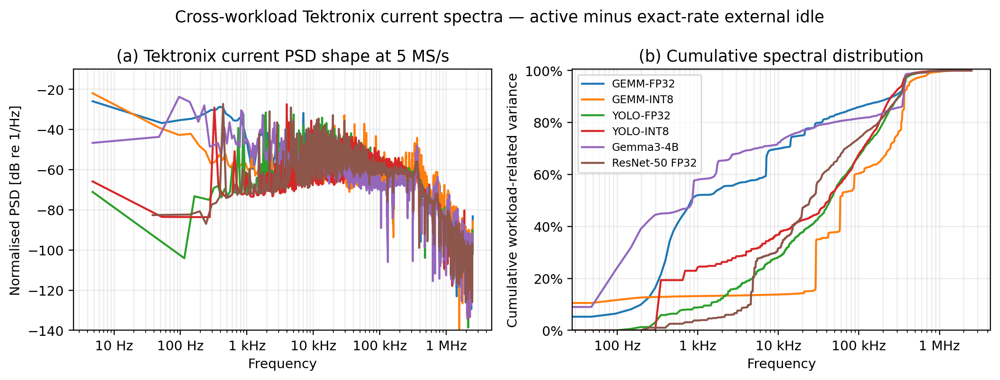

[PNG](../../figures/multi-workload/cross_workload_current_psd_paper.png) · [PDF](../../figures/multi-workload/cross_workload_current_psd_paper.pdf)

### Power spectra across acquisition paths

Workload power PSDs under the recorded conversion and acquisition-path settings.

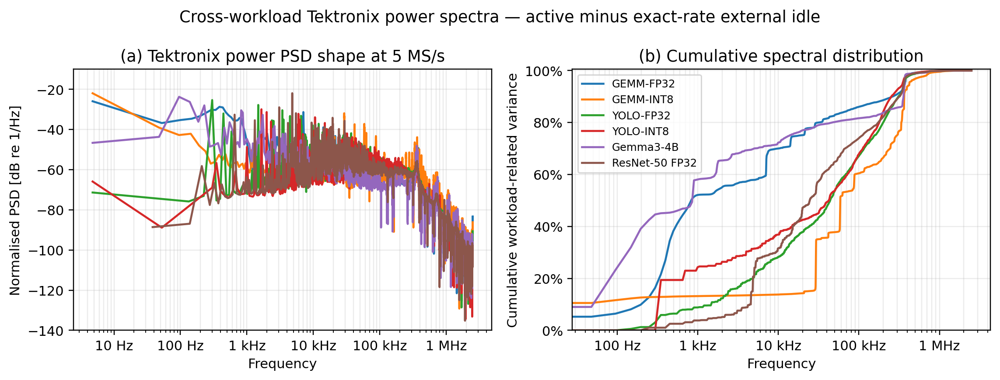

[PNG](../../figures/multi-workload/cross_workload_power_psd_paper.png) · [PDF](../../figures/multi-workload/cross_workload_power_psd_paper.pdf)

### Workload fluctuation bands

Distribution of recorded fluctuation variance among frequency bands.

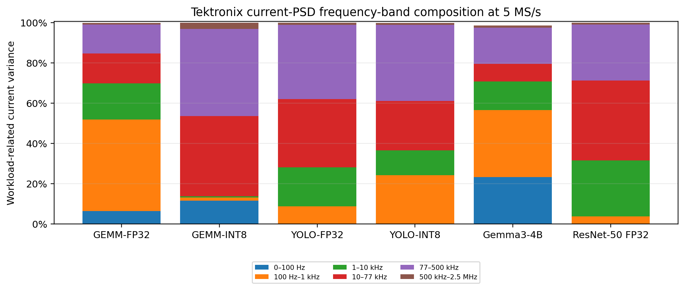

[PNG](../../figures/multi-workload/cross_workload_frequency_bands_paper.png) · [PDF](../../figures/multi-workload/cross_workload_frequency_bands_paper.pdf)

### Active and idle spectra

Active-workload spectra alongside the retained idle spectra.

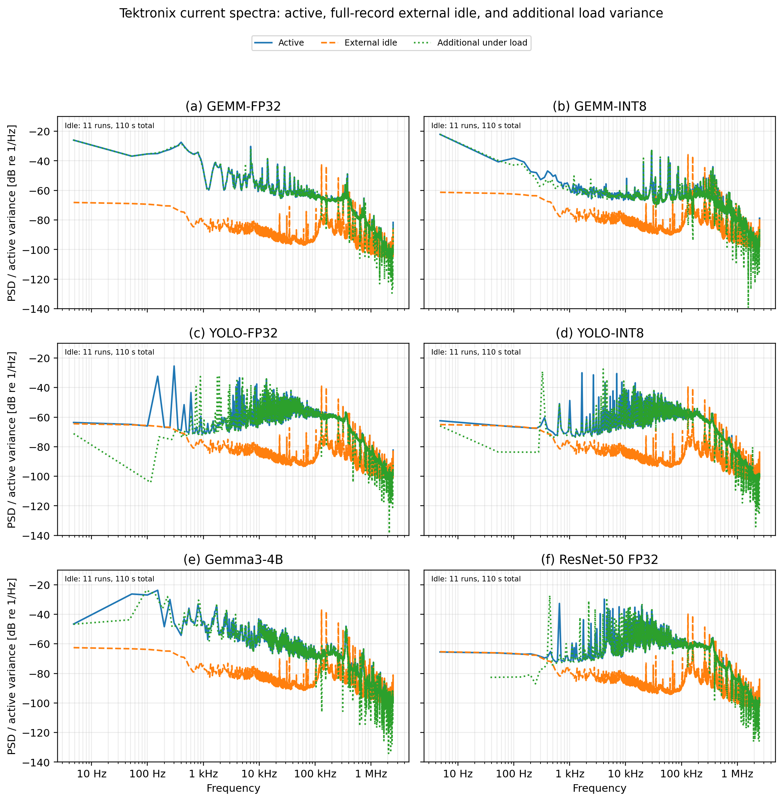

[PNG](../../figures/multi-workload/cross_workload_active_idle_psd_paper.png) · [PDF](../../figures/multi-workload/cross_workload_active_idle_psd_paper.pdf)

### Active-to-idle spectral contrast

Observed active/idle contrast; ratios describe the acquired spectra and do not identify a noise floor.

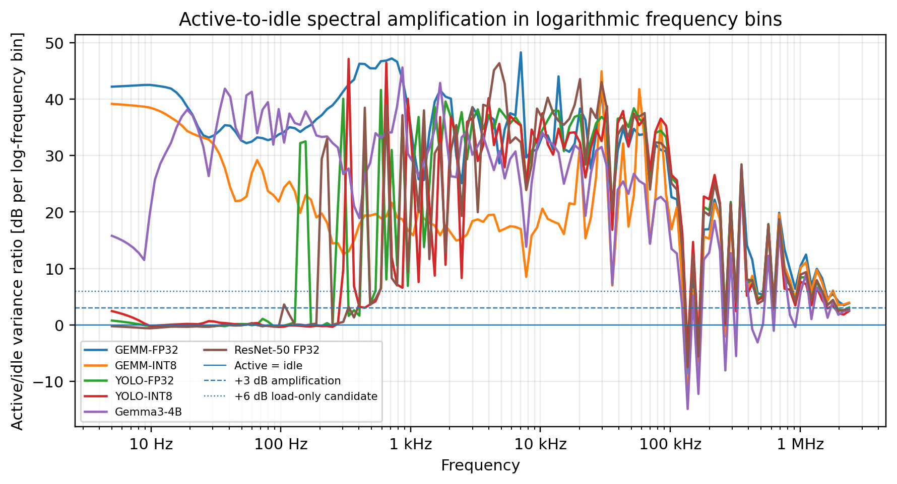

[PNG](../../figures/multi-workload/cross_workload_active_idle_ratio_paper.png) · [PDF](../../figures/multi-workload/cross_workload_active_idle_ratio_paper.pdf)

### Active/idle contrast by frequency band

Bandwise active variance not overlapping the idle PSD and the active-to-idle level, using the source Tektronix current estimator.

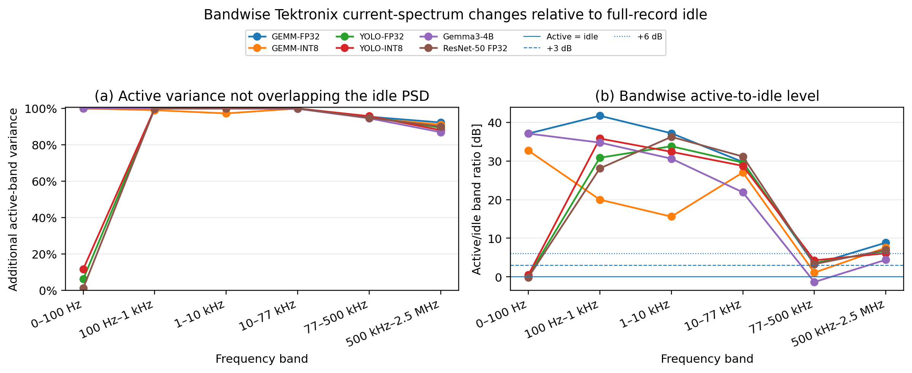

[PNG](../../figures/multi-workload/cross_workload_idle_load_frequency_bands_paper.png) · [PDF](../../figures/multi-workload/cross_workload_idle_load_frequency_bands_paper.pdf)

### Variance share per logarithmic frequency bin

Log-frequency view of cumulative-spectrum changes, emphasizing where workload-related variance is concentrated.

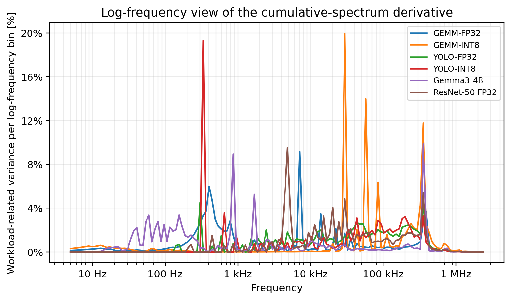

[PNG](../../figures/multi-workload/cross_workload_log_frequency_variance_share_paper.png) · [PDF](../../figures/multi-workload/cross_workload_log_frequency_variance_share_paper.pdf)

### Across-workload spectral detail

A closer view of retained spectral structure in the multi-workload dataset.

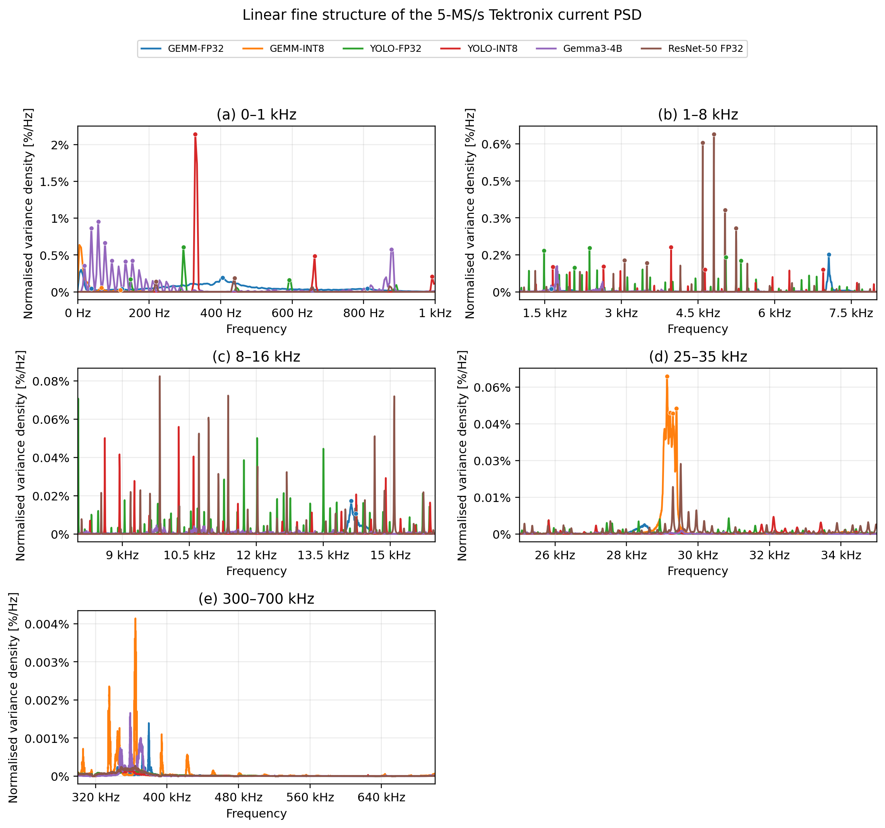

[PNG](../../figures/multi-workload/cross_workload_psd_fine_structure_paper.png) · [PDF](../../figures/multi-workload/cross_workload_psd_fine_structure_paper.pdf)

