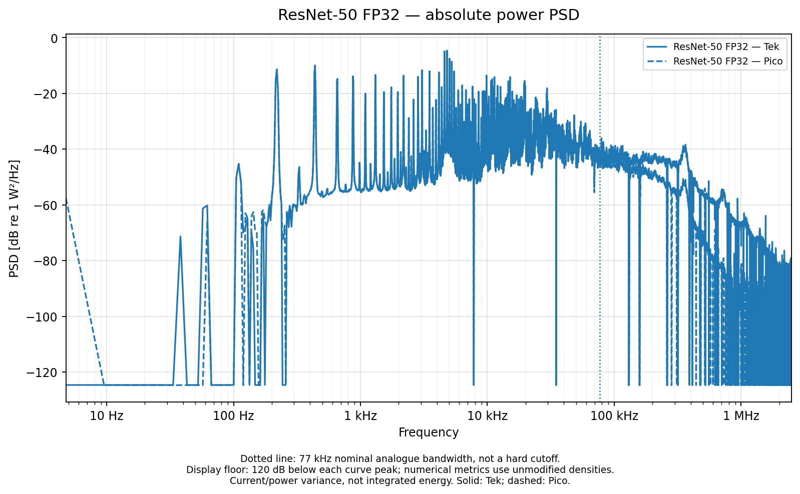
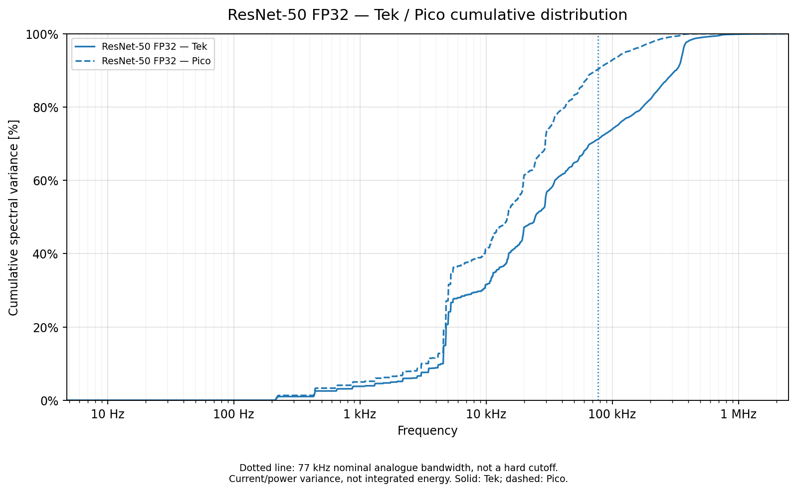

# ResNet-50: native Jetson spectra

[Back to gallery](../spectra-jetson.md) · [Energy results](../../README.md) · [Methods and limits](../../METHODS.md) · [Table index](../../tables/README.md)

Native 5-MS/s setup comparison with the recorded active and independent idle cohorts. PSD integrals are variance. Each cumulative spectrum is normalized by its own full-band variance; those percentages do not measure absolute energy agreement.

### ResNet-50: absolute current PSD

Current fluctuation density in absolute units, retaining the available native frequency band.

[PNG](../../figures/spectra/pico_vs_tek_psd/per_workload/resnet50/current_absolute_psd.png) · [PDF](../../figures/spectra/pico_vs_tek_psd/per_workload/resnet50/current_absolute_psd.pdf)

### ResNet-50: cumulative current variance

Fraction of full-band current variance below each frequency; each setup has its own denominator.

[PNG](../../figures/spectra/pico_vs_tek_psd/per_workload/resnet50/current_cumulative.png) · [PDF](../../figures/spectra/pico_vs_tek_psd/per_workload/resnet50/current_cumulative.pdf)

### ResNet-50: absolute power PSD

Power fluctuation density after the recorded current-to-power model; this is not an energy spectrum in joules.

[PNG](../../figures/spectra/pico_vs_tek_psd/per_workload/resnet50/power_absolute_psd.png) · [PDF](../../figures/spectra/pico_vs_tek_psd/per_workload/resnet50/power_absolute_psd.pdf)

### ResNet-50: cumulative power variance

Fraction of full-band power variance below each frequency, normalized separately for each setup.

[PNG](../../figures/spectra/pico_vs_tek_psd/per_workload/resnet50/power_cumulative.png) · [PDF](../../figures/spectra/pico_vs_tek_psd/per_workload/resnet50/power_cumulative.pdf)

