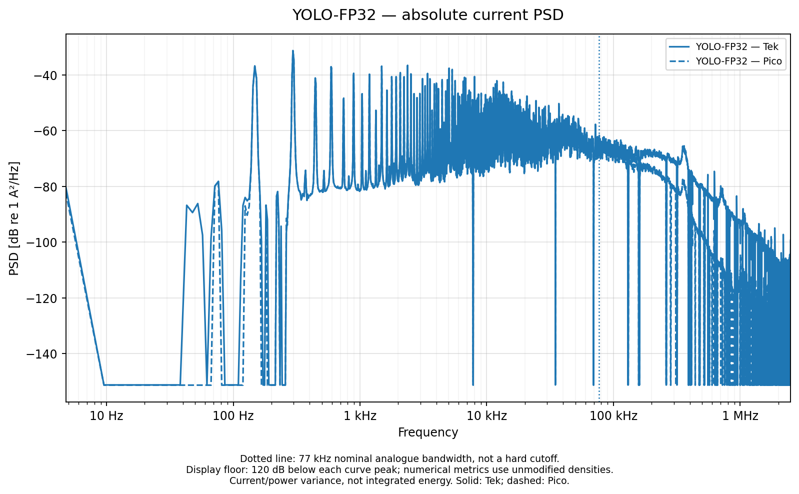
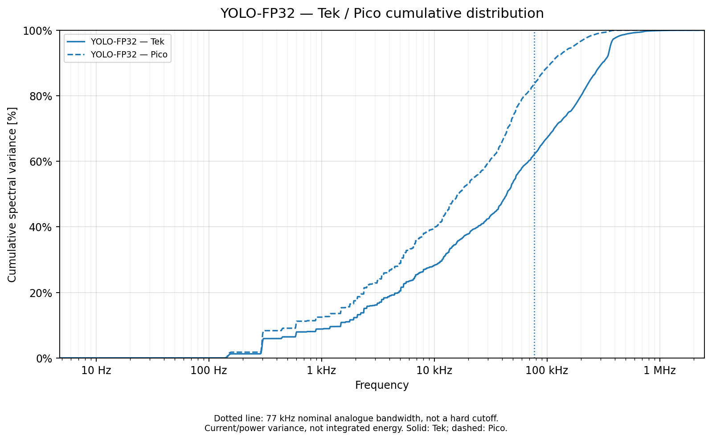

# YOLO FP32: native Jetson spectra

[Back to gallery](../spectra-jetson.md) · [Energy results](../../README.md) · [Methods and limits](../../METHODS.md) · [Table index](../../tables/README.md)

Native 5-MS/s setup comparison with the recorded active and independent idle cohorts. PSD integrals are variance. Each cumulative spectrum is normalized by its own full-band variance; those percentages do not measure absolute energy agreement.

The workload-only Tektronix current offset is retained in the recorded transformations. A constant offset cancels when centering current but need not cancel after nonlinear power conversion. Corrected absolute agreement is not independent validation.

### YOLO FP32: absolute current PSD

Current fluctuation density in absolute units, retaining the available native frequency band.

[PNG](../../figures/spectra/pico_vs_tek_psd/per_workload/yolofp32/current_absolute_psd.png) · [PDF](../../figures/spectra/pico_vs_tek_psd/per_workload/yolofp32/current_absolute_psd.pdf)

### YOLO FP32: cumulative current variance

Fraction of full-band current variance below each frequency; each setup has its own denominator.

[PNG](../../figures/spectra/pico_vs_tek_psd/per_workload/yolofp32/current_cumulative.png) · [PDF](../../figures/spectra/pico_vs_tek_psd/per_workload/yolofp32/current_cumulative.pdf)

### YOLO FP32: absolute power PSD

Power fluctuation density after the recorded current-to-power model; this is not an energy spectrum in joules.

[PNG](../../figures/spectra/pico_vs_tek_psd/per_workload/yolofp32/power_absolute_psd.png) · [PDF](../../figures/spectra/pico_vs_tek_psd/per_workload/yolofp32/power_absolute_psd.pdf)

### YOLO FP32: cumulative power variance

Fraction of full-band power variance below each frequency, normalized separately for each setup.

[PNG](../../figures/spectra/pico_vs_tek_psd/per_workload/yolofp32/power_cumulative.png) · [PDF](../../figures/spectra/pico_vs_tek_psd/per_workload/yolofp32/power_cumulative.pdf)

