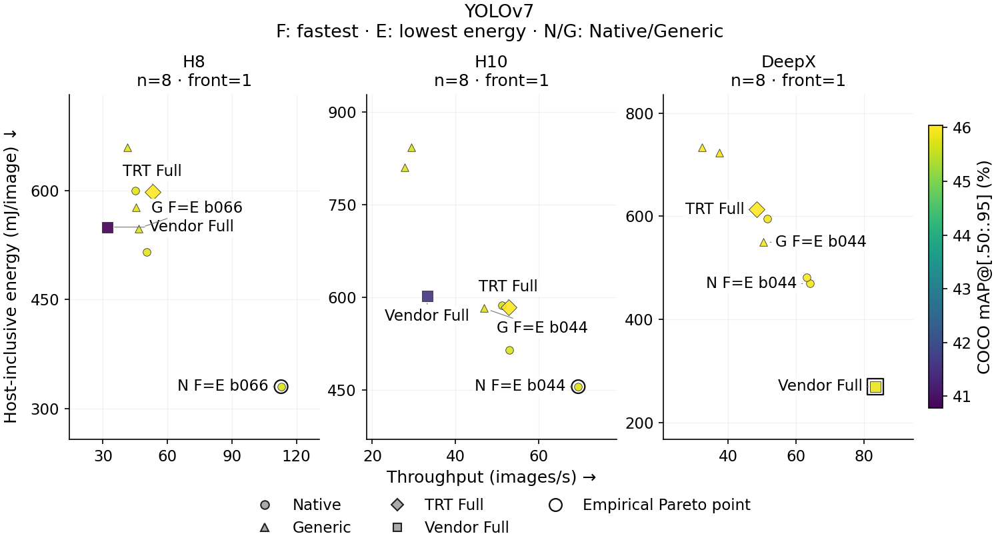
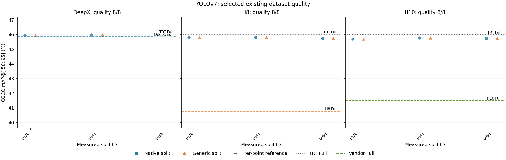

# YOLOv7

[All figures](../README.md) · [Methods](../../METHODS.md) · [Complete data](../../data/PAPER_DATASET.csv)

## Throughput, energy, empirical Pareto front and quality

[PDF](../04_tradeoff_yolov7_paper.pdf) · [SVG](../04_tradeoff_yolov7_paper.svg) · [PNG](../04_tradeoff_yolov7_paper.png)

All 24 observed deployments of YOLOv7, by host setup; axes are scaled separately. Color shows selected dataset quality on one model-wide scale (gray: missing). Energy is calibrated host-inclusive mean(E/N), in mJ/image. Outer outlines mark the empirical two-dimensional Pareto front: maximize FPS, minimize energy, including both Fulls. Quality is displayed, never a filter or third front objective. F/E label runner optima; F=E means one UID. Straight segments only guide between distinct observed front coordinates; intermediate configurations are unproven. Singleton fronts have no line. Timed work and quality differ; see METHODS.md and the exported endpoint notes. Native detector oracles are outside timing; Generic records decoded NMS; Fulls retain their recorded host-tail or normalization work.

## All split and Full quality observations

[PDF](../06_quality_yolov7_paper.pdf) · [SVG](../06_quality_yolov7_paper.svg) · [PNG](../06_quality_yolov7_paper.png)

Absolute selected dataset quality for YOLOv7. Every available split evaluation is shown; gray ticks are its recorded model reference. Horizontal lines show the matching host Vendor Full and TRT Full when numerical quality exists. No missing Full quality is inferred. Percent values denote Top-1 accuracy or COCO mAP as labeled, not relative loss. Exact quality sample counts are in FIGURE_DATA.json.

