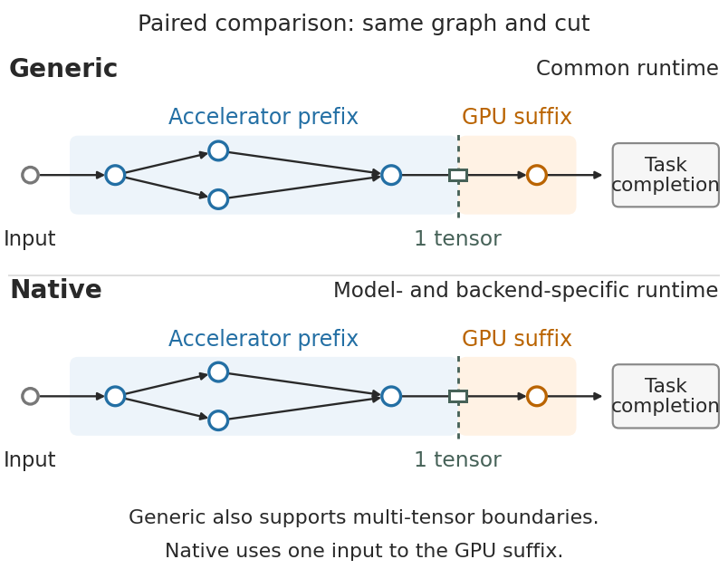
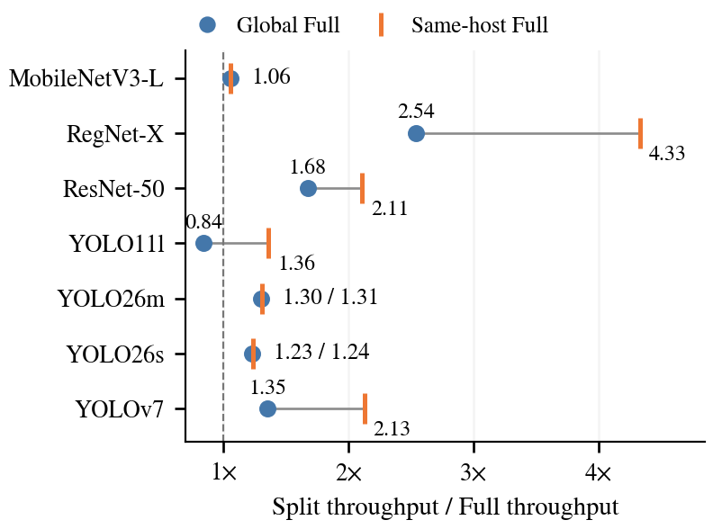
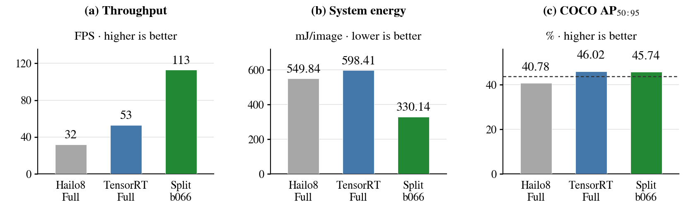
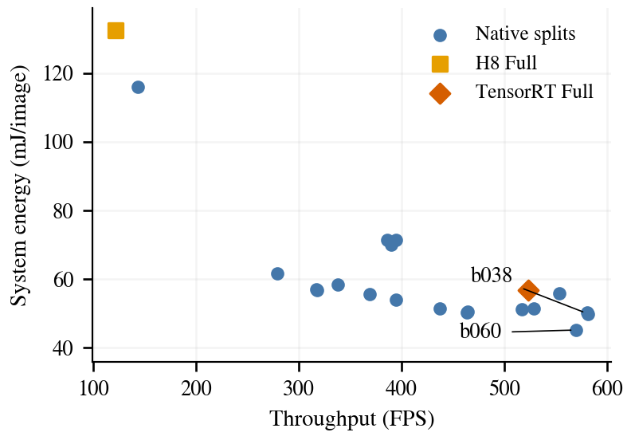
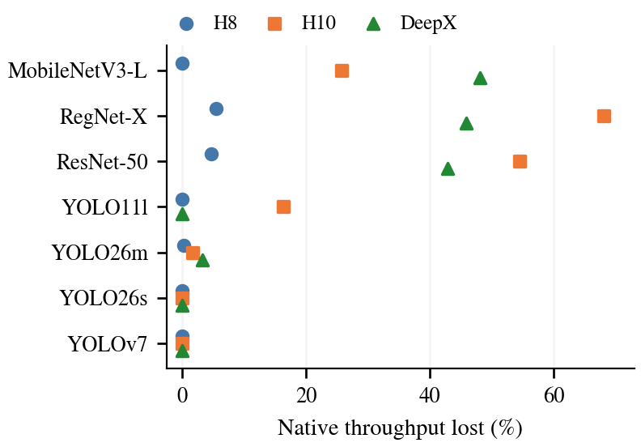
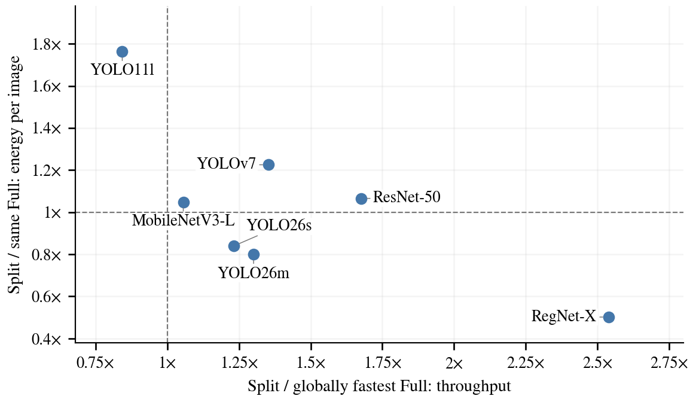
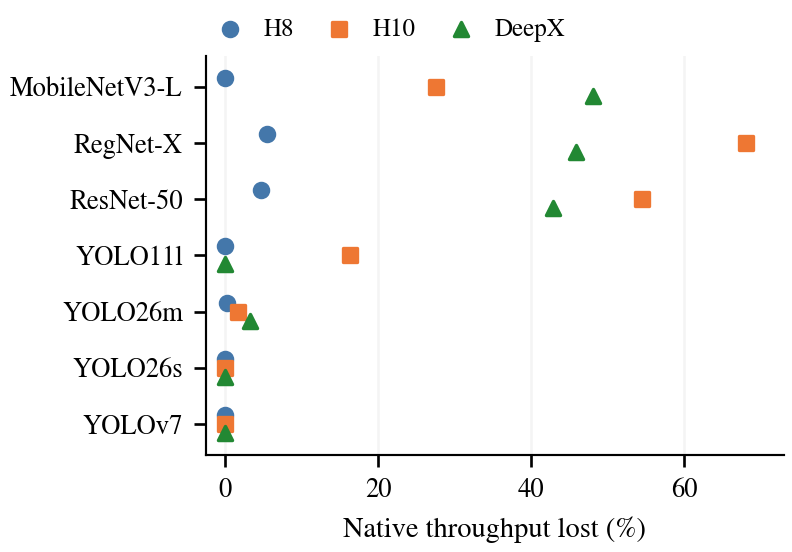
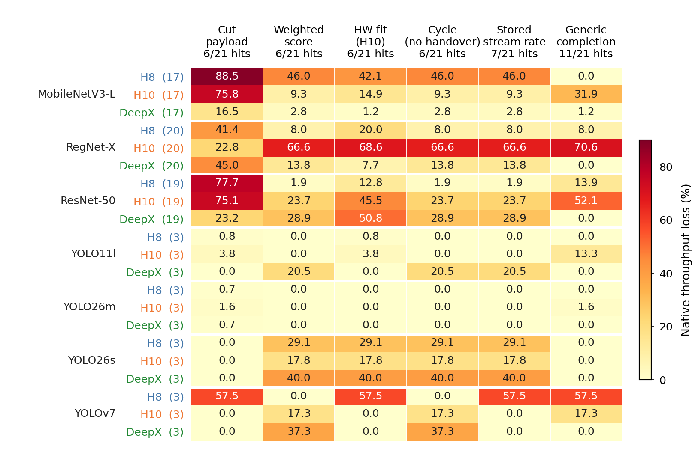

# R22 figure gallery

This registered R22 profile is generated by the existing split-inference reproduction command. Its quality-filtered selection view uses numerical CPU-relative loss ≤5%; the broad 450-deployment analysis and its unfiltered Pareto views remain separate. Historical ranking, energy-window, stage-cost and scheduling studies retain their own cohorts.

## Generic and Native execution schematic

[PDF](system_overview.pdf) · [SVG](system_overview.svg) · [PNG](system_overview.png) · [JSON](system_overview.json)

Generic and Native execute the same one-input cut. Generic also supports multi-tensor boundaries beyond this paired comparison. Native is tailored to the accelerator–GPU combination. The shared cut does not imply equal runtime costs.

R22 label: `fig:runners`. Generation: conceptual-spec-v1.

## Effect of Full-reference choice

[PDF](fastest_split_baseline_comparison.pdf) · [SVG](fastest_split_baseline_comparison.svg) · [PNG](fastest_split_baseline_comparison.png) · [CSV](fastest_split_baseline_comparison.csv) · [JSON](fastest_split_baseline_comparison.json)

The same selected fastest split with two Full references. A connection changes only the denominator, not the split or its speed. Global Full means the fastest actual Full configuration across hosts; same-host Full means the fastest Full on the split's physical host. Labels round factors to two decimals; plot data retain unrounded values and exact UIDs. The paper profile applies the numerical 5% CPU-relative quality rule. Its winners match the broad current view for this generation.

R22 label: `fig:baseline-effect`. Generation: deepx_native_a4_20261015.

## YOLOv7/H8 quality, throughput and energy

[PDF](yolov7_h8_case.pdf) · [SVG](yolov7_h8_case.svg) · [PNG](yolov7_h8_case.png) · [CSV](yolov7_h8_case.csv) · [JSON](yolov7_h8_case.json)

YOLOv7 on the same H8 host. The selected Native split is compared with Hailo8 Full and TensorRT Full. The dashed AP line marks at most 5% relative quality loss against CPU ONNX. Bars are point estimates; available CPU-relative quality intervals are not paired split-minus-Full AP intervals and are not plotted as such. The global DeepX Full comparison remains a separate denominator in the winner tables.

R22 label: `fig:yolov7-case`. Generation: deepx_native_a4_20261015.

## Current ResNet/H8 throughput-energy scatter

[PDF](resnet_h8_energy_current.pdf) · [SVG](resnet_h8_energy_current.svg) · [PNG](resnet_h8_energy_current.png) · [CSV](resnet_h8_energy_current.csv) · [JSON](resnet_h8_energy_current.json)

ResNet-50/H8: current throughput and calibrated system energy for all Native splits and both Full alternatives. The annotated cuts are selected independently by maximum FPS and minimum energy. FPS is the stored performance-cohort median; energy is mean per-repeat E/N in mJ/image. Performance and energy come from separate runs of the same configuration; energy-window rates are not substituted.

R22 label: `fig:resnet-energy`. Generation: deepx_native_a4_20261015.

## Quality-filtered Generic-to-Native loss, 187 pairs

[PDF](quality_generic_selection_loss.pdf) · [SVG](quality_generic_selection_loss.svg) · [PNG](quality_generic_selection_loss.png) · [CSV](quality_generic_selection_loss.csv) · [JSON](quality_generic_selection_loss.json)

Generic-to-Native selection after the numerical 5% CPU-relative quality filter, using 187 paired cuts. Each marker shows the Native throughput lost by choosing the Generic winner in one model/setup group. Zero means no loss. There are 9 exact winner agreements in 21 groups. Each group receives equal weight; the group mean loss is 15.08%. Selection uses unrounded FPS and stable UID ties.

R22 label: `fig:selectors`. Generation: deepx_native_a4_20261015.

## Global throughput-winner energy/throughput ratios

[PDF](fastest_deployment_tradeoff.pdf) · [SVG](fastest_deployment_tradeoff.svg) · [PNG](fastest_deployment_tradeoff.png) · [CSV](fastest_deployment_tradeoff.csv) · [JSON](fastest_deployment_tradeoff.json)

Throughput and energy of each model's fastest split relative to its globally fastest Full. Both axes use the same exact Full configuration. Right of one is faster and below one uses less energy per image. These throughput-selected points are not the full Pareto front or an energy-minimum selection. Quality eligibility does not establish equal accuracy or identical runtime costs. Text positions alone are displaced for readability; there are no inferred confidence intervals.

R22 label: `fig:fastest-tradeoff`. Generation: deepx_native_a4_20261015.

## Unfiltered Generic-to-Native loss, 204 pairs

[PDF](current_generic_selection_loss.pdf) · [SVG](current_generic_selection_loss.svg) · [PNG](current_generic_selection_loss.png) · [CSV](current_generic_selection_loss.csv) · [JSON](current_generic_selection_loss.json)

Generic-to-Native selection before quality filtering, using 204 paired cuts. Each marker shows the Native throughput lost by choosing the Generic winner in one model/setup group. Zero means no loss. There are 9 exact winner agreements in 21 groups. Each group receives equal weight; the group mean loss is 15.16%. Selection uses unrounded FPS and stable UID ties.

R22 label: `fig:supp-unfiltered-selection`. Generation: deepx_native_a4_20261015.

## Historical six-selector loss heatmap

[PDF](selector_loss_heatmap.pdf) · [SVG](selector_loss_heatmap.svg) · [PNG](selector_loss_heatmap.png) · [CSV](selector_loss_heatmap.csv) · [JSON](selector_loss_heatmap.json)

Historical graph-score comparison: Native throughput loss for six selectors in fixed model/setup groups. Every column uses the same historical Native reference measurements within a row. Parentheses give candidate counts; column headers count exact/tie-aware winner agreements. The stored hardware-fit profile is the H10 profile on every setup. The historical reported YOLOv7 Native overlay and archived Generic records remain separate from current A4 deployments. No current quality filter is applied to this historical cohort.

R22 label: `fig:historical-selectors`. Generation: THESIS20_20261005_with_reported_YOLOv7_20261006.

