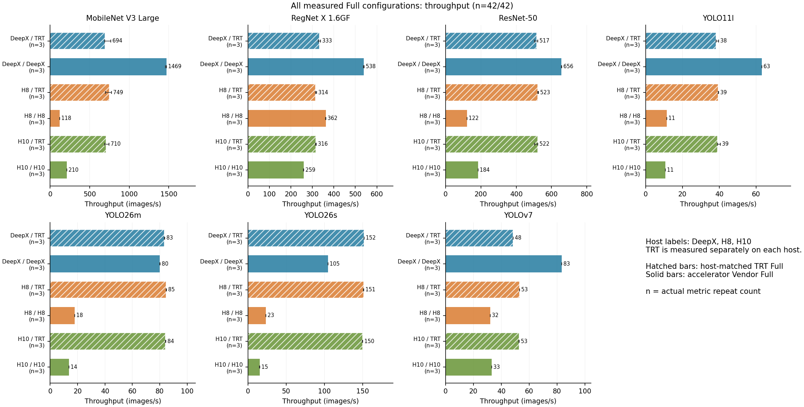

# Split inference: performance, energy and quality

450 observed deployments cover seven models on Jetson Orin NX hosts paired with DeepX M1, Hailo-8 and Hailo-10H; host-specific TensorRT and vendor Full baselines are retained. The current selection contains 204 Native splits, 204 Generic splits and all 42 Full configurations. Every identity has throughput, calibrated host-inclusive energy and an existing numerical dataset-quality observation.

[All figures](figures/README.md) · [Tables](tables/README.md) · [Complete CSV](data/PAPER_DATASET.csv) · [Findings](FINDINGS.md) · [Methods](METHODS.md)

The recommended [Table 3: global fastest Full and split](tables/table3_fastest_deployments.md) selects the highest observed unrounded FPS per model across all measured setups, including both split runners, and reports the energy of those exact configurations. [The same selected split with two Full baselines](tables/fastest_split_baselines.md) adds the fastest Full on its own physical host. Global fastest describes the strongest observed alternative when setup choice is open; same-host describes that split relative to its own host's Full options. The supplementary [Top-2 Native splits by relative same-host speedup](tables/table3_top2_native.md) retains its historical selection method and numerical results and may select different splits.

The [baseline-effect figure](figures/fastest_split_baseline_comparison.pdf) shows the denominator change for the same split. The [fastest-deployment throughput–energy figure](figures/fastest_deployment_tradeoff.pdf) compares throughput and energy with the same global Full UID. Both are generated from the table selections. The second is an overview of throughput-selected deployments; the complete observed-space Pareto views remain below.

[Throughput PDF](figures/01_full_throughput.pdf) · [SVG](figures/01_full_throughput.svg) · [Full energy](figures/02_full_energy.pdf)

The gallery includes complete performance/energy, empirical Pareto fronts and quality views for every model, Full baselines, Native/Generic comparisons and fastest-versus-minimum-energy analyses. Tables also retain negative quality results, sensitivities, observed repeats and nonwinning configurations. The separately dated [supplementary studies](../supplementary-studies/README.md) retain historical selection and diagnostic cohorts. The separate [Hailo-10 format experiments](microbenchmarks/README.md) show device-stage effects with narrower timing boundaries.

The seven model views retain all 450 observations and highlight 33 joint front points across 21 model/setup groups. [Pareto exports](tables/PARETO_POINTS.csv) distinguish joint fronts from Native-/Generic-only fronts. They maximize throughput and minimize energy per image; quality is shown separately and does not exclude points. A front describes the observed implementations and does not establish equal work or equal quality.

Throughput is the stored repeat median in images/s. Energy is the mean of calibrated energy per completed image for each repeat, stored in J/image and displayed in mJ/image. Each of the 450 configurations has three energy repeats; the [repeat tables](tables/README.md) retain counts, ranges, duration, power and uncertainty. Top-1 classification accuracy and COCO mAP@[.50:.95] remain separate quality metrics.

Native is faster in 186/204 paired points and uses less energy in 196/204; 186/204 improve both. Against the fastest measured Full on the same host, 105/204 Native splits are faster. The [findings](FINDINGS.md) retain the detailed summaries. These are retrospective deployment comparisons. They preserve differences in timed work: Native detector splits use an oracle outside timing, while Generic detector splits include decoded NMS. Hailo Full accuracy losses and 53 discrepancies between cached quality loss and selected numerical quality evidence remain visible. Historical source-version gaps and three unknown old clock profiles remain documented in [methods](METHODS.md).

Recreate the numerical exports, both fastest-deployment tables and all 23 figures from compact inputs with [these offline instructions](../../scripts/split-inference/README.md). The same invocation regenerates methods, findings, captions and gallery/table indices. This does not repeat sensor acquisition, inference or dataset evaluation. Raw traces, models and datasets are outside its scope.

Source: the active `deepx_native_a4_20261015` selection replaces performance and energy for exactly 68 DeepX Native splits and seven DeepX Native Full configurations. It retains the 375 other direct observations and all 450 original quality selections from the completed [Refresh16/Pareto analysis](https://github.com/Keff789/onnx-splitpoint-results/tree/380dfa09aa6740acdc71908cb6e5dd5c8fc115ad/results/evaluation/paper_after_refresh16_20261013). The 225 selected performance repeats and 225 valid calibrated energy repeats include accepted reused cohorts; existing dataset quality was not remeasured.

DeepX Native A4 uses batch 1, one engine per process and at most four outstanding asynchronous jobs. Splits retain FIFO depth 3 and a serial TensorRT consumer including task completion. Generic observations, the seven TensorRT Full references on the DeepX host and all H8/H10 observations retain their original measurement modes. The [software overview](../../software/README.md) distinguishes the frozen 2.95.5 A4 sources from historical tool sources.
