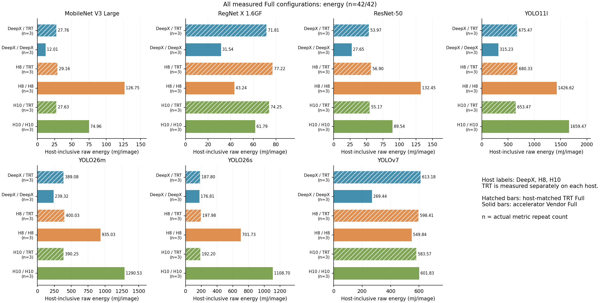
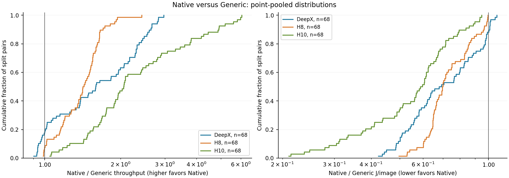
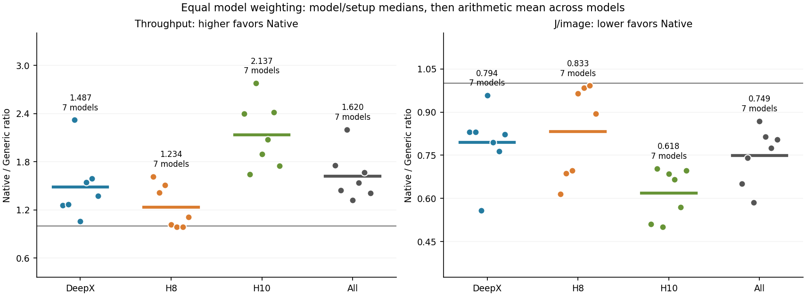
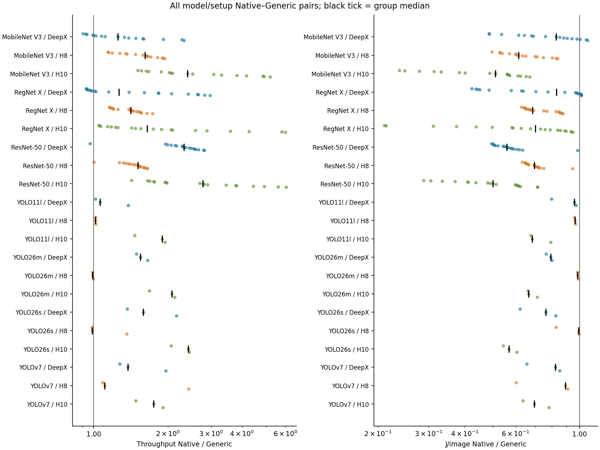
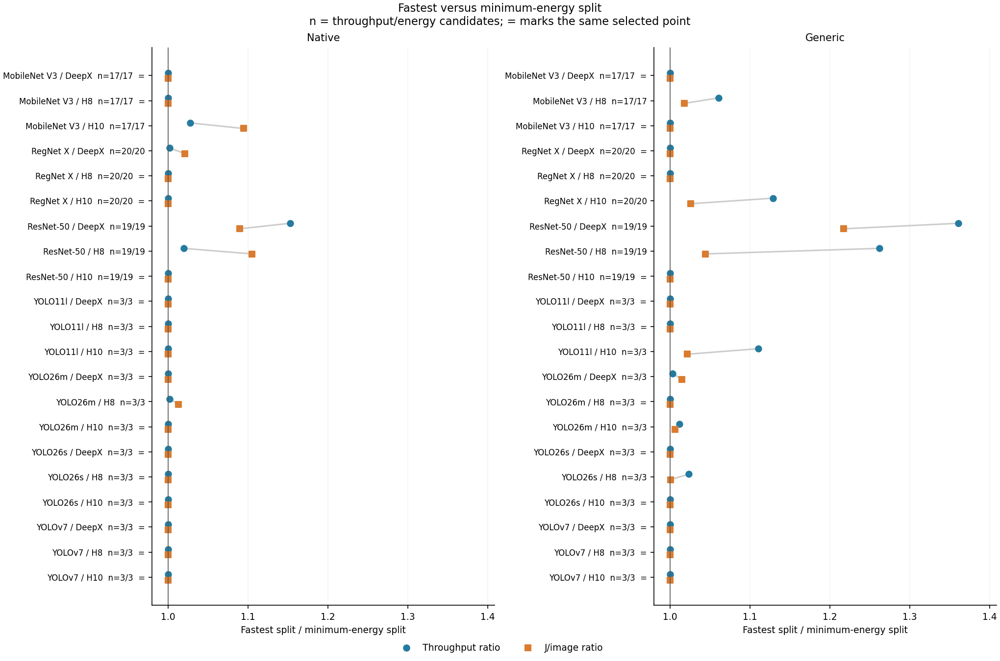
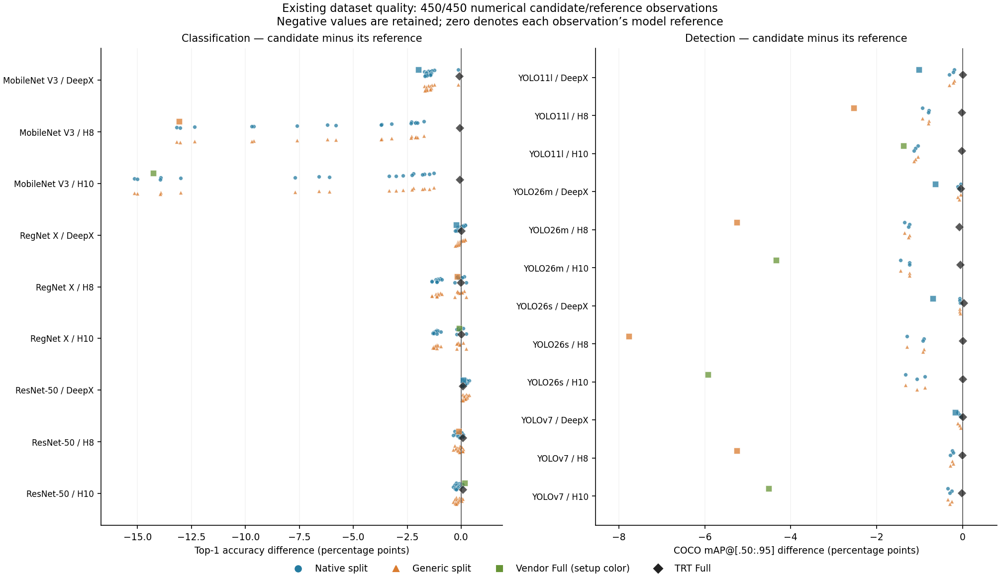

# Split-inference gallery

[Result overview](../README.md) · [Tables](../tables/README.md) · [Full captions](../CAPTIONS.md)

All 21 current figure families are included. Each has a vector PDF/SVG and a PNG preview. Throughput is images/s and calibrated energy includes the host. The figures compare observed deployments with their recorded quality and timed-work differences.

## Complete model views and empirical Pareto fronts

- [MobileNetV3 Large: performance, energy and dataset quality](models/mobilenet_v3_large.md)
- [RegNet X 1.6GF: performance, energy and dataset quality](models/regnet_x_1_6gf.md)
- [ResNet-50: performance, energy and dataset quality](models/resnet50.md)
- [YOLO11l: performance, energy and dataset quality](models/yolo11l.md)
- [YOLO26m: performance, energy and dataset quality](models/yolo26m.md)
- [YOLO26s: performance, energy and dataset quality](models/yolo26s.md)
- [YOLOv7: performance, energy and dataset quality](models/yolov7_paper.md)

The seven model views retain all observations, both Full alternatives and dataset quality. Outlines mark the joint performance–energy front within each model/setup; lines connect discrete front coordinates only. [All 450 points and front flags](../tables/PARETO_POINTS.csv) distinguish the 33 joint front points from runner-specific split fronts. See [methods](../METHODS.md) for dominance and interpretation limits.

## All Full deployments: throughput

[PDF](01_full_throughput.pdf) · [SVG](01_full_throughput.svg) · [PNG](01_full_throughput.png)

Full throughput for all 42 selected model/backend/host identities; 42 have this metric. Host-specific TRT values are separate. No quality, claim, sample-count or hash admission filter is applied. Whiskers show the observed performance-repeat minimum and maximum, not a confidence interval; historical n=1 has no whisker.

## All Full deployments: energy per image

[PDF](02_full_energy.pdf) · [SVG](02_full_energy.svg) · [PNG](02_full_energy.png)

Full energy for all 42 selected model/backend/host identities; 42 have this metric. Host-specific TRT values are separate. No quality, claim, sample-count or hash admission filter is applied. Bars use mean of per-repeat calibrated raw E/N, including the host; n is the actual sensor-repeat count. This is mJ per completed image, not energy divided by FPS.

## Native and Generic: pooled operating points

[PDF](03a_native_generic_pooled.pdf) · [SVG](03a_native_generic_pooled.svg) · [PNG](03a_native_generic_pooled.png)

Point-pooled empirical distributions of Native/Generic throughput and host-inclusive raw J/image ratios. Each split pair has one vote; models with more measured splits have more points here. The two axes use their own observed metric pairs. A ratio of one indicates equality.

## Native and Generic: equal model weighting

[PDF](03b_native_generic_equal_model.pdf) · [SVG](03b_native_generic_equal_model.svg) · [PNG](03b_native_generic_equal_model.png)

One dot is the median ratio within a model/setup. Horizontal bars are arithmetic means of these model medians within each setup, so each observed model has equal weight. In All, each dot first averages the setup medians for one model, then the bar averages across models. Metric-specific pair counts and all model medians are in figures/FIGURE_DATA.json. This differs intentionally from the point-pooled distribution.

## Native and Generic: every model and setup

[PDF](03c_native_generic_model_setup.pdf) · [SVG](03c_native_generic_model_setup.svg) · [PNG](03c_native_generic_model_setup.png)

All observed Native/Generic ratios by model/setup. Every dot is one paired split, spread vertically only for readability; the black tick marks the within-group median. No point is removed because of quality or old admission flags.

## Fastest and lowest-energy splits

[PDF](05_fastest_vs_min_energy.pdf) · [SVG](05_fastest_vs_min_energy.svg) · [PNG](05_fastest_vs_min_energy.png)

Fastest and minimum-energy splits selected independently within each model/setup/runner with stable UID tie-breaking. Blue circles compare throughput; orange squares compare host-inclusive J/image, always fastest divided by minimum-energy split. Labels show performance/energy candidate counts and an equals sign when one observed point realizes both optima. Groups with one candidate are visible and do not constitute independent evidence for a conflict. Quality values and selected identities are retained in FIGURE_DATA.json.

## Dataset quality relative to model references

[PDF](06_quality_reference_comparison.pdf) · [SVG](06_quality_reference_comparison.svg) · [PNG](06_quality_reference_comparison.png)

Selected existing dataset quality minus the corresponding model reference, in percentage points. Top-1 and COCO mAP@[.50:.95] are kept on separate axes. All numerical Native/Generic split and Full evaluations are retained, including Hailo Full losses and split improvements. Values are reused evidence, not new quality measurements. Missing quality is not filled from output-PASS or a historical favorable assessment. References can have different evaluation scopes; sample counts and exact source fields remain in the dataset.

