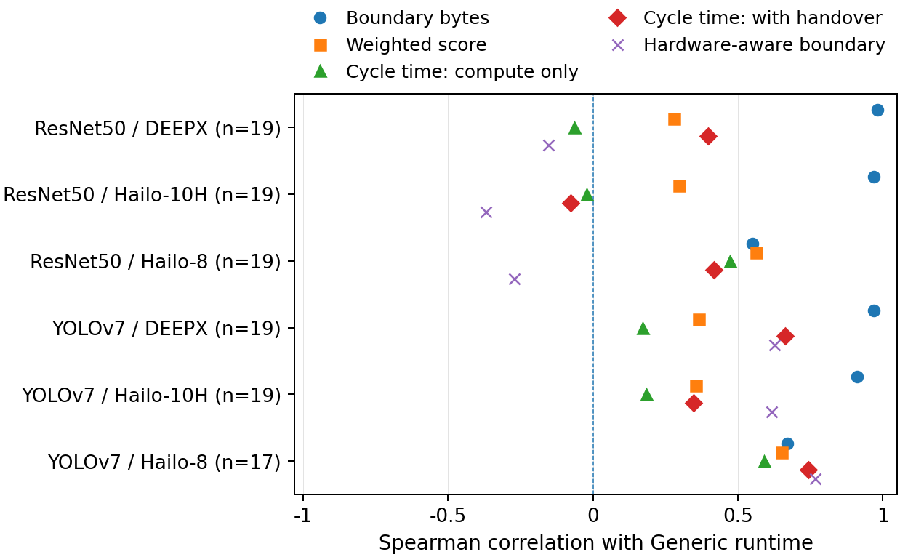
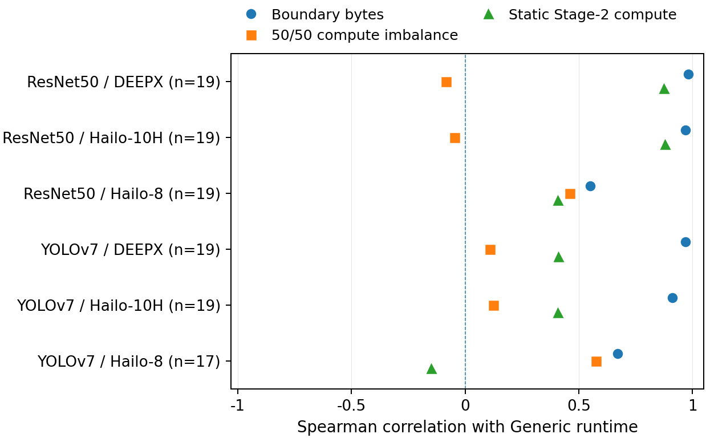

# Historical dissertation development studies

These three studies reproduce reported development evidence from `doctor_thesis_v46_chapter2_literature_source.zip`. They retain their original cohorts and timing contracts, separately from [THESIS20](../thesis20-ranking-20261005/README.md), [Refresh16](../../split-inference/README.md) and the later [YOLOv7 completion study](../yolov7-completion-20261007/README.md).

## Generic ranking and proxy ablation

The six eligible ResNet50/YOLOv7 × accelerator strata contain 19 paired candidates each, except YOLOv7/Hailo-8 with 17. The source selected 20 deterministic, score-independent boundaries per model; YOLO26s retained only eight and fell below the minimum of ten. The supplied 30 method and 18 proxy correlations are **aggregate inputs**, not candidate-level timings. Rendering does not recompute Spearman correlations or estimate uncertainty.

Boundary bytes correlate positively with Generic runtime in all six strata and exceed the weighted score in five. They do not win every comparison or predict milliseconds. Static Stage-2 compute is useful in some strata but reverses for YOLOv7/Hailo-8; 50/50 compute imbalance is inconsistent. These development observations do not establish transfer performance. The technical ranking population is separate from quality-constrained selection.



[Methods PDF](figures/ranking_methods.pdf) · [SVG](figures/ranking_methods.svg) · [table](tables/ranking_methods.md) · [TeX](tables/ranking_methods.tex) · [full-precision CSV](tables/phase2_ranking_diagnostic_spearman_six_eligible_strata.csv)



[Proxies PDF](figures/ranking_proxies.pdf) · [SVG](figures/ranking_proxies.svg) · [table](tables/ranking_proxies.md) · [TeX](tables/ranking_proxies.tex) · [full-precision CSV](tables/static_proxy_spearman_confirmatory.csv)

## YOLOv7 decoder, B500 and compiler sensitivity

The four tables are exact manuscript transcriptions at the precision supplied, as recorded in [TABLE_SOURCE.json](inputs/tables/TABLE_SOURCE.json). Their renderer changes presentation only; it does not recover raw runs or rerun COCO.

| Evidence | Rows | Readable table | TeX | Full-precision CSV |
|---|---:|---|---|---|
| Official decoder comparison | 3 | [MD](tables/decoder_table.md) | [TeX](tables/decoder_table.tex) | [CSV](tables/yolov7_decoder_full_precision.csv) |
| Internal paired B500 quality | 9 | [MD](tables/quality_table.md) | [TeX](tables/quality_table.tex) | [CSV](tables/yolov7_quality_full_precision.csv) |
| Completed Native detections | 9 | [MD](tables/native_table.md) | [TeX](tables/native_table.tex) | [CSV](tables/yolov7_native_full_precision.csv) |
| Compiler optimisation levels | 4 | [MD](tables/hailo_optimisation_table.md) | [TeX](tables/hailo_optimisation_table.tex) | [CSV](tables/hailo_optimisation_full_precision.csv) |

Standard anchors raise official AP from 0.195 to 0.464 and AP75 from 0.009 to 0.502 on the same 500 outputs. Production rows use confidence 0.25, NMS IoU 0.45 and at most 300 detections; the separate sanity row uses 0.001, 0.65 and 100. Exact Generic/Native decoder equality on 500 images is paired equivalence, without an independent canonical upstream prediction reference.

Internal B500 metrics Q/Q50/Q75 are distinct from official AP; the supplied CPU-reference triple is 0.4520187917/0.5973630231/0.4885298674. Seven deployments pass. Both Hailo Full paths fail while their b044 splits pass, consistent with a localisation sensitivity rather than an isolated layer-level cause. None of the three splits beats its matching TensorRT Full. Native rows summarize three fresh processes, each with 100 warm-up and 1000 measured post-NMS frames; reported bootstrap intervals describe those three repeats. Dataset quality is separately bound.

Raising compiler optimisation from level 1 to 2 leaves the balanced preset, 500 calibration images, batch eight and no added model script unchanged. Hailo-8 supplies a negative result; Hailo-10H supplies **no evaluable result**, because the request used `hailo10` instead of `hailo10h`. Empty cells remain missing. This bounded check does not exhaust vendor tuning options.

## Split direction and feature calibration

The [seven-row Imagenette matrix](tables/resnet_matrix.md) ([CSV](tables/resnet_matrix_reported.csv), [TeX](tables/resnet_matrix.tex), [source definition](inputs/tables/RESNET_SOURCE.json)) preserves the active appendix table. It is reported development evidence, not the failed earlier DEEPX Stage-2 attempt, an ImageNet benchmark or the later B500 comparison.

Accelerator suffixes require calibration in the feature-input domain. The tested TensorRT→Hailo-8 path used activation-proxy calibration; the DEEPX suffix needed a multi-sample contract probe. Compilation alone did not establish a usable mapping. DEEPX Full was strong in this setup while its Generic accelerator-prefix split added latency. Mixed latency ranges, completed-feed rates and missing cells remain as reported; throughput is never inferred by inversion.

## Offline reproduction

Run from the repository root, with a fresh or empty external output directory:

```bash
../local-preparation/split-venv/bin/python -I -B scripts/supplementary-studies/dissertation-development-2026/reproduce.py --output ../dissertation-development-reproduced
```

This emits both PDF/SVG/PNG figure families, unchanged full-precision input exports, seven Markdown/TeX table families and count checks. All data come from this repository. The [script notes](../../../scripts/supplementary-studies/dissertation-development-2026/README.md) explain dependencies and optional TeX compilation. Figures preserve the original colours and markers with English labels. The six-stratum checks reject duplicate/missing rows, inconsistent or ineligible candidate counts and nonfinite/out-of-range rho values.

Source functions: `9_resources/style_v44/scripts/{plot_rankings,render_tables}.py`; ranking inputs: `9_resources/generated/phase2_ranking_audit/`; reported cells and wrappers: `9_resources/style_v44/{data,generated}/`. Interpretation follows `2_body/08_evaluation/{06_sensitivity_robustness,10_resnet50_accelerator_matrix_case_study,13_yolov7_standard_contract_closeout}.tex` and the active reproduction appendix. No manuscript archive is required at reproduction time. [Repository rights and notices](../../../RIGHTS_AND_NOTICES.md) continue to apply.
