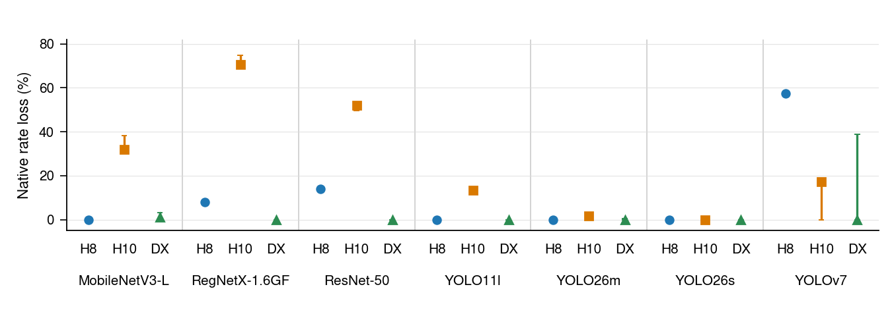
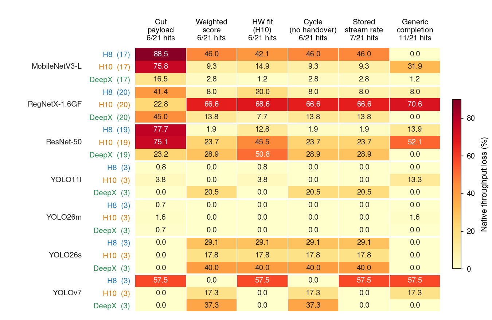
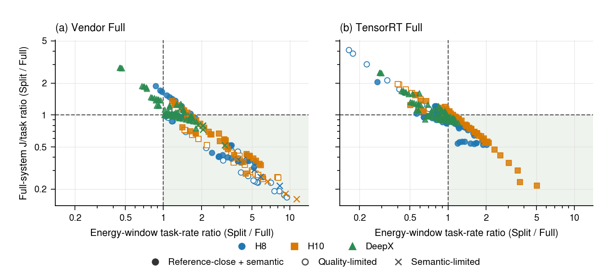
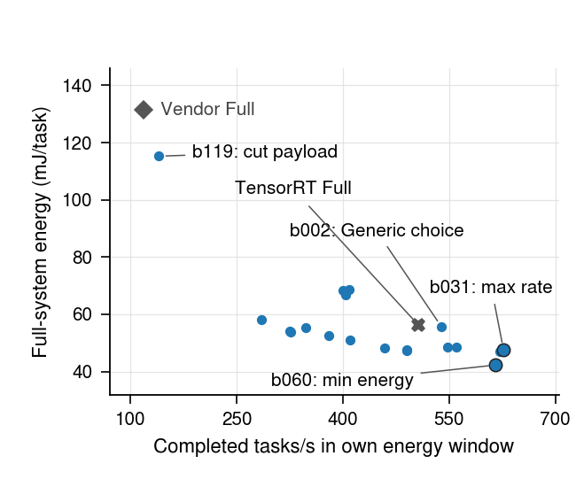

# Historical MLSys selection, quality and feasibility

This study reproduces the supplied **7 October 2026 MLSys R10** compact analysis. Its **204 technical splits, 42 Full references and 21 groups** include a later report overlay for nine YOLOv7 splits and six Fulls. Generic observations remain historical. The unchanged [5 October THESIS20 study](../thesis20-ranking-20261005/README.md) therefore has different YOLOv7 outcomes. Neither cohort is joined to the current Refresh16 dataset.

Measured Generic completion selects 11/21 Native winners, with 12.74% mean throughput loss; groups have equal weight. The oracle is the best measured candidate in each group. Static choices are frozen and use the historical hardware profile. These are descriptive comparisons across recorded campaigns, not a controlled same-state runner experiment.

[](figures/generic_stability.pdf)

[PDF](figures/generic_stability.pdf) · [SVG](figures/generic_stability.svg) · [CSV](figures/generic_stability_source.csv) · [readable table](analysis/reported_update/ranking_tables/generic_stability.md)

The ranges enumerate nine **dependent** Generic/Native repeat combinations per group; they are not confidence intervals or nine independent experiments. Near-tied candidates can produce a correct median choice and a large observed loss range.

[](figures/selector_loss.pdf)

[PDF](figures/selector_loss.pdf) · [SVG](figures/selector_loss.svg) · [CSV](figures/selector_loss_source.csv) · [selector summary](analysis/reported_update/ranking_tables/selector_summary.md)

[](figures/split_full_tradeoffs.pdf)

[PDF](figures/split_full_tradeoffs.pdf) · [SVG](figures/split_full_tradeoffs.svg) · [CSV](figures/split_full_source.csv) · [408 performance pairs](analysis/best_cases_output/best_cases_pairs.csv)

Energy covers **195 splits and 36 Fulls**: 390 dependent pairs against separate accelerator and TensorRT references. Both axes use matching active energy windows: mean(E/N) and mean(N/T). Short Native-performance FPS do not substitute for energy-window rates. Primary energy is calibrated full-system energy without idle subtraction. Shared Full references induce dependence. The later YOLOv7 report supplies Native FPS and labels, but no matching new energy or numeric quality; those values remain NA.

[](figures/resnet_energy.pdf)

[PDF](figures/resnet_energy.pdf) · [SVG](figures/resnet_energy.svg) · [CSV](figures/resnet_energy_source.csv) · [readable table](figures/resnet_energy.md) · [full captions](figures/FIGURE_CAPTIONS.md)

All **19 ResNet-50/H8 splits plus two Full references** are shown. Bars are observed three-repeat minima/maxima. Choosing b060 rather than maximum-rate b031 reduces energy by 11.38% and energy-window rate by 1.79%; the two percentages have different denominators. Fulls do not enter the split oracle.

## Quality, window length and feasibility

The [fastest-Full highlights](analysis/best_cases_output/fastest_full_highlights.md) select the same-host Full by Native throughput before filtering. Of 187 eligible configurations, 86 are faster; among 178 with matching energy, 102 consume less and 67 improve both objectives. These are configuration comparisons, not isolated causal effects of a cut.

- [Quality tolerance](analysis/review_output/quality_tolerance.md) ([CSV](analysis/review_output/quality_tolerance.csv)): 1/2/5% tolerances retain 105/136/178 of 195 cases, with the Full reference fixed across tolerances and semantic conditions retained.
- [Long-window summary](analysis/review_output/long_window_groups.md), [case values](analysis/review_output/long_window_cases.csv) and [highlights](analysis/review_output/long_window_highlights.md): 178 cases in 18 groups; 16/18 winners persist. Existing longer energy windows are not a new controlled thermal experiment.
- [Vendor coverage and quality](analysis/vendor_output/vendor_coverage_quality.md), [quality examples](analysis/vendor_output/quality_examples.md), [Full quality](analysis/vendor_output/full_quality_effects.md) and [MobileNet recovery](analysis/vendor_output/mobilenet_quality_recovery.md): historical 588-row coverage, 560 quality rows and 228 unsupported cases. Shared Full-TRT companions are counted once; negative and unsupported outcomes remain visible.
- [Single-input inventory](analysis/runner_inventory/single_tensor_inventory.md) and [boundary CSV](analysis/runner_inventory/single_tensor_boundaries.csv): 183 eligible cuts among 2,111 enumerated cuts in seven models. Suffix eligibility is `part2_input_count == 1`, which is not equivalent to a single cut tensor; original exclusion reasons remain in the inputs.

The [headline quality table](analysis/review_output/quality_highlights.md) retains the archived paired 95% intervals. MobileNet/H10 b074 passes the 5% point-estimate threshold while its relative-loss interval crosses that threshold. The [calibration summary](analysis/review_output/calibration_summary.md) preserves the three stored fits and their warnings, including H10 residuals; it is not a new fit or a complete propagated uncertainty budget.

## Reproduce

From the repository root, with NumPy, pandas, SciPy and Matplotlib installed:

```bash
python3 -I -B scripts/supplementary-studies/mlsys-selection-20261007/reproduce.py --output /tmp/mlsys-selection-reproduced
```

Use a fresh or empty directory outside the repository. The [tool notes](../../../scripts/supplementary-studies/mlsys-selection-20261007/README.md) describe the tested environment and optional Ghostscript. The command runs the shared THESIS20 score/evaluation functions, best-case and report-overlay updates, quality/window/vendor/inventory calculations and all four PDF/SVG/PNG families. It reads only the curated [compact inputs](inputs/analysis/) and existing THESIS20 package. Full-precision CSVs accompany readable Markdown/TeX; numerical equality is separate from renderer byte identity.

The supplied report is a transcription source, not independent verification of its original raw measurement archive. Aggregated historical admissions and scores retain their original limits; model binaries, datasets and raw energy signals are not reconstructed. [Rights and notices](../../../RIGHTS_AND_NOTICES.md).
