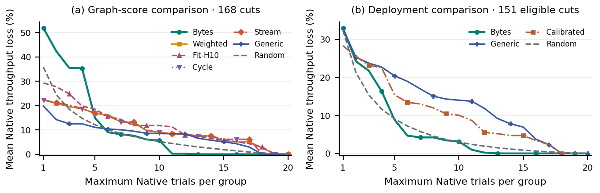
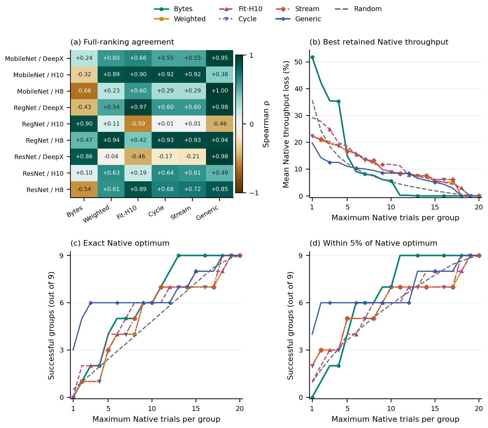
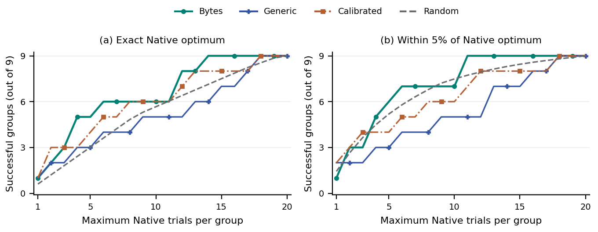

# All-cut rankings and Native search budgets

This study extends the paper's one-, three- and five-cut comparisons to every measured cut and every integer Native-test budget. It evaluates the complete ranking, the best retained throughput, and whether a shortlist contains an exact or near-optimal measured Native cut. No hardware measurements or calibration fits are added.

## Current Native implementations

The current deployment campaign contains 204 paired cuts. The numerical 5% CPU-relative quality rule retains 187 pairs: 151 classifier cuts in nine groups and 36 detector cuts in twelve groups. Classifier groups contain 8–20 eligible cuts. All methods use the same candidates within each view. The unfiltered 204-pair view is also exported.

For the nine quality-eligible classifier groups, the smallest maximum budget achieving success in every group is:

| Ranking | Exact Native optimum | At most 1% throughput loss | At most 5% throughput loss |
|---|---:|---:|---:|
| Boundary bytes | 14 | 13 | 11 |
| Generic | 18 | 18 | 18 |
| Calibrated Generic | 18 | 18 | 18 |

Boundary bytes finds eight of the nine exact winners within twelve tests. Fourteen tests cover all nine. Because groups with fewer candidates stop at exhaustion, that maximum budget corresponds to 115 Native tests in total, compared with 151 for exhaustive measurement. The eleven-test budget for at most 5% throughput loss corresponds to 94 tests. These counts are conditional on the known eligible candidate set, not total build or search costs.

## Five graph rules on a shared measured set

The graph-rule experiment uses its own fixed runtime reference measurements. It contains all 204 paired cuts: 168 classifier cuts in nine groups of 17–20 candidates, and 36 detector cuts in twelve groups of three. Five stored graph rules, measured Generic throughput, and exact uniform-random subsets are compared on those same candidates. The current deployment quality filter is not applied to this separate experiment.

| Ranking | Exact optimum in 8/9 classifier groups | Exact optimum in 9/9 | At most 1% loss in 9/9 | At most 5% loss in 9/9 |
|---|---:|---:|---:|---:|
| Boundary bytes | 12 | 13 | 13 | 11 |
| Weighted score | 18 | 19 | 19 | 19 |
| Fit-H10 | 15 | 19 | 19 | 19 |
| Cycle without handover | 18 | 18 | 18 | 18 |
| Stored stream-rate estimate | 18 | 18 | 18 | 18 |
| Generic | 15 | 18 | 18 | 18 |

The thirteen-test graph-rule result and fourteen-test current result use different Native measurements. In the limiting ResNet/H8 group, the graph-rule campaign's optimum is b031 at byte rank 13. The current campaign's optimum is b038 at byte rank 14. This is not a rounding or tie-breaking discrepancy.

All five static graph rules miss the exact classifier optimum at one test, but their larger shortlists behave differently. Boundary bytes reaches all nine winners earlier than the other evaluated rankings. It is not the best rule at every smaller budget. A Top-1 score and a full-ranking correlation therefore do not fully describe shortlist utility.

For detectors, Weighted, Fit-H10, Cycle, Stream and Generic find all twelve exact winners after two tests. Boundary bytes needs three. These small groups are reported separately from classifiers.

## Figures



The main-paper figure compares full classifier loss curves within each measurement set. [PDF](figures/rq2_shortlist_curves.pdf) · [SVG](figures/rq2_shortlist_curves.svg).



The supplement adds rank correlations and exact/near-optimal success for all five graph rules. [PDF](figures/rq2_graph_analysis.pdf) · [SVG](figures/rq2_graph_analysis.svg).



The deployment comparison uses the 151 quality-eligible classifier cuts. [PDF](figures/rq2_native_success.pdf) · [SVG](figures/rq2_native_success.svg). All plotted values are in [RQ2_FIGURE_DATA.json](figures/RQ2_FIGURE_DATA.json). The [budget table](tables/rq2_search_budget_table.tex) is also exported as [CSV](tables/rq2_search_budget_table.csv) and [JSON](tables/rq2_search_budget_table.json).

## Interpretation and definitions

- An exact success means inclusion of any candidate whose recorded unrounded Native FPS equals the group maximum. Near-optimal success allows at most 1% or 5% throughput loss relative to that maximum. These tolerances are distinct from the CPU-relative task-quality filter.
- Deterministic-rule curves show observed coverage of these fixed model/device groups. They are not success-probability guarantees for new architectures. First-hit ranks are retrospective, not observable stopping conditions during a new search.
- For a uniform subset of k distinct candidates, the exact probability is `1 - C(n-m,k)/C(n,k)`, where m of n candidates meet the target. Expected throughput loss and probability of hitting the optimum are different quantities. For an individual group with one optimum, exact success is k/n.
- All groups keep equal weight at every maximum budget. Actual tests are `min(k,n)`. No aggregate silently drops smaller groups. Minimum, maximum, mean and total actual trials are exported in the success-budget summaries.
- Budgets count Native trials among measured candidates. Generic acquisition, calibration training, quality evaluation and compilation are additional. Failed builds and unmeasured graph boundaries are not assigned invented outcomes.

Uniform random sampling reaches at least 95% mean exact-optimum probability over the nine classifier groups at a maximum budget of 19 in both campaigns. In the current eligible campaign, the analogous mean-probability budgets are 17 for at most 1% loss and 16 for at most 5% loss. These are exact finite-set probabilities, not confidence intervals for new models.

## Available methods

Boundary bytes uses logical tensor size, not measured PCIe traffic including conversions. Weighted combines log boundary size, compute imbalance and excess tensor count with the stored weights and graph-wide normalization. Fit-H10 retains its frozen Hailo-10H/TensorRT profile across setups. Cycle and Stream retain their stored heuristics. The current calibrated Generic predictions are frozen architecture-held-out predictions for the 151 eligible classifier cuts.

Current detector byte bindings are unavailable, so no current detector byte curve is constructed from older scores. Cycle with a Native-handover model and GUI total latency lack configured predictions. The separate four-cut stage-cost study has no CNNParted, Timeloop or Accelergy predictions for this candidate population. This comparison does not stand in for a benchmark of those original literature systems.

## Files

| Directory or file | Contents |
|---|---|
| `current/` | All current candidates, full rankings, correlations, loss curves, availability and checks against published k=1/3/5 values |
| `historical/` | Graph-rule candidate scores, complete rankings, correlations and loss curves; directory name preserves the existing machine-readable schema |
| `success/current/` | Current first-hit ranks, exact and near-optimal success curves, required budgets and actual test counts |
| `success/graph_rules/` | Corresponding curves and budgets for all five graph rules, Generic and random sampling |
| `figures/` | English publication figures rendered from these derived tables |
| `INPUT_MANIFEST.json` | Canonical repository paths, input SHA-256 hashes and derived-input relationships |
| `ASSET_MANIFEST.json` | Each publication figure/table, its generator, numerical sources and output formats |
| `VALIDATION.json` | Exact-optimum cross-check counts and optional published-file verification |
| `REPRODUCTION_ENVIRONMENT.json` | Python and dependency versions used for this export |

## Offline reproduction

From the repository root, in an environment with the [study requirements](../../../scripts/supplementary-studies/rq2-all-cuts-20261020/requirements.txt):

```bash
python -I -B scripts/supplementary-studies/rq2-all-cuts-20261020/reproduce.py \
  --output ../rq2-all-cuts-reproduced --verify
```

Choose an empty output directory. Add `--numeric-only` to omit Matplotlib and figure rendering. Numerical mode still requires NumPy, pandas and SciPy. The tested environment uses Python 3.12.14 with the pinned versions in the requirements file. The command reads the existing canonical compact evidence, temporarily stages engine inputs, and leaves source files unchanged. No network, model files, accelerator hardware, new calibration or random simulation is needed.

Verification checks all 108 previously published classifier k=1/3/5 comparisons, 126 graph-rule Top-1 group comparisons and six graph-rule summary methods. The independent success calculations agree with all 1,386 current and 1,428 graph-rule exact-optimum budget rows. `--verify` additionally compares regenerated scientific CSV/JSON/TeX files byte for byte with the committed copies, including the budget table and exact plotted coordinates in full mode. Figure rendering is regenerated from the same tables; this check does not require byte-identical PDF metadata.

Source evidence revision: `b10d15992d0ce45d0f81329a5e961cb6207a1d09`. Existing [rights and notices](../../../RIGHTS_AND_NOTICES.md) apply. The frozen R22 profile remains unchanged.
