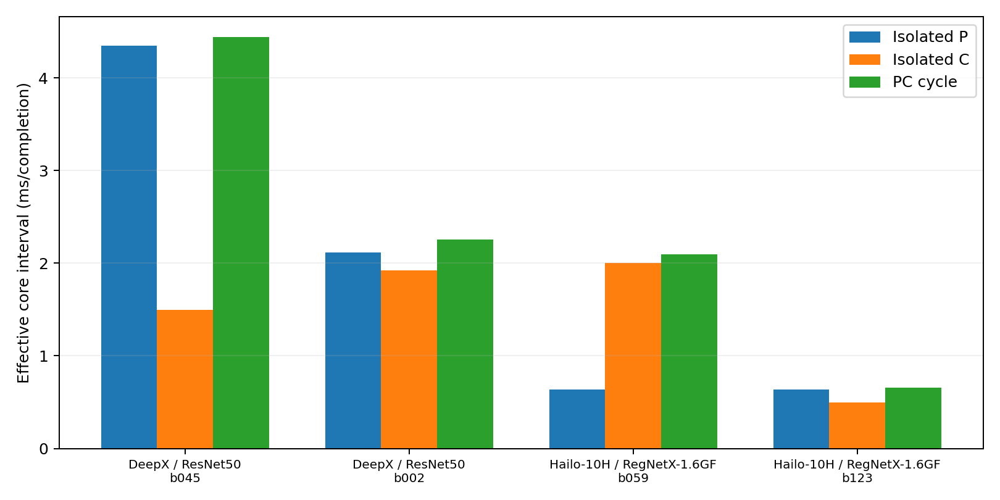
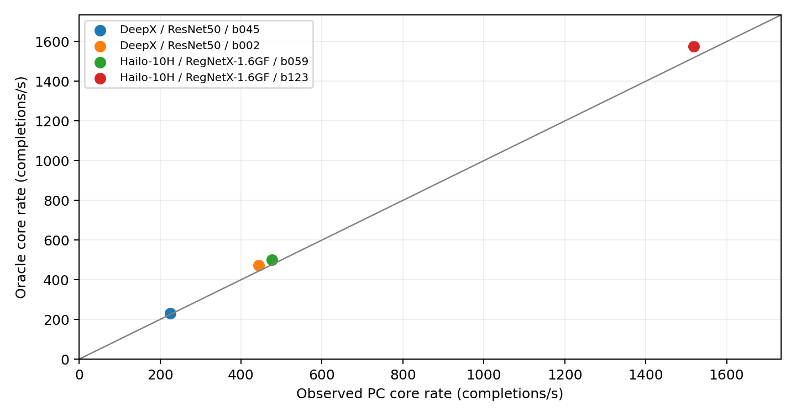

# Independent stage-cost composition

Can independently measured producer and consumer capacities describe their joint pipeline? This completed empirical Oracle test covers four known cuts on two model/backend combinations. It tests the stage-composition principle relevant to CNNParted; it does not reproduce or validate CNNParted, Timeloop or Accelergy cost estimators, search or energy models.

For each of three blocks per case, the prediction is `F_Oracle = min(F_P, F_C)` from isolated P/C runs, compared with a separately executed PC pipeline. All twelve predictions are slightly optimistic; every absolute error is below the predeclared practical 10% band. Both within-model cut orderings agree in all three blocks. These are measured stage capacities, not inexpensive predictions for unmeasured subgraphs.

[Four-case summary](tables/STAGE_COST_SUMMARY.md) · [Full-precision CSV](tables/STAGE_COST_SUMMARY.csv) · [LaTeX table](tables/stage_cost_table.tex) · [Methods and limits](METHODS.md) · [Dissertation section and preview](../../../publications/dissertation/stage-cost-composition/README.md)

## Figures



**Effective stage intervals.** Bars show median inverse core capacities in ms/completion: isolated P, isolated C and the observed PC cycle. These are effective intervals, not single-request latencies. The DeepX/ResNet50 contrast is mainly producer-limited. For Hailo-10H/RegNet, similar producer capacities meet very different consumer capacities, changing the modeled bottleneck from C at b059 to P at b123. Medians are taken over blockwise intervals; in general these must not be replaced by the inverse of a median rate.



**Prediction and observation.** Each point shows one case's median Oracle and PC core rates over three blocks; the diagonal denotes equality. Errors are calculated per block before aggregation. Both figures are regenerated from the freshly evaluated results with English labels. P is the producer, C the consumer and PC their pipeline; capacities count usable boundary tensors (P) or completed classifications (C/PC).

[Stage intervals: PDF](figures/stage_costs.pdf) · [SVG](figures/stage_costs.svg) · [Prediction/observation: PDF](figures/prediction_observation.pdf) · [SVG](figures/prediction_observation.svg)

Detailed exports: [P/C capacities](tables/STAGE_CAPACITIES.csv), [PC measurements](tables/PIPELINE_MEASUREMENTS.csv), [Oracle predictions](tables/ORACLE_PREDICTIONS.csv), [block comparisons and pair ratios](tables/COMPOSITION_COMPARISON.csv), [analysis JSON](results/ANALYSIS.json) and [prediction JSON](results/ORACLE_PREDICTIONS.json).

## Offline reproduction

From the repository root, with Python 3.10+ and Matplotlib (the shared split-analysis environment is suitable):

```bash
../local-preparation/split-venv/bin/python -I -B scripts/supplementary-studies/stage-cost-composition/reproduce.py \
  --output ../stage-cost-reproduction
```

Use a fresh output directory outside the repository. The command uses the existing evaluator on a temporary copy of the supplied 36 measurement reports, plan and reference metadata, then compares all six numerical exports byte for byte. It preserves the inputs and does not read external arrays, archives or hardware. It then generates the full-precision summary CSV, Markdown/LaTeX tables and both figures as PDF/SVG/PNG. Plotting reads the new analysis and comparison records, selecting only `record_type=block`. For a standard-library-only run, use `python3 -I -B` with the same script and `--numeric-only`; that produces all nine numerical/table files without importing Matplotlib. The environment path above is external and can be replaced by any compatible Python with the [shared requirements](../../../scripts/split-inference/requirements.txt). [Code and reproduction scope](../../../scripts/supplementary-studies/stage-cost-composition/README.md).

Each recipe repeats one prepared input. This is neither dataset accuracy nor 360,000 different images. Historical quality flags, operating-state limits and the difference between the consumer's four-buffer replay and fresh pipeline payloads remain explicit in the [methods](METHODS.md). No energy gain, measurement-cost saving or general model transfer is established.

Source: `Stufenkosten_Abschluss_20261014`, experiment `stage_cost_composition_20261014`, source revision `20261014T102852Z`. This cohort is separate from [Refresh16](../../split-inference/README.md), [THESIS20 selection](../thesis20-ranking-20261005/README.md) and the [7 October YOLOv7 completion diagnosis](../yolov7-completion-20261007/README.md). Existing [rights and notices](../../../RIGHTS_AND_NOTICES.md) apply; no new license is asserted.
