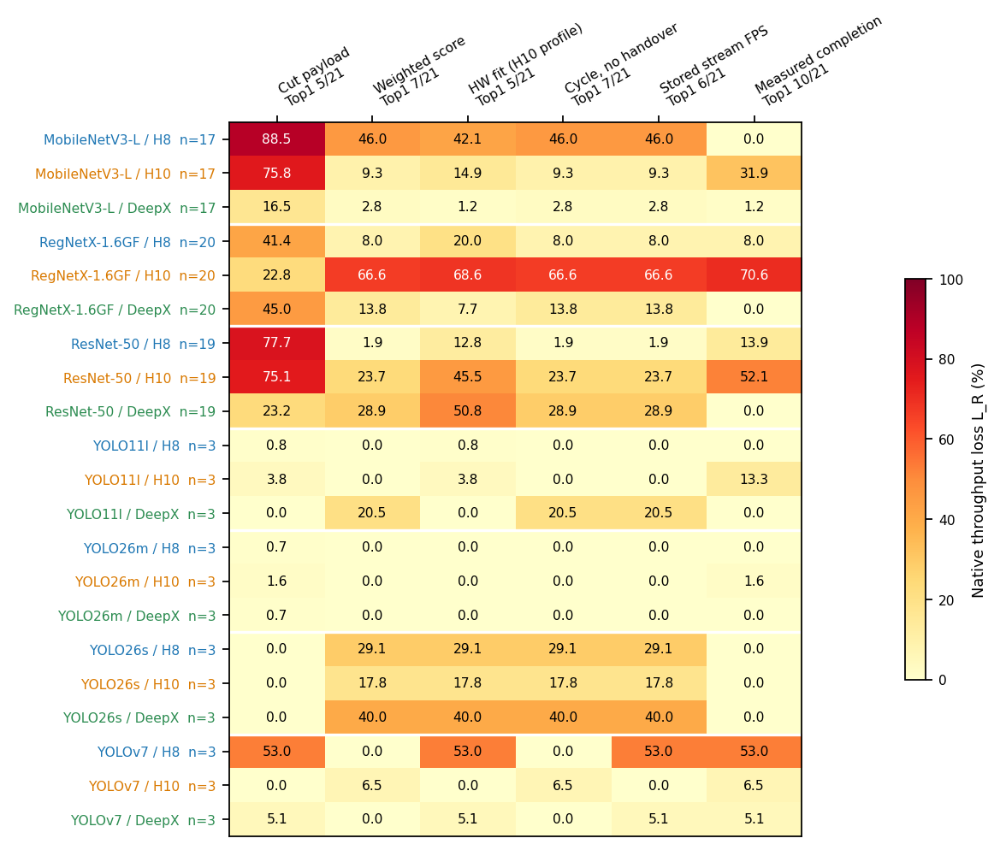
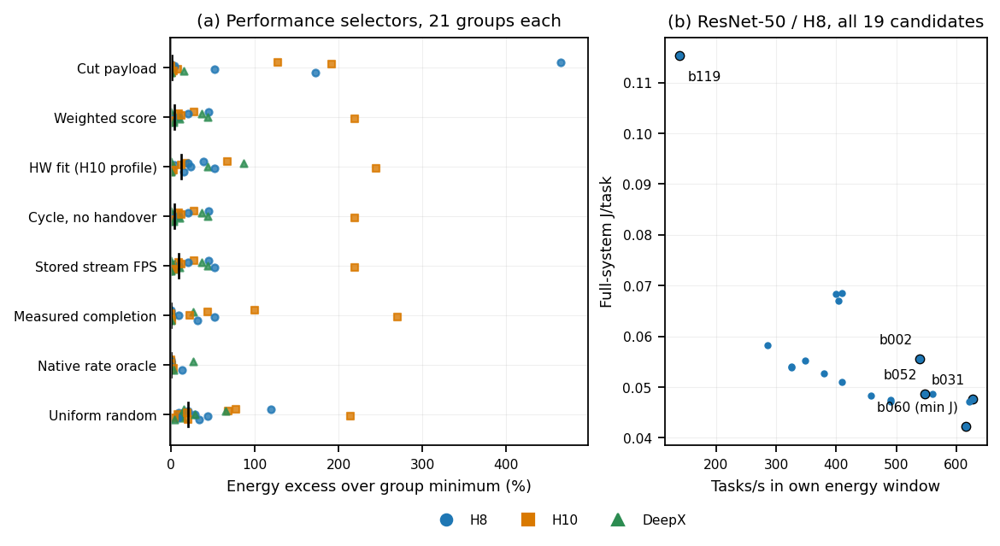

# Historical split selection and energy cost

This completed analysis from 5 October 2026 evaluates frozen graph selectors and measured Generic rankings against the observed Native best. It uses the historical THESIS20 campaign: **204 technical candidates in 21 exact groups**, with separate quality-transfer (201) and both-reference-close (184) subsets. Historical Raw comparisons use the exact 192-case base intersection. These data are not joined to Refresh16.

| Selector | Native Top1 hits / 21 groups | Mean throughput loss |
|---|---:|---:|
| Cut bytes | 5 | 25.31% |
| Historical weighted score | 7 | 14.99% |
| Stored hardware fit, H10 profile | 5 | 19.67% |
| Cycle without handover | 7 | 14.99% |
| Stored streaming-rate prediction | 6 | 17.45% |
| Measured Generic completion | 10 | 12.25% |

Groups receive equal weight. All five static methods have 0/9 exact Top1 hits in classification; each of the twelve detection groups contains only three candidates. Generic completion has 26.54% mean energy excess over the within-group minimum, compared with 21.19% for weighted score/cycle. Better throughput selection need not produce the lowest energy cost.

[](figures/fig01_ranking_methods_loss.pdf)

[Throughput PDF](figures/fig01_ranking_methods_loss.pdf) · [SVG](figures/fig01_ranking_methods_loss.svg) · [source values](tables/fig01_ranking_methods_loss_source.csv)

[](figures/fig02_selector_energy_cost.pdf)

[Energy PDF](figures/fig02_selector_energy_cost.pdf) · [SVG](figures/fig02_selector_energy_cost.svg) · [source values](tables/fig02_selector_energy_cost_source.csv) · [captions](METHOD_FIGURE_CAPTIONS.md)

The [group table](tables/method_groups.csv), [case rankings](tables/method_case_ranks.csv), [summary](tables/method_summary.csv) and [global recommendations](tables/method_global_selection.csv) retain negative results, missing predictions, small groups and unmeasured recommendations. Repeat and tie sensitivities are in the adjoining tables. Throughput loss is `1 − R_selected/R_best`; energy excess is `J_selected/min(J) − 1`, using Native mean(E/N) in J/task. Performance and energy-window throughput remain distinct. Generic energy was not measured in this historical cohort.

This is post-hoc development evidence. The frozen weighted-score parameters are 1/3/0.2, normalized over each complete original graph universe. All stored hardware profiles are H10→TensorRT, including projections to other setups; streaming profiles are `yolov7_streaming_v1`. Native handover models and original GUI SystemSpecs are unavailable. No parameters were fitted to Native outcomes. Graph bytes and heuristic cycle costs are not measured transfer or stage costs. Quality, endpoint and runtime differences remain limitations; repeated combinations are dependent sensitivities.

From this directory, with NumPy and Matplotlib installed:

```bash
PYTHONDONTWRITEBYTECODE=1 python scripts/reproduce_methods.py --output-root /tmp/thesis20-ranking-reproduced
```

Choose a fresh output directory. The command reads only this package's compact [method inputs](inputs/), [historical inputs](source/inputs/) and [energy table](source/deep_analysis/tables/energy_cases.csv). It reproduces scores, tables, report, captions and both figures without private extraction, models or hardware. Numerical/report outputs are reproducible with the split-analysis environment; rendering bytes can vary with Matplotlib. The original figures used Matplotlib 3.5.2.

Source: [reviewed methods package](https://github.com/Keff789/onnx-splitpoint-results/tree/9c9c1c5c059485c6bc9b2e8eae6d3d5d6006dc27/results/evaluation/thesis20_20261004/methods_comparison_20261005), retained in results revision `380dfa09aa6740acdc71908cb6e5dd5c8fc115ad`. Existing inputs and numerical outputs are unchanged; only the reproduction entry point's local defaults are adapted. The four pure tool definitions retain their [source provenance](inputs/method_code_provenance.json) and [MIT notice](scripts/method_core/LICENSE). This does not license the research data or figures; see [rights](../../../RIGHTS_AND_NOTICES.md).
